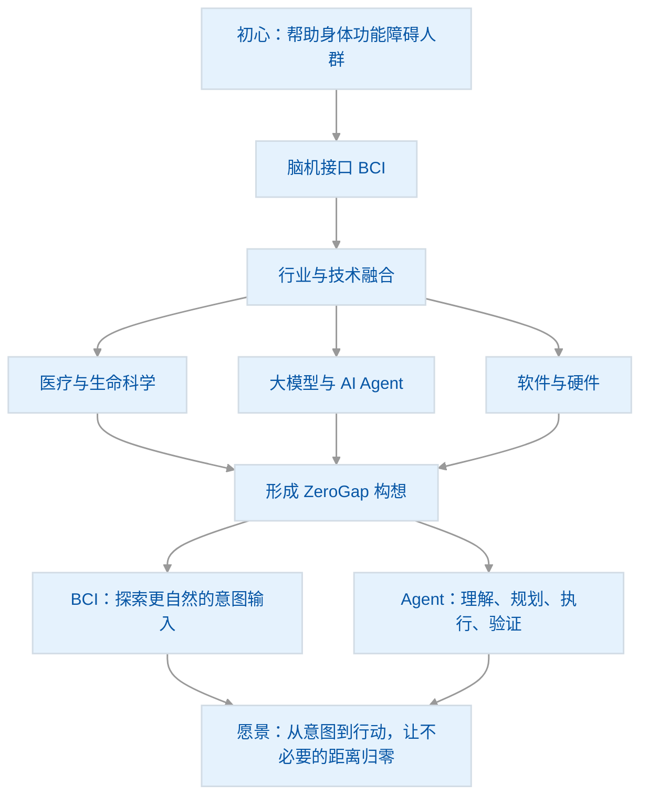

# ZeroGap

### From Intent to Action, Without Steps.

**从意图到行动，让不必要的距离归零。**

ZeroGap 是一个面向未来人机交互的创业构想，致力于探索如何让人的意图更自然、更直接地转化为数字世界中的行动。

我们相信，下一代计算体验的进步，不仅在于设备性能的提升和交互界面的优化，更在于缩短人与技术之间的距离。

通过跨平台 AI Agent、脑机接口等方向的探索，我们希望逐步减少从产生意图到完成行动之间不必要的步骤，让技术更自然地服务于人。

## 愿景

探索更加自然、无缝、易于使用的人机交互方式，让人的意图更直接地转化为行动。

## 项目起源：从一个关于“行动”的问题开始

ZeroGap 的起点，并不是一套成熟的技术方案，而是一个一直值得追问的问题：

**如果一个人已经有了明确的想法，却因为身体条件或现有交互方式的限制，无法顺畅地把想法变成行动，技术还能不能帮他走得更远？**

这个问题最初指向的是身体功能障碍人群。我希望技术不只是提供信息或完成某个单点功能，而是能帮助人更自然地表达意图，并尽可能自主地完成原本不容易完成的操作。对我而言，这不仅是一个技术问题，也关乎技术最终应该服务谁，以及它能否真正融入人的生活。

### 从脑机接口开始思考

沿着这个问题，我开始关注脑机接口（BCI）。

脑机接口让我看到一种不同于键盘、鼠标、触屏和语音的交互可能：尝试从神经信号中识别人的意图，并将其传递给外部设备。无论是侵入式还是非侵入式路径，都在探索大脑与外部世界之间新的信息通道。

但进一步思考后，我发现，**让系统接收到意图，只是整个过程的起点。**

即使系统能够识别一个人的意图，后续仍然需要理解他真正想完成什么、判断当前环境、规划步骤、调用合适的工具或设备，并确认任务是否成功。输入方式变得更自然，并不意味着行动过程中的所有障碍都会自动消失。

### 从“如何表达意图”到“如何完成行动”

与此同时，我在医疗与 IT 领域的工作经历，也让我不断思考技术如何进入真实场景。医疗、生命科学、大模型、AI Agent，以及软件与硬件的发展，看似属于不同领域，却可能在同一个问题上产生联系：

- **医疗与生命科学**，帮助我们理解人的身体、神经系统与真实需求；
- **脑机接口**，探索更直接、更自然的意图输入方式；
- **大模型与 AI Agent**，探索如何理解目标、规划任务、调用工具并验证结果；
- **软件与硬件融合**，让智能能力有机会跨越应用和设备的边界，进入真实环境。

这些方向并不是一开始就被设计成一个完整系统，而是在持续思考中逐渐汇聚到一起。我开始尝试把问题从单一的“如何输入指令”，扩展为更完整的链路：

**产生意图 → 感知与理解 → 规划 → 执行 → 验证 → 纠正 → 完成。**

### ZeroGap：让意图与行动之间少一些阻碍

由此，ZeroGap 的构想逐渐清晰起来：一方面，探索脑机接口等更自然的意图输入方式；另一方面，探索通用、跨平台的 AI Agent，让系统能够理解目标、协调工具与设备、执行任务，并对结果进行验证。

两者既可以分别探索，也可能在未来形成互补：BCI 关注如何更自然地表达意图，Agent 关注如何把意图转化为可执行、可验证的行动。

这也是 ZeroGap 名称背后的想法——不是承诺消除所有技术和现实障碍，而是希望持续缩短从“我想做什么”到“事情真正完成”之间不必要的距离。

**From Intent to Action, Without Steps.**

这仍然是一项处于构想与探索阶段的长期方向。技术是否可行、不同模块应如何协作、哪些场景真正有价值，都需要通过原型、实验与真实用户反馈逐步验证。但它为我确定了一个值得持续探索的问题：如何让技术更理解人的意图，并更可靠地帮助人采取行动。

### 项目起源与构想演进

> **说明：** 这张图表达的是项目想法的形成过程与探索方向，并非已经完成的技术架构。BCI 与 Agent 的融合方式及实际应用价值，仍需通过原型和实验验证。
## 探索方向

### 1. 跨平台 AI Agent

构建能够理解目标、规划任务、调用工具、跨平台执行操作并验证执行结果的智能系统。

### 2. 脑机接口（BCI）

探索将脑电等神经信号作为新型人机交互输入的可能性，通过可验证的技术实验，研究从信号采集、意图分类到设备控制的实现路径。

### 3. 从意图到行动

探索将意图感知、语义理解、任务规划、智能执行与结果反馈连接起来，形成更加自然、连贯的人机交互体验。

## 涉及的领域

ZeroGap 是一个跨领域的探索构想，目前主要关注以下行业与技术方向：

- **医疗与生命科学**：脑科学、神经科学、生物学，以及辅助行动和人机交互等相关应用场景。
- **大模型与人工智能**：自然语言理解、推理、多模态能力与任务规划。
- **Agent 技术**：智能体运行时、工具调用、上下文管理、任务执行与结果验证。
- **硬件与信号采集**：脑电等传感设备、信号采集与处理，以及外部设备控制。
- **软件与系统工程**：跨平台能力、操作系统接口、应用集成、权限控制与安全机制。

以上是项目当前关注的领域范围，并不意味着 ZeroGap 已经具备这些领域的完整技术能力，也不代表已经与相关机构或企业建立合作关系。

## 核心理念

ZeroGap 并不是要消除人与技术之间的所有边界。

我们希望消除的是不必要的操作成本与交互阻隔，同时始终尊重隐私、安全、知情同意与人的自主控制权。

## 内容与图片的创作说明

本项目的文案、文档结构、部分技术说明及配套图片，均借助 ChatGPT 生成或辅助整理。项目发起者负责提出初始想法、确定探索方向、整合跨领域思路，并对项目内容进行选择、调整与持续完善。

**ChatGPT 是本项目的辅助创作与思考工具，而不是项目想法的发起者或现实成果的背书方。** 文档中的构想、技术路径与配图主要用于表达愿景、梳理思路和辅助交流；涉及技术可行性、医疗应用、安全性或商业价值的内容，仍需结合可靠资料、专业意见、原型实验及实际数据进一步验证。

ZeroGap 希望以开放、审慎的态度推进探索：尊重原创思考，也坦诚使用 AI 工具；重视未来愿景，也以可验证的阶段性成果作为前进依据。

## 项目文档

- [愿景与产品理念](docs/vision.md) ✅ 完成
- [企业策划书](docs/business-plan.md) ✅ 完成
- [跨平台 Agent 技术方案](docs/cross-platform-agent.md) ❌ 未完成
- [脑机接口技术验证方案](docs/brain-computer-interface.md)❌ 未完成

## 当前阶段

ZeroGap 目前处于创业构想梳理与技术探索阶段。

长期愿景需要通过具体的原型、可衡量的实验和持续的验证逐步推进。我们希望从可实现的软件系统出发，探索跨平台智能执行能力，并在此基础上研究更加自然的新型交互方式。

---

## 写给未来的自己

> 把现在的想法记录下来。
>
> 此刻的我，基于自己的经历、认知与对未来的想象，开始构思 ZeroGap。我不知道这个想法最终会走向哪里，也无法预知多年以后，当我再次读到今天的文字时，会有怎样不同的理解。
>
> 也许那时的我会发现，今天认为重要的事情，其实还有另一种答案；也许会因为新的技术、新的经历，或对世界更深的理解，产生完全不同的感悟。
>
> 但我想留下这些思考。
>
> 不是为了证明今天的自己是对的，而是想记录下：**在这个时间点，我为什么产生这样的想法，又是如何理解技术、人与未来的关系。**
>
> 多年以后，再回头看看。
>
> 看看这个想法发生了怎样的变化，也看看自己走过了怎样的路。

*ZeroGap — From intent to action, without steps.*
