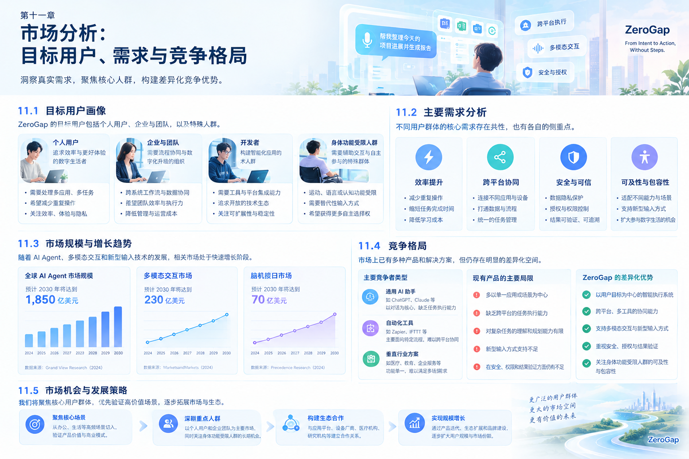

# 第十一章 市场分析：目标用户、需求与竞争格局

# Chapter 11: Market Analysis — Target Users, Needs and Competitive Landscape

## 11.1 市场分析的出发点

ZeroGap 面对的并不是一个已经被明确划定的单一市场，而是人工智能 Agent、跨平台任务自动化、多模态人机交互，以及脑机接口等多个技术方向的交汇区域。

这些方向的发展速度不同，商业成熟度也不同。AI Agent 已经开始进入实际业务流程，但如何稳定执行复杂任务、降低人工监督成本、保障安全并形成可持续的产品价值，仍然是重要挑战。脑机接口则涉及不同的硬件、信号处理与神经科学研究，其成熟度和商业化路径不能简单地与软件 Agent 相提并论。

因此，ZeroGap 不应在创业初期将所有相关市场的规模直接相加，也不应把技术热度等同于实际需求。

本章重点回答五个问题：

1. 哪些用户最有可能率先需要 ZeroGap？
2. 他们目前面临什么样的交互与任务执行问题？
3. 现有产品已经解决了什么，还有哪些问题没有解决？
4. ZeroGap 可以建立怎样的差异化优势？
5. 如何通过真实用户和市场数据验证这些判断？

## 11.2 市场趋势与机会判断

### 11.2.1 AI 正从内容生成走向任务执行

早期的生成式 AI 产品主要帮助用户回答问题、生成文本、编写代码或分析资料。随着 Agent 能力的发展，产品开始进一步尝试理解目标、规划步骤、调用工具，并在多个环节之间持续执行任务。

McKinsey 在 2025 年发布的 AI 调研中指出，62% 的受访者表示所在组织至少正在试验 AI Agent，但大多数组织尚未将 Agent 大规模推广至企业范围。<https://www.mckinsey.com/capabilities/quantumblack/our-insights/the-state-of-ai-2025>

这反映出一个值得关注的机会：市场正在从“AI 能够提供什么答案”，逐步转向“AI 能否可靠地完成一项工作”。

对 ZeroGap 而言，这意味着产品价值不应停留在提供一个更聪明的聊天窗口，而应进一步探索如何连接用户意图、现有应用和实际任务结果。

### 11.2.2 用户需要的不只是更多功能，而是更少的操作负担

在许多数字化工作场景中，完成一项任务可能需要用户经历以下过程：

- 在不同应用之间切换。
- 反复输入相同或相似的信息。
- 手动整理资料并理解上下文。
- 逐个执行多个操作步骤。
- 检查执行结果并修正错误。

这些操作并非每一步都有问题，但当多个步骤不断重复、彼此割裂时，就会形成额外的认知和操作负担。

ZeroGap 的机会在于：当系统能够可靠地理解用户目标、协调必要的执行步骤，并在适当时机向用户反馈结果时，用户就不必再亲自管理所有中间操作。

### 11.2.3 新型交互方式正在拓宽长期探索空间

语音、视觉理解、可穿戴设备以及脑机接口等技术，为人和数字系统之间的交互提供了更多可能。

但不同技术所处的发展阶段并不相同：

| 技术方向 | 当前可探索的价值 | 主要挑战 |
|---|---|---|
| AI Agent | 任务规划、工具调用、流程自动化 | 可靠性、权限、异常恢复 |
| 跨平台执行 | 连接多个应用和数字工作流 | 系统兼容性、接口限制 |
| 语音与视觉交互 | 降低部分场景中的输入负担 | 环境干扰、识别准确率 |
| 可穿戴设备 | 提供更贴近使用场景的交互入口 | 设备体验、生态与成本 |
| 脑机接口 | 探索新的意图输入方式 | 信号质量、设备条件、科学与伦理边界 |

ZeroGap 应优先建立可以独立创造价值的软件能力，同时保持对新型交互技术的长期关注。

## 11.3 目标用户：从最有可能产生价值的人群开始

ZeroGap 的长期愿景面向广泛的人群，但初期产品不应试图服务所有人。

更合理的方式，是按照任务频率、操作复杂度、现有解决方案的不足，以及用户是否愿意为改善付费，对目标用户进行分层。

### 11.3.1 第一类：高频数字工作者

这类用户日常需要使用多个软件、处理大量信息，并反复执行相似的工作流程。

典型人群包括：

- 软件开发者和技术人员。
- 产品经理、运营人员与项目管理者。
- 需要频繁整理资料、撰写文档和分析信息的知识工作者。
- 需要在多个业务系统之间传递信息的办公人员。

**核心需求：** 减少重复操作、应用切换和上下文整理成本。

**潜在产品切入点：** 通过自然语言表达任务，由 Agent 协调工具和应用完成可验证的工作流程。

这类用户适合用于早期产品验证，因为其任务通常比较明确，操作过程可以被观察，执行效率也相对容易衡量。

### 11.3.2 第二类：具有明确业务流程的组织与团队

企业内部通常存在大量跨系统、跨角色的工作流程。例如客户服务、内部知识检索、资料整理、业务数据汇总和流程跟进。

这类场景的需求往往比较具体，但对系统可靠性、权限管理、数据安全和结果可追溯性要求更高。

**核心需求：**

- 将多个应用和业务步骤连接起来。
- 减少重复录入与人工转交。
- 降低流程执行时间和操作错误。
- 保留必要的审核、权限与追踪能力。

**潜在产品切入点：** 面向某个明确业务流程，提供能够连接现有系统的 Agent 执行能力。

对于这类客户，ZeroGap 需要证明的不只是“能够自动执行”，还包括自动执行是否安全、是否稳定，以及是否真正降低了整体成本。

### 11.3.3 第三类：对传统交互方式存在障碍的人群

部分用户可能因为工作环境、身体状况、操作限制或特定使用场景，难以方便地通过传统键盘、鼠标或触屏完成任务。

语音、视觉、辅助输入设备以及其他交互方式，可能帮助这些用户更容易地表达意图和控制数字系统。

但不同用户的实际需求存在很大差异，不能仅凭技术设想推断产品效果。ZeroGap 应通过用户访谈、可用性测试和专业合作，理解真实的使用障碍。

**核心需求：** 以适合个人能力和场景的方式表达意图，并获得清晰、可控的执行反馈。

**潜在产品切入点：** 优先支持已经具备成熟技术基础的辅助交互方式，再根据研究结果评估其他新型输入技术。

### 11.3.4 第四类：脑机接口与新型人机交互研究群体

这类用户包括相关科研团队、技术开发者、研究机构，以及对新型意图输入技术有明确研究需求的合作方。

其主要关注点可能包括信号采集、意图分类、交互控制、系统集成和实验评估。

**核心需求：** 将新型输入信号与数字系统连接，验证从信号识别到实际动作的技术链路。

**潜在产品切入点：** 提供从输入信号到 UI 控制或 Agent 任务触发的实验性软件框架。

这一方向具有长期战略价值，但设备获取、实验设计、信号识别和科学验证都可能带来较高成本。因此，它更适合作为独立研究方向逐步推进，而不是初期商业化的唯一依托。

### 11.3.5 目标用户的优先级

| 用户类别 | 需求明确程度 | 早期验证难度 | 建议优先级 |
|---|---|---|---|
| 高频数字工作者 | 较容易通过具体任务验证 | 相对较低 | 第一优先 |
| 具有明确流程的组织 | 可以围绕业务指标验证 | 中等 | 第二优先 |
| 需要辅助交互的用户 | 需要深入理解具体需求 | 取决于场景 | 定向探索 |
| 脑机接口研究群体 | 技术目标可以明确界定 | 较高 | 长期研究与合作 |

以上排序是产品规划假设，不代表已经完成用户调查或确认市场需求。后续应根据真实反馈、技术可行性和付费意愿调整。

## 11.4 用户需求与核心痛点

ZeroGap 需要将抽象的“减少交互距离”转化为具体、可观察的问题。

### 11.4.1 操作步骤过多

用户知道自己想完成什么，却必须通过多个界面、菜单和表单逐步完成任务。

这类问题适合通过对比任务完成前后的操作步骤、耗时和错误率进行验证。

### 11.4.2 应用之间缺乏连续性

用户可能在一个应用中获取信息，在另一个应用中整理资料，再进入第三个应用执行操作。

每次切换都可能带来上下文丢失、重复输入和额外确认。

ZeroGap 可以探索通过统一的任务入口和执行协调机制，减少这些不必要的中间步骤。

### 11.4.3 用户需要管理过多执行细节

传统软件往往要求用户明确知道每个操作应该在哪里完成、按照什么顺序执行，以及如何检查结果。

Agent 可以尝试接管部分执行细节，但必须允许用户查看进度、修改目标、确认重要操作，并在失败时恢复控制。

### 11.4.4 自动化并不一定意味着更省事

如果系统经常误解需求、执行失败，或者需要用户持续检查和纠正结果，那么自动化带来的收益可能被监督成本抵消。

因此，ZeroGap 不能只衡量自动执行了多少步骤，还应关注用户为监督、纠错和恢复任务投入了多少时间。

### 11.4.5 新型输入方式必须解决真实问题

更自然的输入方式不一定适用于所有场景。

例如，语音可能不适合安静的办公环境，视觉输入可能涉及隐私与设备限制，而脑机接口还存在信号识别和硬件使用方面的挑战。

ZeroGap 应根据任务场景选择输入方式，而不是为了展示技术而增加复杂度。

## 11.5 竞争格局：现有产品解决了什么

ZeroGap 所处的竞争环境不是单一产品类别，而是多个相邻领域共同构成的竞争与合作生态。

### 11.5.1 第一类：传统自动化与流程工具

这类产品通过规则、工作流、脚本或预设触发条件，连接不同系统并执行重复操作。

**优势：**

- 执行流程通常较为明确。
- 规则和运行结果相对容易检查。
- 对重复性高、条件固定的任务具有实用价值。

**局限与机会：**

- 流程配置可能需要专业知识。
- 遇到不确定、变化较多的任务时，往往需要额外设计规则。
- 不同系统之间的上下文和异常处理可能需要独立维护。

ZeroGap 不必取代所有传统自动化工具，而可以在需要自然语言理解、动态任务规划和多步骤协调的场景中探索差异化价值。

### 11.5.2 第二类：AI 助手与 Copilot

这类产品将 AI 能力嵌入聊天界面、办公软件、开发工具或其他既有应用，帮助用户理解信息、生成内容并完成部分操作。

**优势：**

- 用户容易理解和使用。
- 能够在特定应用内提供上下文相关的帮助。
- 可以快速改善写作、分析、编程和信息处理体验。

**局限与机会：**

- 某些能力局限于特定产品或应用环境。
- 用户仍可能需要自行协调多个工具。
- 从生成建议到稳定完成跨应用任务，还存在执行和验证方面的挑战。

ZeroGap 的差异化假设，是将关注点从“在当前应用中帮助用户”进一步扩展到“围绕用户目标组织跨应用任务”。

### 11.5.3 第三类：通用 Agent 与 Agent 开发平台

这类产品尝试让 AI 理解目标、调用工具、拆解任务，并通过多个步骤完成工作。部分平台面向终端用户，部分则为开发者提供构建 Agent 的基础设施。

**优势：**

- 能够处理比单轮问答更复杂的任务。
- 具备工具调用、流程编排或多步骤执行能力。
- 可以通过连接器和定制逻辑扩展能力。

**局限与机会：**

- 任务可靠性和异常恢复仍然重要。
- 工具接入、权限治理与系统兼容性可能增加实施成本。
- 对终端用户而言，配置和管理 Agent 本身也可能形成新的负担。

ZeroGap 需要明确自身究竟要做终端产品、跨平台执行层，还是开发者基础设施。初期不宜同时承担所有角色。

### 11.5.4 第四类：输入设备、辅助技术与脑机接口

这类产品关注如何让用户通过键盘、鼠标、触屏、语音、眼动或神经信号等方式与数字系统交互。

**优势：**

- 能够针对特定交互方式进行优化。
- 部分技术已经拥有成熟的设备和使用场景。
- 在特定需求下，可能显著改善用户的操作体验。

**局限与机会：**

- 不同输入设备的适用场景存在差异。
- 输入信号本身并不等同于完整的任务执行能力。
- 新型交互技术可能受到设备、识别准确率、成本和安全条件限制。

ZeroGap 的长期探索方向，是让不同输入方式能够连接到统一的意图理解与任务执行体系中，而不是要求所有用户使用同一种设备。

## 11.6 ZeroGap 的差异化假设

ZeroGap 不能仅仅依靠“AI”“Agent”“多模态”或“脑机接口”等技术标签形成竞争优势。这些技术本身都可能被其他产品采用。

更值得验证的是以下四个方向。

### 11.6.1 以意图为中心，而不是以应用为中心

传统交互通常围绕应用、页面和操作步骤组织。

ZeroGap 希望让用户首先表达目标，再由系统根据任务需要决定如何执行。

例如，用户提出“整理这几份资料并生成一份摘要”，系统应围绕这个目标组织必要步骤，而不是要求用户预先理解每个应用的操作方式。

### 11.6.2 以任务完成为目标，而不止于生成内容

生成文本或提出建议只是部分任务的中间结果。

ZeroGap 需要进一步验证系统是否能够执行实际操作、确认执行状态，并判断最终结果是否满足用户目标。

这要求产品具备适当的任务状态管理、异常处理、权限控制和结果验证能力。

### 11.6.3 以跨平台协调减少应用割裂

ZeroGap 可以探索连接多个应用与系统的能力，使用户不必在每个应用之间手动传递全部信息。

但跨平台能力并不意味着可以绕过系统权限、应用限制或用户授权。具体执行范围必须由实际接口能力和安全边界决定。

### 11.6.4 为不同意图输入方式保留统一入口

用户可以根据场景通过文字、语音、图片或其他可用方式表达意图。

长期来看，脑机接口等新型输入方式也可以作为研究方向接入同一体系。

真正需要统一的不是所有硬件，而是从意图理解到任务执行、再到结果反馈的核心流程。

### 差异化定位总结

ZeroGap 的定位假设可以概括为：

**以用户意图为起点，以跨平台 Agent 为执行基础，以多模态交互为扩展方向，持续探索更自然的人机协作方式。**

这是一项需要通过产品原型和真实用户反馈验证的定位，而不是已经被市场证明的竞争优势。

## 11.7 市场验证：如何判断需求是否真实

市场研究不能只依赖行业报告、技术趋势或团队内部讨论。ZeroGap 需要尽早接触目标用户，观察其实际行为，并验证产品是否创造了可衡量的价值。

### 11.7.1 用户访谈

建议优先访谈具有明确工作流程的数字工作者，围绕以下问题展开：

- 最近一次让你觉得操作繁琐的任务是什么？
- 完成这个任务需要使用哪些应用？
- 哪些步骤必须手动完成？
- 任务通常需要多长时间？
- 哪些步骤最容易出错？
- 你目前使用什么方式解决这个问题？
- 如果交给 AI 执行，你最担心什么？
- 什么样的改善会让你愿意持续使用或付费？

访谈重点应放在用户过去真实发生的行为，而不是只询问其是否喜欢一个尚未实现的概念。

### 11.7.2 任务观察与原型测试

选择一到两个具体任务，记录用户当前的完整操作过程，再通过 ZeroGap 原型完成相同任务。

对比以下指标：

- 完成任务所需的时间。
- 用户必须执行的操作步骤。
- 任务成功率和结果正确率。
- 用户介入、纠错和重试的次数。
- 用户对结果的信任程度。
- 系统的运行和维护成本。

如果原型只是将操作从一个界面转移到另一个界面，却没有减少整体负担，就需要重新审视产品设计。

### 11.7.3 付费意愿验证

用户认为产品有用，并不代表其愿意为产品付费。

对于个人用户，可以测试不同功能和使用限制下的付费意愿；对于企业客户，则需要明确被解决的业务问题、现有成本、预期收益、部署条件和采购流程。

早期可以通过试点合作、付费概念验证或小范围部署，获得比单纯问卷更有参考价值的商业证据。

### 11.7.4 建立市场验证指标

| 验证维度 | 关注指标 | 希望回答的问题 |
|---|---|---|
| 需求真实性 | 问题发生频率、现有解决成本 | 用户是否确实存在这一问题？ |
| 产品价值 | 任务成功率、时间节省、操作减少 | 产品是否改善了任务结果？ |
| 使用体验 | 重复使用率、纠错次数、用户反馈 | 用户是否愿意持续使用？ |
| 技术可行性 | 执行稳定性、失败率、恢复能力 | 系统是否能够可靠完成任务？ |
| 商业可行性 | 付费意愿、试点转化、服务成本 | 产品是否具备可持续的商业基础？ |

具体的目标值应通过初期基线测试确定，而不是预先设定未经验证的市场成绩。

## 11.8 市场风险与应对策略

### 11.8.1 大型平台可能持续扩展 Agent 能力

模型厂商、操作系统厂商和成熟软件平台都可能持续增加任务执行、跨应用连接与多模态能力。

**应对方向：** 不要只依赖某个模型的单项能力，而应关注真实工作流、用户体验、可靠执行和具体场景中的差异化价值。

### 11.8.2 产品范围过大，难以形成明确定位

如果 ZeroGap 同时试图服务所有用户、支持所有应用并覆盖所有输入设备，早期开发成本将很难控制。

**应对方向：** 从一个具有明确用户、任务和验收标准的场景切入，再根据验证结果扩展。

### 11.8.3 Agent 的监督成本可能抵消效率收益

自动化执行并不必然带来净收益。如果用户需要持续监控、纠正错误或处理异常，系统可能反而增加工作负担。

**应对方向：** 将人工监督时间、纠错成本和失败恢复时间纳入产品指标。

### 11.8.4 跨平台执行受到权限和生态限制

不同操作系统、应用和服务提供的接口与授权机制不同，某些操作可能无法通过统一方式实现。

**应对方向：** 优先接入稳定、合规且具备明确权限边界的接口；对无法可靠执行的任务提供清晰反馈和人工确认。

### 11.8.5 脑机接口的成熟度存在不确定性

脑机接口的技术发展、设备成本和实际用户需求可能与预期不同。

**应对方向：** 将其作为长期研究路线，设置独立的阶段验收条件，并避免让早期产品的商业成立依赖尚未验证的神经交互能力。

## 11.9 本章总结

ZeroGap 所处的市场机会，来自 AI 从内容生成向任务执行的发展趋势，以及用户对更自然、更连续、更低负担的人机交互方式的需求。

但市场机会不等于已经验证的商业机会。产品需要从具体用户和明确任务开始，通过真实场景测试，证明自己能够减少操作负担、稳定完成任务，并创造足以支持持续使用或付费的价值。

因此，ZeroGap 的市场策略应遵循三个步骤：

1. **先找到真实问题：** 选择高频、明确且可以衡量的任务场景。
2. **再证明产品价值：** 通过原型验证任务完成效果、可靠性和效率收益。
3. **最后验证商业可行性：** 通过持续使用、付费意愿和服务成本判断是否值得扩大投入。

ZeroGap 不需要在创业初期与所有 AI 产品正面竞争。更重要的是找到一个现有方案尚未充分解决、而 ZeroGap 有能力切实改善的问题，并以此建立进入市场的第一个支点。

*ZeroGap — From Intent to Action, Without Steps.*