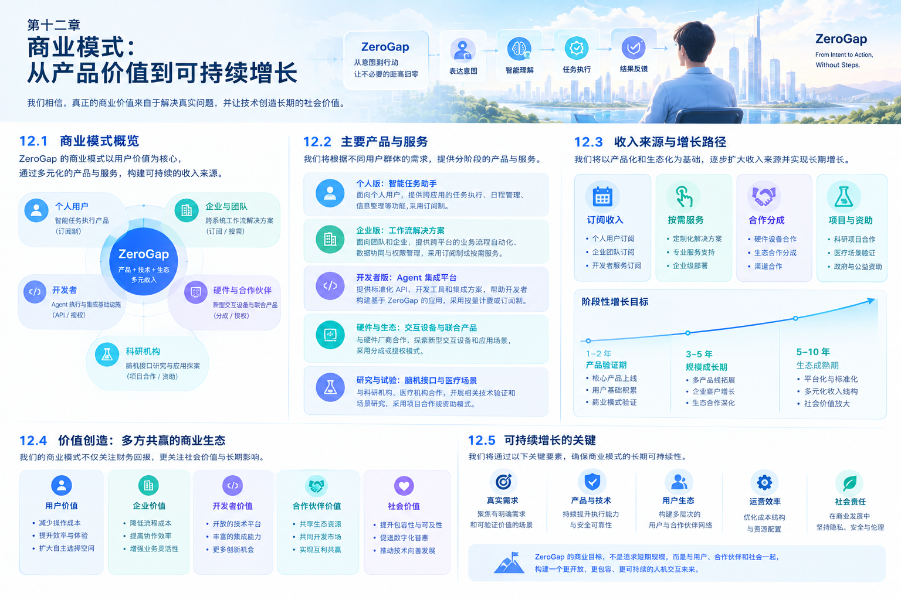

# 第十二章 商业模式：从产品价值到可持续增长

# Chapter 12: Business Model — From Product Value to Sustainable Growth

## 12.1 商业模式的核心：为减少交互距离创造价值

ZeroGap 的长期愿景，是让人能够更直接地表达意图，让数字系统能够理解目标、完成任务，并将结果反馈给用户。

但技术愿景本身并不是商业模式。只有当产品解决了真实问题，用户能够感知到改善，并愿意持续使用或付费时，技术能力才可能转化为可持续的商业价值。

因此，ZeroGap 的商业模式应围绕一个核心问题展开：

**用户为什么需要 ZeroGap，以及为什么愿意持续为它付费？**

潜在答案不是因为 ZeroGap 使用了先进的 AI、Agent 或脑机接口技术，而是因为它能够帮助用户：

- 减少完成任务所需的操作步骤。
- 降低跨应用切换与信息整理的成本。
- 将部分重复性工作交由系统可靠执行。
- 缩短从表达需求到获得结果的时间。
- 通过适合自己的交互方式完成任务。

商业模式的建立应从这些具体价值出发，而不是先决定收费方式，再寻找能够收费的功能。

## 12.2 商业模式设计原则

### 12.2.1 先验证价值，再扩大投入

在产品早期，ZeroGap 不应急于构建完整的商业化体系。

更合理的路径是先找到一个真实、高频、可衡量的用户需求，通过最小可行产品验证其价值，再决定是否扩大产品范围和商业投入。

### 12.2.2 从单点产品价值逐步扩展

初期应选择一个明确的用户群体和任务场景，建立可重复交付的产品能力。

当核心场景得到验证后，再逐步扩展到更多应用、工作流和用户群体，避免在尚未形成稳定价值之前投入过多资源。

### 12.2.3 收费方式必须与交付价值相匹配

不同客户的需求和成本结构不同。

个人用户可能更关注便利性和使用体验；企业客户可能更关注工作效率、可靠性、权限管理与投资回报；开发者则可能更关注接入能力、开发效率和运行成本。

因此，ZeroGap 不必从一开始就采用单一的收费方式。

### 12.2.4 让增长建立在持续使用之上

如果用户只是因为新奇体验尝试一次产品，却没有持续使用的理由，产品就难以形成稳定收入。

ZeroGap 应优先解决能够反复发生的任务，让产品逐渐成为用户工作流程的一部分。

## 12.3 第一阶段：以明确场景建立收入基础

ZeroGap 初期最重要的商业任务，不是覆盖尽可能大的市场，而是找到愿意为某项具体价值付费的第一批用户。

建议优先探索以下方向。

### 12.3.1 面向个人用户的效率产品

产品可以围绕高频数字任务提供更自然的任务入口和 Agent 执行能力。

潜在场景包括：

- 整理信息并生成结构化结果。
- 在多个应用之间传递和处理资料。
- 辅助完成重复性的数字工作。
- 将自然语言需求转化为可执行的操作流程。

可能的收费方式包括免费基础功能、个人订阅或按使用量收费。

不过，具体收费模式应根据用户使用频率、产品成本和付费意愿决定。若产品尚未显著改善任务效率，就不应仅凭技术能力设定订阅价格。

### 12.3.2 面向专业工作者的效率工具

对于开发者、产品人员、运营人员等高频数字工作者，ZeroGap 可以探索围绕特定工作流提供更深入的任务执行能力。

与通用助手相比，专业工具更容易围绕明确的任务结果建立价值，例如减少重复录入、缩短资料整理时间或自动完成固定流程。

商业化可以采用专业版订阅、增值功能或使用量计费等方式。

这一方向的关键，是让用户能够清楚地判断：产品节省的时间和成本，是否足以覆盖其付费支出。

### 12.3.3 面向企业的工作流解决方案

企业客户可能需要将 Agent 接入现有业务系统，并满足权限、安全、审计和运维方面的要求。

ZeroGap 可以从一个边界清晰的业务流程切入，例如信息汇总、内部资料处理或跨系统任务协同。

潜在收费方式包括：

- 按用户或团队订阅。
- 按业务流程或部署规模收费。
- 提供企业级权限、审计和管理能力。
- 为特定业务场景提供集成与实施服务。

企业方向的潜在合同金额可能高于个人产品，但销售周期、实施成本和交付复杂度也可能更高。因此，需要通过试点项目验证实际交付成本和客户收益。

## 12.4 第二阶段：建立可复用的 Agent 能力

当初期产品验证了明确的用户需求后，ZeroGap 可以逐步沉淀可复用的技术能力。

这部分能力可能包括：

- 统一的任务描述与状态管理。
- Agent 规划、执行和结果验证。
- 跨应用工具接入与权限管理。
- 上下文管理与任务连续性。
- 执行日志、异常恢复和人工确认。
- 不同输入方式与反馈方式的统一接口。

这些能力既可以支撑 ZeroGap 自身的终端产品，也可能成为面向开发者或企业的基础设施。

但两种方向的商业逻辑不同。

| 方向 | 主要客户 | 核心价值 | 潜在收费方式 |
|---|---|---|---|
| 终端产品 | 个人用户、专业工作者 | 直接完成任务，减少操作负担 | 订阅、增值功能 |
| 企业解决方案 | 企业团队与组织 | 自动化业务流程、降低运营成本 | 团队订阅、企业合同 |
| Agent 基础设施 | 开发者、技术团队 | 降低构建和维护 Agent 的成本 | API 用量、平台订阅 |
| 集成与实施 | 有特定系统需求的客户 | 将能力接入现有业务环境 | 项目费用、维护服务 |

早期不建议同时全面推进所有方向。更合理的做法是先通过终端场景或企业试点验证核心执行能力，再根据客户需求决定是否开放平台化能力。

## 12.5 第三阶段：从单一产品走向交互基础设施

如果 ZeroGap 能够在多个场景中证明其任务执行能力，并逐步积累稳定的应用连接与用户需求，那么未来可以探索更广泛的平台形态。

在这一阶段，产品价值可能不再局限于某一项功能，而是体现在一套能够连接不同意图输入、数字应用和任务执行流程的基础能力上。

潜在的发展方向包括：

1. 为更多应用提供统一的任务执行入口。
2. 支持开发者构建适配不同场景的 Agent。
3. 提供可管理、可观察、可验证的执行基础设施。
4. 根据用户需求接入不同输入设备和反馈方式。
5. 与企业软件、设备厂商和技术生态建立合作。

平台化的前提是已经存在稳定的使用需求、可复用的技术能力和足够清晰的产品边界。

如果过早追求平台规模，可能会增加开发、维护和生态建设成本，却无法证明用户真正需要这些能力。

## 12.6 脑机接口的商业化定位

脑机接口是 ZeroGap 长期愿景中的重要探索方向，但不应被预设为初期收入的主要来源。

其商业化路径受到设备成熟度、信号识别能力、研究成本、使用场景和监管要求等因素影响。

因此，建议将脑机接口相关工作分为三个层次。

### 12.6.1 第一层：软件交互与实验原型

探索将已有设备提供的信号或识别结果连接到 UI 控制和 Agent 执行流程中。

这一层的重点是验证软件集成、交互逻辑和任务链路，而不是自行承诺解决全部神经信号采集与识别问题。

### 12.6.2 第二层：研究合作与技术验证

与具备相应设备、研究条件和专业能力的团队合作，验证不同交互方案的准确性、稳定性和实际使用价值。

潜在合作方式包括联合研究、技术集成和实验原型开发。

是否收费、如何收费，应取决于具体合作内容和成果交付方式。

### 12.6.3 第三层：成熟场景下的产品化探索

只有在技术能力、用户需求、安全边界和合规条件得到充分验证后，才考虑将相关能力扩展到成熟产品或商业解决方案中。

这条路线需要独立的阶段验收和投入决策，不能以长期愿景替代短期商业验证。

## 12.7 收入模式设计

ZeroGap 可以根据产品发展阶段，逐步评估不同的收入模式。

| 收入模式 | 适用方向 | 优点 | 主要挑战 |
|---|---|---|---|
| 个人订阅 | 面向个人的效率产品 | 收入相对可预测 | 需要持续提供足够价值 |
| 团队订阅 | 专业团队与企业协作 | 便于围绕团队价值定价 | 需要团队管理和协作能力 |
| 使用量计费 | API、Agent 执行服务 | 收费与资源消耗相关联 | 成本与账单管理更复杂 |
| 企业合同 | 定制化业务流程与企业部署 | 可覆盖较大范围的业务价值 | 销售周期和交付成本较高 |
| 集成与实施服务 | 需要系统接入的客户 | 适合早期探索具体需求 | 收入可能依赖项目交付 |
| 平台与开发者服务 | 可复用的 Agent 基础设施 | 具备生态扩展潜力 | 需要开发者需求和平台能力支撑 |

这些模式并不需要同时实施。

初期应优先选择与产品形态和目标客户最匹配的方式，并通过实际交易、续费和交付数据验证其可行性。

## 12.8 单位经济模型：收入是否能够支撑增长

产品产生收入，并不意味着商业模式已经成立。

ZeroGap 需要持续评估获取客户的成本、服务用户的成本，以及用户能够带来的长期收入。

### 12.8.1 核心指标

- **客户获取成本（CAC）：** 平均获得一名付费客户所需的营销和销售成本。
- **客户生命周期价值（LTV）：** 一名客户在整个付费关系期间预计贡献的收入或毛利。
- **毛利率：** 收入扣除直接交付成本后所占的比例。
- **留存率：** 用户在一定时间后仍然持续使用或付费的比例。
- **单次任务成本：** 完成一项任务所消耗的模型、计算、工具和其他直接资源成本。
- **人工介入成本：** 系统执行过程中所需的人工监督、纠错与支持成本。

对于 Agent 产品，单次任务成本尤其值得关注。复杂任务可能涉及多次模型调用、工具执行和失败重试。如果只考虑单次模型调用费用，可能低估真实的交付成本。

### 12.8.2 基础计算方法

在简化模型中：

**月度毛利 = 月度收入 − 月度直接交付成本**

**毛利率 = 月度毛利 ÷ 月度收入**

**客户生命周期价值（简化估算） = 平均月度客户毛利 × 平均付费月数**

这些指标只能用于初步评估。实际经营中，还需要考虑固定研发投入、销售费用、管理费用、退款、折扣、客户流失和现金流等因素。

ZeroGap 应在获得真实使用与付费数据后建立财务模型，而不是在缺少依据时预设收入规模或盈利时间。

## 12.9 市场进入策略：从一个可验证的切入口开始

建议将市场进入分为三个步骤。

### 第一步：找到高频且可衡量的任务

选择一个用户经常遇到、操作过程相对明确，并且能够通过数据判断改善程度的任务。

初期不必追求覆盖所有应用。一个能够稳定完成任务、明显减少操作负担的场景，比功能繁多但价值不清晰的产品更有验证意义。

### 第二步：通过真实用户建立产品证据

邀请目标用户体验原型，记录任务完成情况、失败原因、用户介入频率和实际使用意愿。

在条件允许时，通过小规模付费试点验证客户是否愿意为结果付费，而不是仅凭口头认可判断商业价值。

### 第三步：复制已经验证的产品能力

当某一场景具备明确需求、稳定交付能力和合理的单位经济模型后，再考虑将相同能力扩展到相邻任务或客户群体。

扩展应建立在已有证据上，而不是仅因为技术上可以实现更多功能。

## 12.10 可持续增长机制

ZeroGap 的长期增长不应只依赖广告投放或一次性技术热点，而应逐步建立在持续的产品价值之上。

### 12.10.1 从高频任务形成使用习惯

当产品能够稳定完成用户经常需要处理的任务时，用户更有理由持续使用。

因此，应优先关注任务完成质量、可靠性和体验，而不是单纯追求功能数量。

### 12.10.2 从个人价值扩展到团队价值

如果个人用户能够获得明确收益，下一步可以验证同类任务是否也存在于团队中。

团队层面的协同、权限和管理能力可以成为进一步扩展的基础，但需要通过真实组织需求决定建设优先级。

### 12.10.3 从重复集成中沉淀可复用能力

在接入不同应用和业务流程的过程中，ZeroGap 可以逐步沉淀标准化的连接方式、任务模板、状态管理和安全控制机制。

这些积累有机会降低后续交付成本，并提高产品扩展效率。

### 12.10.4 通过反馈持续改善产品

任务失败、用户纠错、人工介入和使用中断，都可以帮助团队识别产品的薄弱环节。

在符合用户授权和数据保护要求的前提下，ZeroGap 可以利用这些反馈改善执行策略、交互设计和可靠性。

增长的基础应是持续改善真实用户价值，而不是无边界地收集数据或增加自动化程度。

## 12.11 商业风险与应对策略

### 12.11.1 用户认为产品有用，却不愿意付费

**应对方向：** 聚焦能够带来明确经济价值或时间收益的任务，通过付费试点验证需求。

### 12.11.2 模型和执行成本高于收入

**应对方向：** 记录完整任务链路的资源消耗，优化模型调用、执行步骤和失败重试机制，并根据任务价值设计合理的使用限制与定价。

### 12.11.3 产品依赖外部平台能力

**应对方向：** 设计适当的模型和工具适配层，避免不必要的单一供应商依赖，并为接口变化、权限限制和服务中断准备降级方案。

### 12.11.4 企业项目导致产品过度定制

**应对方向：** 区分通用能力与客户专属需求，优先将可复用的功能沉淀到产品中，谨慎评估定制项目的长期维护成本。

### 12.11.5 长期研究分散商业资源

**应对方向：** 将核心产品与前沿技术研究分别设定目标、预算和验收标准，确保长期探索不会持续挤压短期产品验证所需的资源。

## 12.12 本章总结

ZeroGap 的商业模式应从真实用户需求出发，通过可验证的产品价值建立第一批付费客户，再逐步扩展到团队、企业和开发者场景。

其发展路径可以概括为：

**明确需求 → 验证价值 → 获得付费 → 优化交付 → 复制场景 → 扩展平台能力。**

在这一过程中，AI Agent 是实现任务执行的重要基础，多模态交互是改善用户体验的扩展方向，脑机接口则是需要长期研究和验证的新型意图输入方向。

ZeroGap 不需要一开始就拥有完整的平台或成熟的脑机接口产品。它首先需要证明一件更具体的事：

用户表达目标后，ZeroGap 能够以可靠、可控且具有经济价值的方式，帮助用户完成原本需要付出更多操作成本的任务。

当这一价值能够被持续验证、重复交付并形成合理的收入与成本结构时，ZeroGap 才真正拥有从技术愿景走向可持续商业发展的基础。

*ZeroGap — From Intent to Action, Without Steps.*