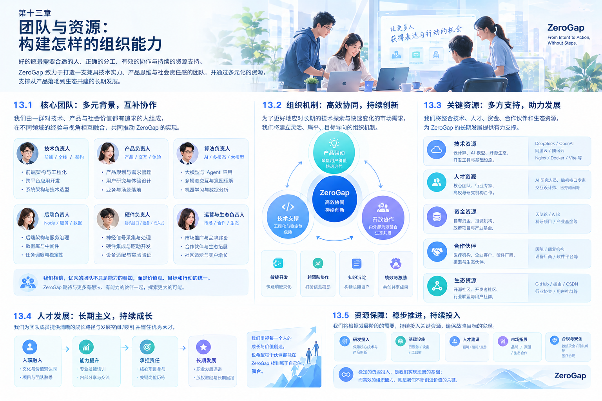

# 第十三章 团队与资源：构建怎样的组织能力

# Chapter 13: Team and Resources — Building the Capabilities We Need

## 13.1 组织建设的核心原则

ZeroGap 的目标，是探索从人的意图到数字世界行动之间更自然、更直接的连接方式。

这一目标涉及多个技术领域：软件工程、人工智能、跨平台 Agent、硬件系统、脑机接口、神经科学、医学研究，以及实验设计与数据分析。

这些领域之间既存在紧密的协作关系，也存在明显的专业边界。单纯依靠软件开发团队，难以独立解决脑机接口涉及的全部科学与工程问题；反过来，如果在产品价值尚未验证时，就建立完整的硬件研发团队、医学团队和实验室，也可能造成资源投入过早、组织成本过高。

因此，ZeroGap 的组织建设应遵循四项原则：

1. **核心能力自主掌握：** 将决定产品体验、系统架构和核心执行能力的工作放在内部团队。
2. **专业问题交由专业人员：** 对神经科学、医学、脑信号采集和实验设计等领域，寻求具备相应资质与研究经验的专家支持。
3. **根据阶段逐步投入：** 先验证软件产品价值，再根据研究结果决定是否增加硬件、实验室与专职科研投入。
4. **以协作机制连接不同学科：** 建立共同的技术接口、实验目标、数据规范和阶段验收机制。

ZeroGap 不需要一开始就拥有所有资源，而需要知道哪些能力必须掌握、哪些能力可以合作获得，以及什么时候应该投入更多资源。

## 13.2 ZeroGap 需要构建的六类核心能力

ZeroGap 的组织能力可以划分为六个相互协作的领域。

| 能力领域 | 核心职责 | 初期组织策略 |
|---|---|---|
| 软件工程与系统架构 | 构建产品、Agent、跨平台执行与基础设施 | 核心团队自主建设 |
| AI 与 Agent 工程 | 意图理解、任务规划、工具调用、结果验证 | 核心团队自主建设 |
| 硬件与嵌入式系统 | 设备连接、信号采集、固件与设备集成 | 按项目合作或逐步引入 |
| 脑机接口与神经科学 | 信号处理、实验范式、神经信号解释 | 优先与专业团队合作 |
| 医学与伦理支持 | 研究边界、受试者安全、医学相关风险与伦理审查 | 根据研究内容引入合适专家和机构 |
| 实验室与科研验证 | 设备、实验环境、测试流程、数据分析 | 优先利用合作实验室资源 |

上述划分是能力地图，不代表六个部门必须在创业初期全部成立。早期可以由少数核心成员承担多个软件岗位，而专业研究领域通过合作方式获得支持。

## 13.3 第一支柱：软件工程与系统架构团队

### 13.3.1 团队定位

软件团队是 ZeroGap 初期产品建设的核心。

在脑机接口等前沿技术尚未形成稳定产品能力之前，ZeroGap 仍然可以通过软件与 AI Agent，探索如何减少用户在数字系统中的操作负担，并验证从意图表达、任务执行到结果反馈的完整链路。

因此，软件团队不仅负责开发界面，也需要负责构建产品的执行基础设施。

### 13.3.2 核心职责

**产品与交互层**

- 构建用户交互入口。
- 支持文字、语音、图片等输入方式。
- 展示任务进度、执行状态和结果反馈。
- 提供人工确认、取消、修改和恢复机制。

**Agent 与任务执行层**

- 实现意图解析和任务规划。
- 管理上下文、任务状态和执行记录。
- 接入工具、应用与外部服务。
- 处理异常、重试和任务恢复。
- 对执行结果进行验证。

**系统与基础设施层**

- 设计可扩展的系统架构。
- 管理 API、权限和数据边界。
- 建立日志、监控、测试与发布机制。
- 支持不同模型、设备和执行环境的适配。

**跨平台集成层**

- 探索浏览器、桌面应用、移动端与其他数字环境的连接方式。
- 处理不同平台的权限与接口限制。
- 建立统一的任务调用和结果返回机制。

### 13.3.3 初期人员配置

初期可以采用精简的工程团队：

- 1 名技术负责人，负责整体架构、技术路线和工程质量。
- 1–2 名全栈或后端工程师，负责 Agent 运行时、服务端与工具集成。
- 1 名产品前端或全栈工程师，负责交互入口、任务状态和用户体验。
- 根据工作量引入测试、设计或产品支持。

以上人数是可供讨论的起步配置，不是必须达到的招聘指标。具体人员规模应根据产品范围、成员能力和资金状况决定。

### 13.3.4 核心建设目标

软件团队的第一阶段目标不是建立庞大的技术平台，而是完成一个能够稳定运行的产品原型，并具备持续迭代的工程基础。

最重要的交付物包括：

1. 可运行的产品原型。
2. 可观察的 Agent 执行链路。
3. 统一的任务状态与结果反馈机制。
4. 基础权限、安全与异常处理能力。
5. 可重复执行的测试用例。

## 13.4 第二支柱：AI 与 Agent 工程能力

### 13.4.1 为什么需要独立关注 Agent 能力

ZeroGap 的长期方向不只是让用户通过更方便的方式输入信息，还包括让系统理解目标并完成相应任务。

模型能够理解语言，并不意味着它能够可靠地完成实际工作。真正的 Agent 产品还需要任务规划、工具执行、上下文管理、状态追踪和结果验证等工程能力。

因此，AI 能力不能仅仅等同于模型 API 的调用。

### 13.4.2 核心职责

- 研究模型选择与任务适配。
- 构建意图理解和任务拆解机制。
- 设计工具调用和执行策略。
- 管理上下文、记忆和任务状态。
- 评估执行结果的正确性与可靠性。
- 建立模型评测、任务测试和失败分析流程。
- 控制推理成本、执行延迟与人工介入成本。

### 13.4.3 与软件团队的协作

AI 与 Agent 工程不一定需要在早期成为完全独立的部门，可以由核心工程团队共同承担。

关键是建立清晰的模块边界：

- AI 层负责理解、规划和必要的推理。
- 执行层负责将计划转换为实际操作。
- 系统层负责权限、状态、可靠性和运行环境。
- 产品层负责让用户理解、控制并确认任务结果。

这种分工能够避免把所有问题都交给模型处理，也有利于后续替换模型、增加工具或接入新的输入方式。

## 13.5 第三支柱：硬件与嵌入式系统

### 13.5.1 硬件团队的作用

当 ZeroGap 进入新型输入设备与脑机接口研究阶段时，硬件能力将逐步变得重要。

相关工作可能包括设备连接、数据采集、通信协议、固件开发、传感器集成和设备稳定性测试。

不过，硬件并不一定意味着 ZeroGap 必须从零开始设计自己的设备。研究早期应优先评估现有设备是否能够满足验证需求。

### 13.5.2 核心职责

- 评估现有脑电或其他传感设备。
- 处理设备连接、数据传输与协议适配。
- 建立硬件数据与软件系统之间的接口。
- 评估采样率、数据质量、延迟和连接稳定性。
- 在必要时开展嵌入式开发与定制硬件集成。
- 记录设备限制、运行条件和维护要求。

### 13.5.3 组织策略：先集成，再决定是否自研

建议按照以下顺序推进：

**第一步：使用现有设备。**

优先选择能够获得技术文档、具备可用数据接口且适合目标实验的设备。

**第二步：完成软硬件集成。**

验证设备数据能否稳定进入 ZeroGap 的软件系统，并支持明确的交互任务。

**第三步：识别现有设备的真实限制。**

通过实验确认问题究竟来自硬件、信号处理、算法、用户操作，还是整体系统设计。

**第四步：根据明确的技术瓶颈决定是否自研。**

只有当现有设备无法满足重要需求，且自研的成本、周期与预期收益合理时，才考虑投入定制硬件。

### 13.5.4 初期资源配置

初期不一定需要全职硬件团队。可以通过设备供应商、硬件工程顾问、嵌入式开发合作方或高校实验室获得必要支持。

随着研究方向明确，再决定是否引入专职硬件工程师。

## 13.6 第四支柱：脑机接口与神经科学研究

### 13.6.1 为什么需要专业研究能力

脑机接口涉及脑信号采集、信号处理、实验范式、统计分析和神经科学解释等专业问题。

尤其是 EEG 信号，容易受到眼动、肌肉活动、设备接触状态、环境噪声和个体差异的影响。某次实验能够触发 UI，并不意味着系统已经可靠地识别了用户意图。

因此，ZeroGap 必须区分：

- 设备是否成功采集信号。
- 算法是否能够识别特定信号模式。
- 信号模式是否与预期任务存在可靠关系。
- 系统是否能够在新的测试条件下重复得到结果。
- 用户是否能够在真实使用场景中稳定完成任务。

这些问题需要通过规范的实验设计和专业分析逐步验证。

### 13.6.2 核心职责

**信号与算法研究**

- 研究信号预处理与特征提取。
- 评估分类算法和识别方法。
- 分析噪声、伪迹与个体差异。
- 评估准确率、误触发率、延迟和稳定性。

**实验设计**

- 明确实验假设和目标指标。
- 制定实验流程与对照条件。
- 设计训练、验证和测试方法。
- 记录设备条件、实验参数和失败案例。

**结果分析**

- 判断实验结果是否能够重复。
- 区分偶然结果与稳定效果。
- 评估算法在不同用户和条件下的表现。
- 识别下一阶段需要解决的科学问题。

### 13.6.3 与软件团队的协作边界

神经科学研究团队不必负责整个 ZeroGap 产品的开发。

更合理的合作方式是由研究团队提供经过定义的信号处理结果、算法接口、实验数据和评估报告，软件团队则负责将这些能力接入 UI 控制或 Agent 执行流程。

例如，可以约定一个标准化接口，传递经过处理的事件或分类结果，包括：

- 事件类别。
- 识别置信度。
- 事件时间。
- 数据质量或有效性状态。
- 必要的实验和设备标识。

具体字段应根据研究方案和设备能力确定。系统必须允许识别结果为“不确定”，而不是强迫算法对每一次输入都给出动作指令。

## 13.7 第五支柱：医学、伦理与安全支持

### 13.7.1 医学角色的定位

ZeroGap 涉及脑机接口和人体相关实验的长期探索，因此需要重视医学知识、受试者保护和研究伦理。

但并非所有脑机接口项目都属于医疗产品，也不能将普通交互实验直接视为临床研究。是否涉及医学研究、临床试验或医疗器械监管，需要根据实际研究内容、目标用途、实施方式和所在地法规判断。

因此，ZeroGap 应在进入相关研究之前，明确项目的性质与边界，并根据需要寻求医学、伦理和法规方面的专业支持。

### 13.7.2 需要哪些专业能力

**神经科学与相关医学专业人员**

帮助团队理解神经信号的科学背景、实验限制和相关风险。

**医学与人体研究顾问**

在涉及人体参与者或医学相关研究时，协助评估适用的研究规范与参与者保护要求。

**研究伦理支持**

根据研究性质，确定是否需要伦理审查、知情同意、风险评估和专门的数据管理机制。

**法规与合规支持**

在涉及医疗器械、健康相关功能、敏感个人信息或跨境数据处理时，评估适用的法律法规和合规义务。

### 13.7.3 必须建立的底线

- 不将实验性信号识别结果宣传为已获得临床验证的能力。
- 不在缺乏必要专业评估的情况下开展具有不适当风险的人体实验。
- 对参与者充分说明研究目的、流程、潜在风险和退出机制。
- 根据研究性质落实知情同意与伦理审查要求。
- 对神经信号及相关个人数据实行严格的访问控制、使用限制和保存管理。
- 不将未经验证的研究原型用于诊断、治疗或其他超出验证范围的用途。

### 13.7.4 初期组织方式

在研究方向尚未确定时，可以通过医学顾问、科研合作机构和专业服务支持相关工作，不必立即组建完整的医学部门。

但如果后续进入对临床专业能力、受试者保护或医疗器械合规有明确要求的领域，就需要建立与项目风险相匹配的专业治理机制。

## 13.8 第六支柱：实验室与科研合作体系

### 13.8.1 实验室不仅是设备空间

对于 ZeroGap，实验室的价值不只是拥有脑电设备或实验场地，更重要的是能够提供规范的研究条件、专业指导和可重复的验证流程。

一套有价值的实验体系，通常需要具备：

- 与研究目标匹配的设备。
- 稳定的采集与测试环境。
- 明确的实验流程和记录规范。
- 数据质量控制与分析能力。
- 适当的参与者保护机制。
- 可追溯的实验结果和失败记录。

因此，是否自建实验室应由实际研究需求决定，而不应成为创业初期的默认选择。

### 13.8.2 三种实验室建设模式

| 模式 | 资源来源 | 优点 | 主要限制 |
|---|---|---|---|
| 合作实验室 | 高校、科研机构或专业实验室 | 可以利用现有设备与研究经验 | 需要协调合作计划与资源排期 |
| 联合实验项目 | ZeroGap 与合作方共同投入 | 能围绕具体问题组织研究 | 需要明确分工、成果归属与数据边界 |
| 自建实验室 | 自行采购设备、建设环境并配置人员 | 研究安排与设施管理更自主 | 资金、人员、维护和合规成本较高 |

**建议的起步模式：优先合作实验室，必要时开展联合实验项目。**

在没有稳定的实验需求、专业人员和持续经费之前，不建议仅为了体现技术实力而投入大量资源自建实验室。

### 13.8.3 实验室合作应明确的事项

与高校、科研机构或专业实验室合作时，应提前明确：

1. 研究目标与双方职责。
2. 设备使用、维护与实验排期。
3. 数据采集、访问、存储和删除规则。
4. 参与者招募、知情同意与伦理责任。
5. 研究成果、代码、专利和知识产权归属。
6. 研究结果的发表、对外宣传与保密边界。
7. 合作费用、资源投入和终止条件。

这些约定有助于降低后续的组织摩擦，也能让技术合作建立在明确、可持续的基础上。

## 13.9 如何让不同专业真正协同

ZeroGap 的组织难点，不只是找到不同领域的专业人员，更是让这些人员围绕同一个目标协作。

软件工程师关注系统是否能够运行，硬件工程师关注设备与数据是否稳定，神经科学研究人员关注实验是否成立，医学与伦理专家关注研究边界和参与者保护。

如果缺少统一目标，各专业可能分别完成自己的工作，却无法共同验证产品价值。

### 13.9.1 建立共同的研究问题

每个跨学科项目都应先明确：

- 希望验证什么假设？
- 需要哪些输入和输出？
- 由什么指标判断结果？
- 哪些因素可能导致失败？
- 什么结果意味着继续投入，什么结果意味着调整方向？

例如，在“EEG 信号控制 UI”实验中，项目不能只以“按钮成功触发”为唯一标准，还需要记录识别条件、误触发率、重复测试表现、延迟和用户操作负担。

### 13.9.2 建立统一的接口与数据规范

跨团队协作应尽量通过标准化接口进行，而不是依赖个人之间的临时沟通。

建议逐步建立：

- 软件模块与硬件设备之间的接口定义。
- 实验数据的字段和元数据规范。
- 统一的时间戳与事件记录方式。
- 实验版本、算法版本与设备参数记录。
- 结果评估和异常分类规范。

对于敏感研究数据，应另外制定严格的数据访问和处理规范，避免为了工程便利而扩大数据使用范围。

### 13.9.3 建立阶段性评审机制

每个阶段结束时，由相关领域的负责人共同评审结果。

评审不应只检查任务是否完成，还应检查：

- 结果是否可重复。
- 结论是否有足够证据支持。
- 是否存在尚未解决的安全问题。
- 当前技术是否达到下一阶段的前置条件。
- 后续投入是否有合理依据。

这样可以避免某一专业领域的局部成功，被误认为整个产品已经具备成熟能力。

## 13.10 分阶段建设组织与资源

ZeroGap 不应一开始就建立完整的多学科组织，而应让组织能力随着产品与研究目标逐步增长。

### 阶段一：软件原型与需求验证

**重点目标：** 验证用户需求与核心产品链路。

组织配置：

- 核心软件与 AI 工程团队。
- 产品设计与用户研究支持。
- 按需引入的外部技术顾问。

资源投入重点：

- 软件开发环境与云资源。
- 模型调用和基础测试工具。
- 用户访谈、原型测试与工程验证。

此阶段通常不需要自建硬件团队或实验室。

### 阶段二：Agent 执行与多模态集成

**重点目标：** 提升任务执行能力与系统可靠性。

组织配置：

- 软件与 AI 工程团队继续扩展。
- 引入测试、安全与系统集成能力。
- 根据场景增加语音、视觉或设备接入方面的支持。

资源投入重点：

- 模型与工具接入。
- 任务执行测试。
- 权限、监控和异常恢复机制。

这一阶段应继续优先投入能够直接改善产品价值的工程能力。

### 阶段三：脑机接口实验验证

**重点目标：** 验证特定设备、信号处理方案与软件控制链路的可行性。

组织配置：

- 软件与 AI 核心团队。
- 硬件或嵌入式技术支持。
- 神经科学研究合作方。
- 根据研究性质引入医学、伦理与法规专业支持。
- 合作实验室及必要的实验人员。

资源投入重点：

- 合适的研究设备。
- 实验设计与数据质量控制。
- 软件集成、算法验证和重复实验。
- 参与者保护与数据管理。

应优先采用合作研究模式，待需求和研究路径明确后，再评估是否建立专职团队或自有实验设施。

### 阶段四：产品规模化与研究深化

**重点目标：** 在真实场景中扩大产品价值，并对已验证的研究方向进行深入投入。

组织配置：

- 产品、工程、测试与运维能力。
- 企业合作与客户支持能力。
- 根据业务规模建立专门的硬件、研究或合规岗位。
- 对关键合作机构建立长期合作机制。

资源投入重点：

- 产品稳定性与部署能力。
- 客户交付和持续支持。
- 研发与研究预算的独立管理。
- 关键技术与知识产权积累。

是否进入这一阶段，应由产品验证和资源状况决定，而不是仅依据日历时间。

## 13.11 资源配置：哪些应该自建，哪些适合合作

| 资源或能力 | 建议策略 | 判断依据 |
|---|---|---|
| 核心产品代码与系统架构 | 自建 | 直接决定产品迭代速度与系统控制能力 |
| Agent 执行与任务管理 | 以自建为主 | 属于核心产品能力 |
| 通用模型能力 | 优先接入成熟服务，保留适配能力 | 避免早期承担不必要的基础模型训练成本 |
| 常规硬件设备 | 采购或租用 | 先验证现有设备是否满足需求 |
| 定制硬件与嵌入式开发 | 按需合作，验证后再决定自建 | 取决于真实技术瓶颈 |
| 脑机接口与神经科学研究 | 与专业团队合作 | 需要专门研究经验与实验条件 |
| 医学、伦理与法规支持 | 根据项目风险引入专业力量 | 取决于研究性质和适用要求 |
| 实验室与专用设备 | 优先合作使用 | 避免过早承担固定投入与维护成本 |
| 用户研究与产品验证 | 核心团队主导，必要时寻求外部支持 | 必须持续反馈到产品决策 |

这张表的核心思想是：**把稀缺资源投入真正构成竞争力的地方，把尚未验证的高成本能力留在可控的探索范围内。**

## 13.12 资金与资源管理

ZeroGap 的资金规划不应仅按岗位数量制定，还应考虑不同技术路线的投入特点。

软件产品的主要成本可能来自人员、模型调用、云服务和产品交付；硬件与脑机接口研究则可能额外涉及设备采购、实验场地、专业研究人员、实验组织和数据管理。

建议将预算划分为三个相互独立、又能协同管理的部分。

### 13.12.1 核心产品预算

用于产品开发、Agent 工程、基础设施、测试、用户研究和产品交付。

这是早期需要优先保障的预算。

### 13.12.2 技术预研预算

用于新型输入设备、脑机接口集成、信号处理和实验性原型。

这部分预算应与明确的研究问题和阶段交付物绑定，避免无边界投入。

### 13.12.3 外部合作预算

用于专家咨询、实验室使用、联合研究、硬件开发和专业服务。

合作费用应与具体工作范围、成果交付和知识产权约定对应。

在实际经营中，还应设置现金流与预算复核机制，确保长期技术探索不会影响核心产品的持续迭代。

## 13.13 组织治理、知识产权与数据责任

多学科协作会带来技术、数据和知识产权方面的额外要求。

ZeroGap 应尽早建立基本治理规则，避免在产品或研究取得进展后，才发现关键成果无法合法使用或持续维护。

### 13.13.1 知识产权管理

明确代码、算法、硬件设计、实验方法、数据分析结果和联合研究成果的归属。

与外部人员或机构合作时，应通过适当协议确定背景知识产权、合作成果、许可范围、保密要求和后续使用权。

### 13.13.2 数据治理

建立数据分类、访问权限、保存期限、删除机制和数据使用范围管理。

涉及脑信号、健康相关信息或人体研究数据时，应根据适用法规和研究要求采取更严格的保护措施。

### 13.13.3 技术安全与责任边界

Agent 的执行权限应与任务风险相匹配。对重要、不可逆或可能造成明显损失的操作，应提供必要的用户确认和结果检查。

实验性脑机接口能力则应明确其验证范围，不能把研究原型的表现直接推断为对所有用户都有效的成熟能力。

### 13.13.4 研究结论与产品宣传

产品宣传应与实际验证结果一致。

对尚未验证的能力，应明确标注为研究方向、技术假设或实验性功能；对已经验证的能力，也应说明其适用条件和限制。

## 13.14 本章总结

ZeroGap 需要构建的不是一个单纯的软件开发团队，而是一套能够连接软件工程、AI Agent、硬件、神经科学、医学支持与科研实验的组织能力。

但这种多学科能力不必在创业初期全部内部化。

更合理的路径是：

1. 以软件与 AI 团队建立核心产品能力。
2. 通过真实用户和可重复测试验证产品价值。
3. 在需要新型输入技术时，引入硬件与专业研究合作。
4. 根据研究性质建立必要的医学、伦理和数据治理机制。
5. 通过合作实验室完成阶段性验证。
6. 只有在关键能力已被证明具有持续需求和战略价值时，才逐步建立专职团队与自有设施。

ZeroGap 的组织竞争力，不取决于一开始拥有多少部门、设备或实验室，而取决于能否将不同领域的专业能力组织起来，围绕明确的问题持续取得可验证的成果。

**先建立能够交付价值的核心团队，再逐步扩展支撑长期愿景的跨学科能力。**

*ZeroGap — From Intent to Action, Without Steps.*