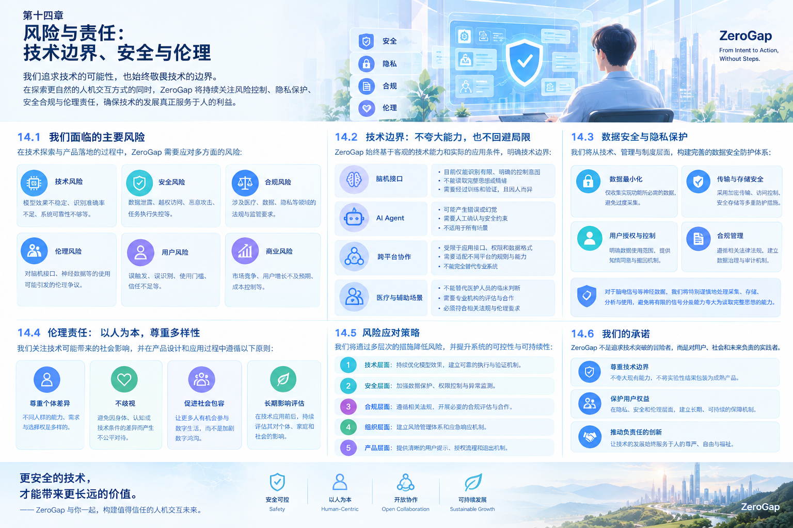

# 第十四章 风险与责任：技术边界、安全与伦理

# Chapter 14: Risks and Responsibility — Technical Boundaries, Safety and Ethics

## 14.1 为什么风险与责任是 ZeroGap 的核心问题

ZeroGap 希望缩短人的意图与数字世界行动之间不必要的距离。

当系统能够理解用户目标、调用工具、操作应用，并在未来探索语音、视觉甚至脑机接口等输入方式时，它所承担的责任也会随之增加。

一个只生成文字的系统，错误可能主要影响信息质量；一个能够实际执行任务的 Agent，错误则可能进一步影响文件、账户、业务流程和现实决策。如果输入信号来自脑机接口，系统还需要面对神经信号的可靠性、个人隐私、研究伦理和潜在的医学误解。

因此，ZeroGap 不能只关注系统“能不能做到”，还必须回答：

- 系统是否有权执行这项操作？
- 系统是否真正理解了用户的意图？
- 执行结果是否可以验证？
- 出现错误时，用户能否及时停止并恢复控制？
- 用户的数据是否得到了合理保护？
- 技术能力是否被用于经过验证的适当场景？

ZeroGap 的安全设计应当与产品架构同步建设，而不是在产品上线之后才补充。

## 14.2 核心原则：减少操作距离，不等于取消安全边界

ZeroGap 的目标是减少不必要的交互步骤，而不是移除所有确认、权限和监督机制。

某些步骤确实只是重复操作，可以由系统承担；另一些步骤则承担着确认意图、检查风险和保护用户的作用，不应为了追求速度而一并删除。

例如：

- 自动整理普通资料，可以在明确授权的范围内直接执行。
- 发送重要邮件前，可能需要用户确认收件人和内容。
- 删除大量文件、转移资金或修改重要权限时，应设置更严格的授权与确认。
- 涉及医疗决策或其他高风险领域时，不能把模型输出直接当作专业判断或执行许可。

因此，ZeroGap 应区分两种不同的交互步骤：

**可以被自动化的步骤：** 重复、明确、低风险且可恢复的操作。

**必须保留的控制环节：** 用于授权、风险判断、重要结果确认和责任边界管理的机制。

真正有价值的自动化，是减少无意义的操作，同时保留必要的控制权。

## 14.3 Agent 自主执行的风险

### 14.3.1 意图理解错误

用户的表达可能不完整、含糊或存在多种解释。模型即使能够生成看似合理的计划，也不代表它准确理解了用户真正想要的结果。

如果系统在理解错误后继续执行，可能导致一连串不符合用户预期的操作。

**应对措施：**

- 在执行前明确关键目标、范围和约束。
- 对存在歧义的高风险请求主动询问。
- 在任务执行过程中允许用户修改或取消。
- 对重要结果进行独立检查。
- 在无法可靠判断时停止执行，而不是强行猜测。

### 14.3.2 工具调用与执行错误

Agent 可能选择错误工具、使用错误参数、调用失败，或者将工具返回的结果误认为任务已经完成。

**应对措施：**

- 对工具输入和输出进行格式与权限校验。
- 对关键步骤设置前置条件。
- 区分工具调用成功与业务任务成功。
- 对重要操作保留执行日志和状态记录。
- 对可恢复任务设计重试、回滚或人工介入机制。

### 14.3.3 过度自主与权限滥用

如果 Agent 拥有过大的执行权限，即使只是一个小的判断错误，也可能造成较大损失。

ZeroGap 不应因为系统具有自动执行能力，就默认授予其完整的文件、账户或应用控制权限。

**应对措施：**

- 遵循最小权限原则。
- 将授权限定在明确的任务和资源范围内。
- 区分只读、可修改和不可逆操作。
- 对高风险操作设置额外确认。
- 提供随时停止任务和撤销可撤销操作的能力。

### 14.3.4 多步骤任务的错误累积

复杂任务通常由多个子步骤构成。单个步骤的小错误，可能在后续步骤中被放大。

因此，ZeroGap 不能只在任务开始时检查一次目标，还需要根据任务风险，在关键节点验证状态与结果。

对于低风险任务，可以采用轻量化检查；对于影响范围较大的任务，则需要更严格的步骤验证与人工监督。

## 14.4 权限、安全与用户控制

### 14.4.1 最小权限原则

每个 Agent、工具或连接器只应获得完成当前任务所需的权限。

例如，整理某个目录中的文件，不意味着系统需要访问用户的全部文件；读取某份业务资料，也不意味着系统自动获得修改或删除该资料的权限。

### 14.4.2 按风险分级执行

ZeroGap 可以根据操作的影响范围、可逆性和潜在损失，将任务划分为不同风险级别。

| 风险级别 | 典型操作 | 建议控制方式 |
|---|---|---|
| 低风险 | 搜索资料、生成草稿、整理副本 | 在授权范围内自动执行 |
| 中风险 | 修改文件、更新业务记录、发送普通通知 | 明确授权、执行前检查、记录结果 |
| 高风险 | 删除重要数据、修改权限、资金或关键业务操作 | 强化身份验证、明确确认、限制执行范围 |
| 特殊高风险 | 医疗相关决策、可能危及人身安全的行动 | 采用适用的专业监督与法规要求，不依赖未经验证的自动判断 |

风险分级应根据具体场景动态调整，不能仅凭操作名称判断。一个看似普通的文件修改，如果涉及关键生产数据，也可能具有很高风险。

### 14.4.3 用户必须能够介入

用户应当能够：

- 查看当前任务目标和执行状态。
- 在适当时机确认或拒绝关键操作。
- 暂停或终止执行。
- 修改任务范围。
- 查看重要操作记录。
- 在技术条件允许时撤销或恢复操作。

对于无法完全撤销的操作，系统应在执行前明确说明其影响，并设置相应的控制措施。

## 14.5 数据隐私与神经信号保护

### 14.5.1 ZeroGap 可能处理哪些数据

随着产品能力扩展，系统可能接触以下类型的数据：

- 用户输入的文字、语音和图片。
- 应用内容、文件和任务上下文。
- 账户信息、操作记录和任务执行日志。
- 与设备交互相关的信号和事件。
- 在特定研究场景中产生的脑信号或相关实验数据。

不同数据具有不同的敏感程度，应根据实际用途、可识别性和潜在风险实施分级管理。

### 14.5.2 脑信号不应被过度解读

脑机接口研究尤其需要避免一种错误认识：采集到脑信号，就意味着系统能够直接读取人的思想。

脑信号的含义取决于设备、实验条件、信号处理方法和具体任务。某个实验中识别出的信号模式，并不能直接证明系统能够普遍、准确地识别复杂想法、意图或情绪。

ZeroGap 应明确区分：

- 原始信号采集。
- 特定实验条件下的信号分类。
- 经过验证的交互指令识别。
- 对复杂意图或心理状态的推断。

这些能力的证据要求并不相同，不能将其中一项的实验结果宣传为另一项已经成熟。

### 14.5.3 数据最小化与目的限制

ZeroGap 应尽量只采集完成特定任务所必需的数据，并将数据用途限制在用户已知且授权的范围内。

建议采用以下措施：

- 明确告知数据采集的目的。
- 尽可能减少不必要的数据保存。
- 对敏感数据设置严格的访问权限。
- 在适用情况下对数据进行去标识化处理。
- 制定保存期限与删除机制。
- 防止未经授权的数据共享和二次使用。
- 对外部模型、设备和研究合作方的数据处理方式进行评估。

去标识化并不必然意味着数据无法重新识别，因此仍需结合实际风险采取保护措施。

### 14.5.4 神经信号的特殊责任

如果未来开展涉及神经信号的研究，ZeroGap 应更加谨慎地管理相关数据。

应在研究开始前明确采集范围、处理目的、访问主体、保存期限、共享条件和退出后的数据处理方式。

对于涉及人体参与者的研究，还应根据适用要求落实知情同意、伦理审查和参与者权益保护。

ZeroGap 不应把神经信号视为可以无限采集和使用的普通产品数据。

## 14.6 脑机接口研究的科学边界

### 14.6.1 区分技术演示与科学验证

一个 EEG 设备能够触发按钮，是有价值的工程验证，但不能单独证明系统已经准确识别了人的真实意图。

研究必须考虑信号噪声、误触发、个体差异、训练条件、实验偏差和重复性等因素。

对于任何声称能够识别特定意图的能力，都应明确其适用条件，并通过合理设计的实验评估其性能。

### 14.6.2 不把实验成功等同于普遍可用

某个参与者在特定环境中完成任务，并不意味着其他用户能够获得相同效果。

ZeroGap 应逐步验证：

- 不同测试条件下的稳定性。
- 不同用户之间的差异。
- 误触发与漏识别的发生情况。
- 长时间使用的表现。
- 设备佩戴和使用负担。
- 与传统输入方式相比的实际收益。

研究结论应与测试规模和证据强度相匹配。

### 14.6.3 不以技术愿景替代证据

脑机接口是 ZeroGap 的长期探索方向，但不能为了实现愿景而忽略现实限制。

如果某项技术尚未达到预期指标，团队应允许调整研究路线、缩小应用范围，甚至暂停相关项目。

这种决策不是放弃愿景，而是避免在缺少证据的情况下投入过多资源或作出不恰当承诺。

## 14.7 医学、伦理与人体研究责任

### 14.7.1 明确产品与医学应用的边界

ZeroGap 的普通效率工具、交互原型与医疗用途系统，可能面临不同的风险和监管要求。

是否构成医疗器械、医学研究或其他受监管活动，需要根据具体用途、功能、研究方式及适用法规判断，不能仅凭产品是否涉及脑信号来决定。

如果产品涉及诊断、治疗、康复或其他医学用途，就需要在相应的专业与监管框架下进行评估。

### 14.7.2 保护研究参与者

涉及人体参与者的研究，应根据适用要求评估是否需要伦理审查，并落实知情同意、风险说明、退出机制和数据保护措施。

参与者应当理解研究的目的、流程、潜在风险以及数据如何使用。

研究过程还应避免对参与者施加不合理压力，不应把参与研究与获得不相关服务或权益不当绑定。

### 14.7.3 尊重专业分工

软件团队可以负责系统实现，硬件团队可以负责设备集成，但这些工作不能替代医学、神经科学或研究伦理方面的专业判断。

涉及专业结论时，应由具备相应能力和资质的人员承担责任。

## 14.8 算法偏差与公平性

AI 模型和信号识别算法的表现可能因用户、设备、环境和数据条件不同而产生差异。

如果系统只在有限条件下进行测试，就可能忽视其他用户遇到的实际问题。

ZeroGap 应采取以下措施：

- 记录模型与算法的适用范围。
- 评估不同用户和使用条件下的性能差异。
- 区分数据不足、设备限制与算法本身的问题。
- 对不确定的结果提供适当反馈。
- 避免把未经验证的能力推广到不适合的场景。
- 为用户提供纠错、反馈和人工介入渠道。

在脑机接口场景中，还应特别关注设备佩戴条件、信号质量、用户差异和实验设计对结果的影响。

## 14.9 故障处理与责任追踪

即使经过充分测试，复杂系统仍然可能发生故障。ZeroGap 应把故障处理作为产品能力的一部分。

### 14.9.1 建立可追踪的执行记录

对于重要任务，系统应记录必要的执行信息，例如：

- 用户授权的任务目标。
- 使用的工具和关键参数。
- 任务状态与重要操作结果。
- 失败、重试和人工介入情况。
- 关键权限检查与确认记录。

记录内容应遵循数据最小化原则，避免为了追踪而无必要地保存敏感信息。

### 14.9.2 建立异常处理机制

当系统发现目标不明确、工具返回异常、执行结果不符合预期或风险超出授权范围时，应能够停止后续操作并通知用户。

对于可能造成较大损失的故障，应优先阻止风险继续扩大，而不是为了完成任务而不断重试。

### 14.9.3 建立事故复盘机制

发生重大异常后，团队应分析：

- 事故发生的条件与影响范围。
- 哪个环节未能识别或阻止风险。
- 是否存在权限设计或验证机制缺陷。
- 哪些用户、数据或业务受到影响。
- 应采取哪些修复与预防措施。

在适用情况下，还应及时履行对用户、合作方或监管机构的通知与报告义务。

## 14.10 安全建设的阶段性路线

ZeroGap 应根据产品能力逐步建立与风险相匹配的安全机制。

| 阶段 | 主要风险 | 建设重点 |
|---|---|---|
| 原型验证 | 意图理解错误、功能不稳定 | 明确测试范围、记录失败、限制执行权限 |
| Agent 集成 | 工具调用错误、任务失控 | 权限管理、执行状态、人工确认 |
| 多模态融合 | 隐私泄露、输入误判 | 数据保护、输入校验、不确定性处理 |
| 真实场景部署 | 业务损失、服务中断 | 监控、审计、异常恢复与责任分工 |
| 脑机接口研究 | 信号误判、参与者权益与数据风险 | 专业实验设计、适用的伦理审查与数据治理 |

这一路线并不意味着低风险阶段可以忽略安全，而是要求安全措施与系统实际能力、使用场景和潜在影响相匹配。

## 14.11 ZeroGap 的责任框架

ZeroGap 应将责任落实到具体的产品机制、团队角色和决策流程中。

### 产品责任

确保产品能力描述准确，明确适用范围和限制，并让用户能够理解和控制关键操作。

### 工程责任

建立必要的权限隔离、日志记录、测试、监控和故障恢复机制。

### 研究责任

保证研究方法与结论相匹配，避免夸大实验结果，并保护研究参与者及其数据。

### 组织责任

明确项目负责人、技术负责人和专业顾问的职责边界，为高风险决策设置适当的评审流程。

### 商业责任

不以未经验证的技术能力作出过度承诺，不利用用户对 AI 或脑机接口的误解进行宣传。

责任框架不能替代适用的法律义务，也不能通过免责声明把系统设计本身应承担的安全责任转移给用户。

## 14.12 本章总结

ZeroGap 希望让人的意图更直接地转化为数字世界中的行动，但这种能力必须建立在安全、可靠和可控的基础上。

越是能够自主执行任务的系统，越需要明确权限、验证结果和处理异常；越是接近个人敏感数据与神经信号的技术，越需要谨慎管理数据、科学证据与伦理边界。

ZeroGap 应始终坚持以下原则：

1. 减少不必要的操作，不取消必要的安全确认。
2. 让自动化能力与授权范围相匹配。
3. 保护用户数据，尤其谨慎对待脑信号和其他敏感信息。
4. 将实验演示与科学验证、普通交互与医学用途清晰区分。
5. 让系统能够停止、解释、追踪并纠正错误。
6. 以真实证据决定技术投入和产品承诺。

**ZeroGap 的目标不仅是缩短从意图到行动的距离，也是在这个过程中保留人的控制权、知情权与选择权。**

*ZeroGap — From Intent to Action, Without Steps.*