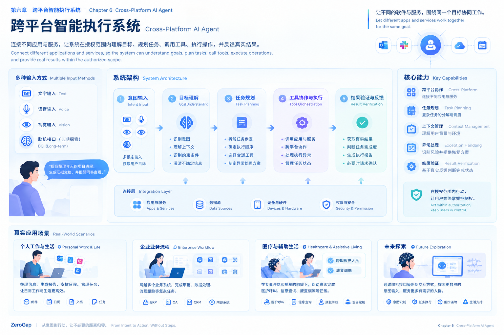
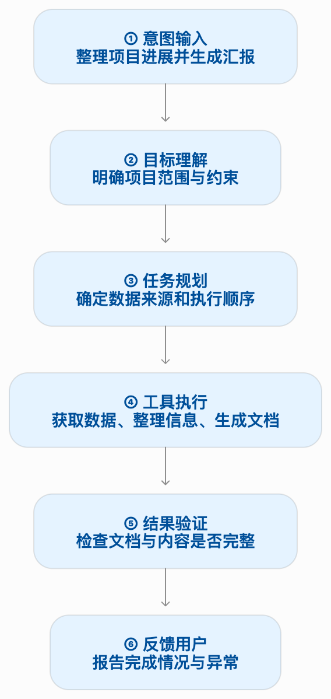
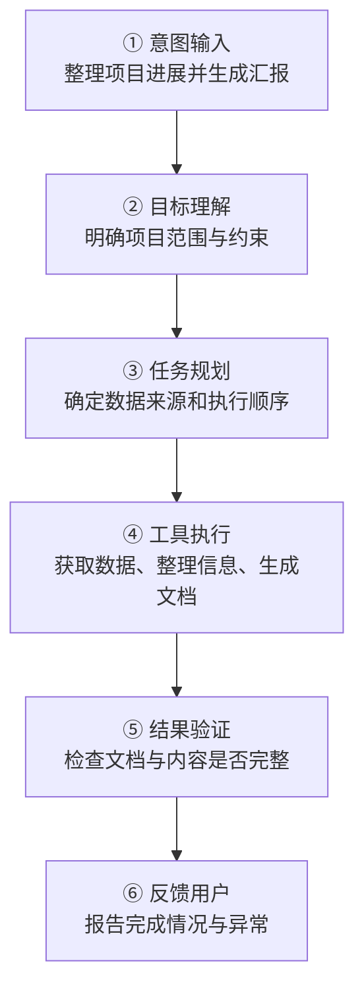

# 第六章 跨平台智能执行系统：让不同软件围绕同一个目标协同工作

*Chapter 6: Cross-Platform AI Agent — Making Different Applications Work Together Toward One Goal*

> **让不同的软件与服务，围绕人的同一个目标协同工作。**
>
> *Let Different Applications and Services Work Together Toward One Goal.*

## 6.1 为什么需要跨平台 Agent？

*Why Cross-Platform AI Agents?*

今天的软件世界并不缺少功能。

办公软件负责文档与协作，企业系统负责业务流程，日历负责日程管理，数据库负责存储信息，各类 SaaS 平台则提供不同的专业能力。

问题在于，这些系统通常围绕各自的功能设计，而一个真实任务却可能同时跨越多个系统。

例如，完成一次项目汇报，可能需要获取项目数据、查询任务进度、整理文档、生成图表，并通知相关人员。

过去，这些步骤主要由人亲自完成。人需要知道应该打开哪个应用、使用哪个功能、从哪里获取数据，以及如何把一个系统的结果交给另一个系统。

随着 AI 能力的发展，我们有机会重新组织这个过程。

用户不再只告诉软件「我要使用什么功能」，而是可以直接描述「我希望完成什么目标」。

AI Agent 则尝试理解目标、规划任务、选择工具，并在授权范围内协调不同系统完成工作。

这就是 ZeroGap 探索跨平台 Agent 的原因。

我们希望逐步建立一种连接层，让现有软件能力能够围绕用户目标协同工作，减少重复操作、信息搬运和跨系统协调成本。

## 6.2 产品定位：连接用户目标与现有软件能力

*Product Positioning: Connecting User Goals with Existing Software Capabilities*

ZeroGap 的跨平台 Agent，是一套以任务为中心的智能执行系统。

它位于用户意图与现有软件、服务和设备之间，负责把抽象的目标转化为有明确步骤、执行状态和结果反馈的任务。

它并不需要替代所有现有应用。

现有应用继续提供各自成熟的业务能力，而 Agent 负责在适当的权限范围内组织和调用这些能力。

例如：

- **个人工作：** 整理项目进展、生成汇报文档、安排日程。
- **企业协作：** 协调多个业务系统，跟踪流程状态，汇总业务数据。
- **辅助交互：** 在适用条件下，协助身体功能受限的人群表达需求并完成特定任务。
- **未来探索：** 研究如何将经过验证的新型意图输入方式与智能执行系统结合。

这些场景具有不同的业务要求和风险等级，但共享一个基本思想：

**用户表达目标并作出必要决策，系统负责在授权范围内组织执行。**

## 6.3 系统架构：从用户输入到任务完成

*System Architecture: From User Input to Task Completion*

ZeroGap 的跨平台 Agent 可以从逻辑上划分为五个核心阶段。

### 第一阶段：意图输入（Intent Input）

系统接收用户希望完成的目标。

近期可以支持文本、语音等成熟输入方式，并根据具体需求逐步引入视觉输入。脑机接口属于需要独立研究和验证的长期方向。

这一阶段负责接收输入，而不是直接决定执行什么操作。

### 第二阶段：目标理解（Goal Understanding）

系统分析用户表达的内容，结合必要的上下文，识别目标、约束和缺失信息。

例如，「整理今天的项目进展」可能还需要明确项目范围、数据来源和汇报格式。

当信息不足以支持可靠判断时，系统应该先询问用户，而不是将猜测当成事实。

### 第三阶段：任务规划（Task Planning）

系统将目标拆解为可执行的步骤，确定前后依赖关系，并考虑失败时的处理方式。

任务规划不仅是生成步骤清单，还需要明确每一步的输入、预期结果和完成条件。

### 第四阶段：工具协作与执行（Tool Orchestration & Execution）

系统根据任务需要，调用已经接入并获得授权的 API、业务服务、浏览器自动化能力或其他工具。

执行过程中需要维护任务状态，处理超时、失败、重复调用和部分成功等情况。

工具是否可调用、能够访问哪些数据，以及允许执行什么操作，都必须受到明确权限规则的约束。

### 第五阶段：结果验证与反馈（Result Verification & Feedback）

系统根据实际执行结果，判断任务是否达到预期目标。

例如，文档是否成功生成、数据是否正确写入、通知是否实际发送。

如果某一步失败，系统应说明失败位置与影响，并根据任务风险决定重试、调整计划或请求人工介入。

这五个阶段共同构成一个执行闭环：

**接收意图 → 理解目标 → 规划任务 → 调用工具 → 验证结果。**

真实任务可能在这些阶段之间反复迭代。关键不在于流程必须始终单向执行，而在于系统能够追踪状态，并依据真实结果决定下一步行动。

## 6.4 核心能力：让 Agent 不只是会调用工具

*Core Capabilities: Beyond Tool Calling*

一个能够调用工具的模型，并不自动等于可靠的 Agent。

ZeroGap 需要逐步建立以下能力。

### 任务规划与状态管理（Task Planning & State Management）

将复杂目标拆解为子任务，记录执行进度、依赖关系和待处理事项。

当任务中断时，系统应能够判断哪些步骤已经完成、哪些步骤尚未执行，以及是否可以安全恢复。

### 上下文管理（Context Management）

系统需要使用与当前任务相关的信息，同时避免将无关历史和过多内容带入每一次模型请求。

上下文可以包括当前目标、必要的历史信息、已确认的约束、工具返回结果和任务执行状态。

上下文管理的目的不是尽可能保存所有信息，而是让系统在需要的时候获得足够、相关且可靠的信息。

### 工具选择与跨平台协作（Tool Selection & Orchestration）

不同工具具有不同的输入格式、权限要求、错误类型和返回结果。

Agent 需要根据任务选择合适的能力，并处理工具之间的数据传递。

当某个工具不可用时，系统应该识别限制，而不是假设所有平台都支持相同的操作。

### 异常处理与恢复（Exception Handling & Recovery）

真实系统无法保证每一步都成功。

网络超时、接口报错、权限不足和数据格式变化，都可能导致任务中断。

系统需要区分可重试错误、需要用户处理的问题，以及不能继续执行的高风险情况。

对于可能产生重复后果的操作，还需要考虑幂等性、执行记录和重复提交保护。

### 结果验证与可追踪性（Result Verification & Traceability）

系统应区分以下三种状态：

- 模型生成了一个计划。
- 工具执行了一个操作。
- 业务目标已经完成。

这三者并不等价。

必要时，系统可以通过查询最终状态、检查返回数据或请求用户确认来验证结果。同时，应保留适当的任务记录，以便排查问题、分析失败原因并持续改进。

## 6.5 一个真实任务如何运行？

*How a Real Task Runs*

以「整理今天的项目进展并生成汇报文档」为例。

### 执行流程（Execution Flow）

### 每一步具体做什么？

| 阶段 | Agent 的工作 | 输出结果 |
|---|---|---|
| 意图输入 | 接收用户的任务描述 | 原始需求 |
| 目标理解 | 分析目标、范围和约束 | 明确的任务目标 |
| 任务规划 | 拆解步骤并确定执行顺序 | 任务计划 |
| 工具执行 | 调用已接入且获授权的工具 | 实际执行结果 |
| 结果验证 | 检查结果是否符合预期 | 验证结论 |
| 反馈用户 | 汇总完成情况与未解决问题 | 执行报告 |

### 回答问题与完成任务的区别

普通 AI 对话的主要结果是生成回答，而任务型 Agent 还需要协调外部工具，并确认实际操作的结果。

- **回答问题：** 告诉用户应该如何生成项目汇报。
- **执行任务：** 在获得必要授权后，获取项目数据、生成汇报文档，并检查文档是否成功创建。
- **处理失败：** 如果数据接口调用失败，明确报告问题，而不是声称汇报已经完成。

以上是产品流程示例。实际能够执行哪些操作，取决于系统接入的工具、用户授权与具体业务条件。

## 6.6 应用方向：从个人效率到医疗辅助

*Application Scenarios: From Personal Productivity to Healthcare Assistance*

### 场景一：个人工作与生活（Personal Work & Life）

帮助用户整理信息、生成文档、安排任务和协调不同应用，减少重复操作与信息搬运。

### 场景二：企业业务流程（Enterprise Workflow）

在身份认证、权限控制和审计机制下，连接不同业务系统，协助处理数据汇总、审批准备和流程跟踪等任务。

### 场景三：医疗与辅助生活（Healthcare & Assistive Living）

对于部分难以使用传统输入方式的人群，未来可以探索将经过验证的辅助输入与 Agent 执行系统结合。

例如，在适当的条件下，协助患者发起医护呼叫、获取经过授权的服务信息，或选择由专业人员制定的康复训练流程。

涉及诊断、治疗、用药和高风险设备控制的任务，必须遵循适用的医疗规范和专业监督要求。Agent 不能替代临床判断。

### 场景四：新型人机交互（Future Human–Computer Interaction）

脑机接口等新型输入方式，可能为部分用户提供不同于键盘、鼠标和语音的交互选择。

但输入识别与任务执行是两个独立的技术问题：前者需要验证信号是否可靠地表达特定控制意图，后者需要确保执行过程安全、可控且结果可验证。

只有两者分别达到相应要求，才有条件探索进一步融合。

## 6.7 安全边界：自动化不等于放弃控制权

*Safety Boundaries: Automation Without Losing Human Control*

跨平台 Agent 能够执行真实操作，也意味着它可能带来新的风险。

因此，ZeroGap 需要从产品设计阶段就考虑权限与安全问题。

- **最小权限：** 只授予任务所需的访问与操作权限。
- **分级确认：** 根据操作风险决定是否需要用户确认。
- **执行记录：** 保留适当的调用、状态与结果记录。
- **失败保护：** 对不确定、异常或超出权限的操作及时停止。
- **结果透明：** 清楚区分已完成、部分完成、失败和无法验证的任务。

系统不应仅因为用户表达了一个目标，就默认拥有执行所有相关操作的权限。

对于涉及医疗与辅助设备的场景，还需要根据具体风险增加专业评估、人工监督、应急停止和其他适用的保护措施。

我们的目标是让系统承担更多合适的工作，同时让用户保有必要的知情权、决定权与控制权。

## 6.8 研发路径：从可验证的执行闭环开始

*Development Roadmap: Start with a Verifiable Execution Loop*

ZeroGap 不会一开始就试图连接所有软件、支持所有任务。

我们建议按照以下顺序推进。

### 第一阶段：验证单任务闭环

选择一个范围明确、风险较低的任务，验证系统能否完成目标理解、工具调用与结果验证。

### 第二阶段：验证多工具协作

在单任务能力稳定后，增加工具组合，研究状态管理、上下文传递、异常恢复和执行记录。

### 第三阶段：逐步扩展跨平台能力

根据真实需求接入不同软件与业务服务，验证跨平台协作是否真正降低用户成本。

### 第四阶段：探索辅助交互场景

在适用的场景中评估更自然的输入方式，并与相关专业人员共同研究医疗辅助等长期应用方向。

每个阶段都应该有明确的成功标准，而不是仅凭演示效果决定是否继续投入。

衡量指标可以包括任务完成率、结果准确性、失败恢复能力、人工介入成本、执行耗时，以及权限与安全事件。具体指标应根据任务类型设定，不宜用一个统一数字评价所有场景。

## 6.9 本章小结：让软件能力围绕人的目标组织起来

*Summary: Organizing Software Capabilities Around Human Goals*

跨平台 Agent 是 ZeroGap 将长期愿景转化为可实现产品能力的重要起点。

它通过任务规划、上下文管理、工具协作、异常处理与结果验证，将用户的目标与现有软件能力连接起来。

近期，我们优先验证低风险、边界明确的软件任务，逐步建立可靠的执行闭环。

长期，我们希望将这套执行能力与更多输入方式相结合，包括面向部分身体功能受限人群的辅助交互探索。

无论输入来自文本、语音，还是未来经过验证的脑机接口，系统都必须尊重权限边界，并以真实结果作为判断任务完成的依据。

ZeroGap 不只是希望让 AI 更会回答问题，而是希望让智能系统更可靠地帮助人完成事情。

> **让不同的软件与服务，围绕人的同一个目标协同工作。**
>
> *Let Different Applications and Services Work Together Toward One Goal.*
