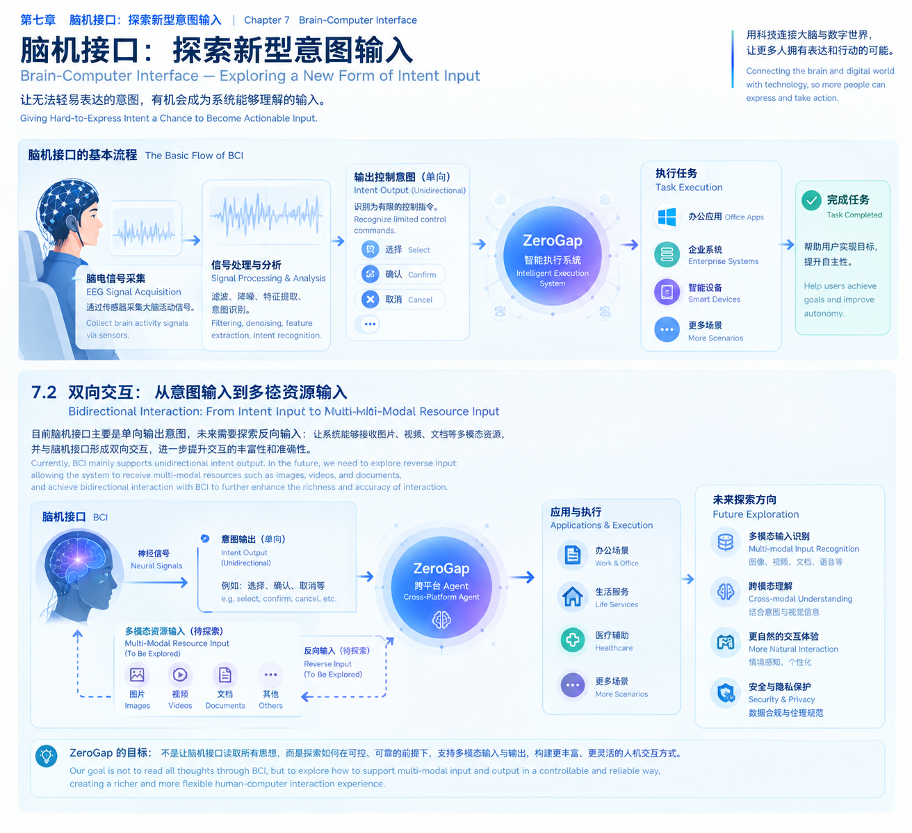
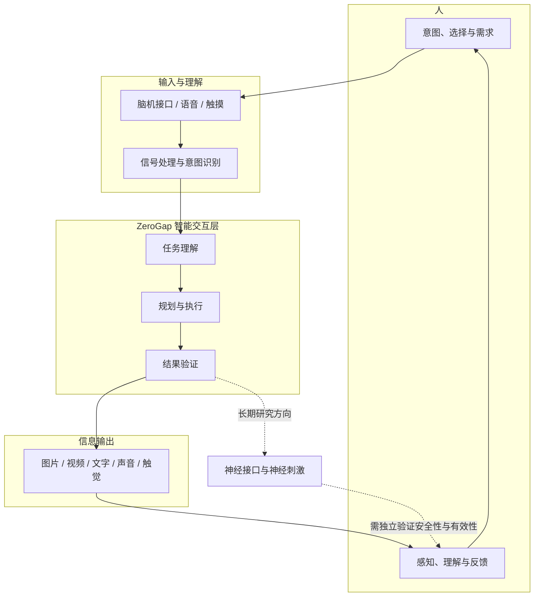
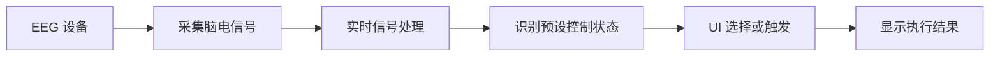
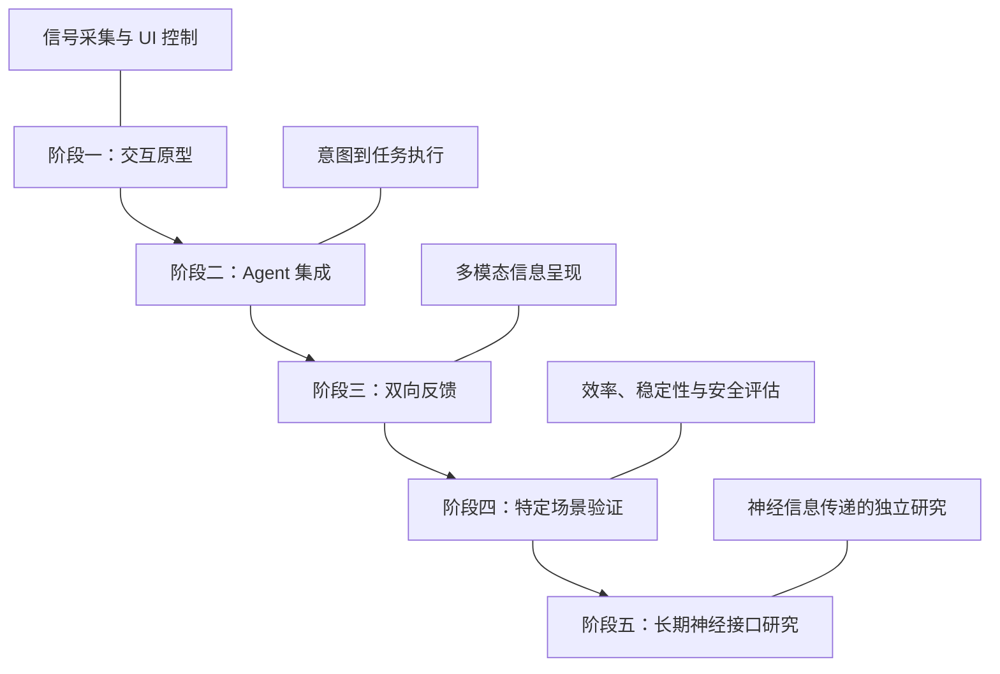

# 第七章 脑机接口：探索人与数字世界的直接连接
### Chapter 7: Brain-Computer Interface — Toward a Direct Connection Between Humans and the Digital World

> **ZeroGap — From Intent to Action, Without Steps.**
>
> 从意图到行动，让不必要的距离归零。

## 7.1 愿景：让人与数字世界之间的距离持续缩短

人类与数字世界的交互方式，一直在发生变化。

从键盘、鼠标，到触摸屏、语音助手，再到能够理解目标并执行任务的 AI Agent，每一次技术演进，都在尝试减少人表达意图、系统理解意图，以及最终完成行动之间的阻隔。

但现有交互方式仍然存在一些共同限制：

- 人需要通过特定的设备表达自己的意图。
- 系统需要将输入转换为能够理解的指令。
- 人需要主动查看屏幕、聆听声音，才能获取系统反馈。
- 复杂任务往往需要多次确认、切换和操作。

ZeroGap 希望进一步探索：**如果人与数字世界之间的交互，不再局限于键盘、鼠标、触摸屏和语音，而是能够更直接地连接人的意图、数字系统的行动，以及系统向人的信息反馈，会发生什么？**

脑机接口（Brain-Computer Interface，BCI）为这一愿景提供了一个值得探索的方向。

ZeroGap 并不把脑机接口视为唯一的交互入口，而是将它看作未来人机交互体系中可能存在的一种重要技术。

## 7.2 脑机接口是什么：从神经信号到数字交互

脑机接口是一类建立在脑活动与外部设备之间的信息交互技术。

它尝试采集和分析脑活动相关信号，将其中能够可靠识别的特征转换为外部系统可以使用的控制信息。

例如，在特定实验条件下，系统可能识别用户是否处于某种注意状态，或区分经过训练的几种控制意图，并将结果转换为界面选择、设备控制等操作。

需要注意的是，脑机接口并不等于读取任意思想。不同技术能够获取的信息、识别准确率、使用条件和侵入程度存在很大差异。

### 7.2.1 一条典型的脑机接口处理链路

这条链路的核心，是把原始信号转化为具有明确含义、可以被外部系统使用的信息。

以非侵入式脑电图（Electroencephalography，EEG）为例，系统通常需要面对信号幅度较弱、噪声干扰、个体差异以及使用者状态变化等问题。

因此，从实验中识别某种信号特征，到在真实环境中稳定控制数字设备，中间仍然存在大量工程与研究问题。

## 7.3 ZeroGap 的核心探索：从单向输入到双向交互

当前许多脑机接口研究，重点关注一个方向：

**人 → 系统：通过神经信号表达意图，让外部设备执行相应操作。**

但 ZeroGap 希望进一步提出另一个问题：

**系统 → 人：系统能否以更自然、更低负担的方式，向人提供信息、反馈和辅助？**

这两个方向共同构成了 ZeroGap 对未来交互方式的探索。

### 7.3.1 方向一：从人的意图到系统行动

这是近期可以开展原型验证的方向。

用户通过脑机接口、语音、触摸或其他输入方式表达意图。系统识别输入后，将其交给智能执行层处理，最终完成相应任务。

例如：

- 通过经过训练的脑电控制方式选择界面中的目标。
- 在辅助交互场景中触发按钮或切换界面。
- 将识别出的控制意图交给 Agent，进一步完成多步骤任务。
- 在适当的辅助设备上验证低负担的交互方式。

这一方向的关键不在于单纯识别脑电信号，而在于建立完整的交互链路：

**信号采集 → 意图识别 → 任务理解 → 行动执行 → 结果反馈。**

### 7.3.2 方向二：从系统信息到人的感知

当系统完成任务后，信息还需要回到人。

在近期可实现的技术范围内，系统可以通过常规感官通道提供信息，例如：

- 图片、视频与可视化界面；
- 文字、提示与结构化结果；
- 语音、声音和空间音频；
- 震动、触觉反馈以及其他辅助设备。

这些方式不需要直接向大脑传递信息，就能够构建完整的双向交互闭环。

从 ZeroGap 的视角看，系统不仅要理解人的意图并执行任务，也应根据任务场景、用户需求和反馈情况，选择适合的信息呈现方式。

### 7.3.3 更长期的探索：通过神经接口传递信息

在更长期的研究中，还可以探索另一种可能性：

**系统能否通过神经接口，直接影响或传递特定的感知信息？**

这与通过屏幕、扬声器或触觉设备提供信息有本质区别。

神经刺激和神经接口研究涉及不同的技术路线。例如，部分研究关注通过刺激特定神经通路产生有限的感知体验，但这不意味着已经能够将任意图片、视频、文字或声音直接传输到大脑，并让人完整理解其内容。

这一方向涉及复杂的神经科学、硬件、信号编码、人体安全和伦理问题，应被视为长期研究议题，而不是现阶段可以直接实现的产品能力。

## 7.4 ZeroGap 双向交互的整体架构

ZeroGap 的长期目标不是单独开发一个脑电控制器，而是探索一套能够连接人的意图、智能执行和信息反馈的交互体系。

*配图建议：以人为中心，左侧展示脑机接口与其他输入方式，中间展示 ZeroGap Agent，右侧展示系统执行和信息输出；下方用回环箭头连接系统反馈与人的新意图，并以虚线表示长期探索的神经接口信息传递路线。*

这套架构可以分为四个部分：

1. **输入层：** 通过脑机接口及其他交互方式获取人的意图或状态信息。
2. **智能交互层：** 理解任务、规划步骤、调用合适的能力，并验证执行结果。
3. **输出层：** 根据场景选择图片、视频、文字、声音、触觉等反馈方式。
4. **反馈闭环：** 人理解结果后，可以确认、修正、提出新意图，或继续下一步任务。

其中，脑机接口只是输入层的一种潜在技术；神经接口信息传递则属于独立的长期研究方向。两者不能因为都涉及神经信号，就被视为同一条技术链路。

## 7.5 从一个小型 Demo 开始验证

ZeroGap 不需要一开始就解决完整的脑机交互问题。

更合理的路径，是先验证一个边界清晰、能够测量效果的原型。

### 7.5.1 第一阶段：EEG 与 UI 控制

可以尝试构建一个 EEG → UI 的小型 Demo。

例如，可以研究利用经过训练的 EEG 控制方式完成界面选择，或者在受控实验条件下识别预设的控制状态。

如果采用眨眼作为触发方式，需要特别区分：眨眼可能通过眼电或眼部肌肉活动产生明显信号，它不应被直接当作已经识别出脑电意图的证据。

第一阶段的目标，是验证信号采集、处理、识别和界面控制之间的完整链路。

### 7.5.2 第二阶段：接入 ZeroGap Agent

在 UI 控制验证后，可以把预设控制信号交给 Agent。

例如，用户通过可靠的输入方式表达选择，Agent 理解其目标并完成一项简单任务，再通过界面或语音反馈执行结果。

这一步可以验证脑机接口与智能执行系统之间的协作，而不需要一开始就追求复杂的脑信号解码能力。

### 7.5.3 第三阶段：构建双向反馈

当输入和执行链路稳定后，再进一步验证系统反馈：

- 系统能否根据任务结果选择合适的呈现方式？
- 图片、文字和语音等反馈能否降低用户理解成本？
- 用户能否通过简单的确认或修正完成下一步交互？
- 在特定场景中，能否减少对传统输入设备的依赖？

这些问题能够帮助 ZeroGap 逐步衡量交互体验是否真的得到改善。

## 7.6 关键技术挑战与评估指标

脑机接口是否有价值，不应只看它能否成功识别某个信号，还需要看它能否在真实任务中可靠地工作。

| 评估维度 | 需要回答的问题 |
| --- | --- |
| 识别准确率 | 系统能否可靠区分预设控制意图？ |
| 响应延迟 | 从信号采集到设备执行，需要多长时间？ |
| 误触发率 | 系统是否会在用户没有意图时执行操作？ |
| 稳定性 | 不同时间、环境和使用状态下，表现是否一致？ |
| 使用负担 | 设备佩戴、校准和训练是否足够简单？ |
| 任务效率 | 与触摸、语音等方式相比，是否真正减少了操作成本？ |
| 安全与隐私 | 信号如何存储、处理、授权和保护？ |
| 用户体验 | 用户是否更容易理解、控制和纠正系统行为？ |

对 ZeroGap 而言，最终应关注的不只是技术指标，还包括用户完成任务所需的时间、步骤、认知负担以及可控性。

只有在明确场景中证明它比现有方式更有价值，脑机接口才有必要成为产品中的一种交互能力。

## 7.7 研发路线：从可验证原型走向长期探索

ZeroGap 可以采用分阶段的研发路线，避免在基础链路尚未验证之前，就投入难以衡量的复杂研究。

- **阶段一：** 使用现有设备和成熟工具，验证有限的输入控制方式。
- **阶段二：** 将可靠的输入事件接入 Agent，验证目标理解与任务执行。
- **阶段三：** 增加图片、文字、语音和其他反馈方式，形成交互闭环。
- **阶段四：** 在明确的应用场景中评估实际效果，并判断是否值得继续投入。
- **阶段五：** 在具备相应研究能力、专业合作和安全审查的前提下，探索更长期的神经接口信息传递问题。

各阶段都应有明确的成功标准。如果现有技术无法带来足够收益，就应优先改进已有交互方式，而不是为了使用脑机接口而使用脑机接口。

## 7.8 安全边界与长期责任

涉及脑活动、神经信号和人体交互的技术，必须把安全、隐私和用户自主权放在核心位置。

ZeroGap 在这一方向上需要坚持以下原则：

- **不夸大能力：** 不把有限的信号分类描述为读取任意思想，也不宣称可以直接向大脑传输任意数字内容。
- **尊重用户自主权：** 用户应能够确认、拒绝、中止或纠正系统操作。
- **保护敏感数据：** 对神经信号进行必要的访问控制、最小化采集和安全存储。
- **建立可靠的执行边界：** 对高风险操作设置额外确认、权限约束和可追溯机制。
- **区分研究与产品：** 神经刺激和侵入式技术必须经过相应的专业评估、伦理审查与安全验证。
- **优先解决真实问题：** 以可验证的用户收益决定技术路线，而不是以技术的新颖程度决定产品方向。

ZeroGap 的目标不是绕过人的判断，而是减少不必要的操作负担，同时保留人的选择权和控制权。

## 7.9 本章总结：从连接意图，到连接整个交互闭环

脑机接口让 ZeroGap 有机会重新思考人与数字世界之间的连接方式。

在近期，值得探索的是通过现有脑机接口设备与其他输入方式，降低特定场景中的操作负担，并把可靠的意图输入接入智能执行系统。

在中期，可以进一步建立输入、任务执行、信息呈现和用户反馈之间的闭环，让系统不仅能够执行任务，也能够以适合人的方式返回结果。

在长期，ZeroGap 可以持续关注神经接口与神经刺激研究，探索信息是否能够通过新的神经交互方式传递。但这条路线需要独立的技术验证、安全研究和伦理约束。

**ZeroGap 所追求的，并不是让人适应越来越复杂的机器，而是让技术逐步适应人的意图、感知与行动方式。**

从人的意图，到系统的行动；从系统的结果，到人的理解。每减少一个不必要的步骤，人与数字世界之间的距离就有机会再缩短一点。

**ZeroGap — From Intent to Action, Without Steps.**