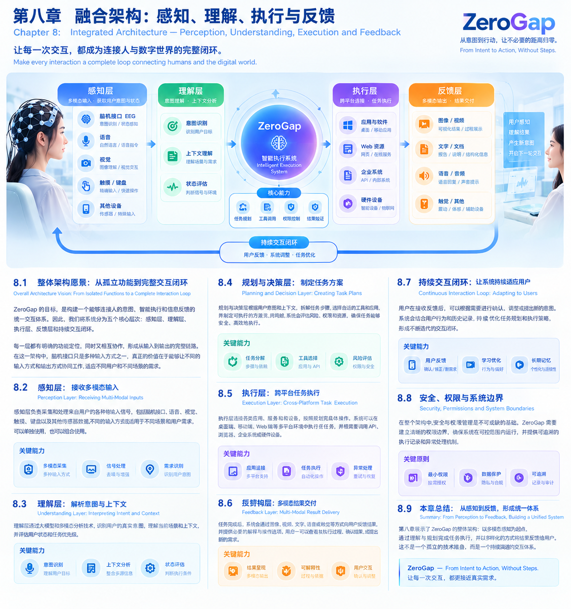
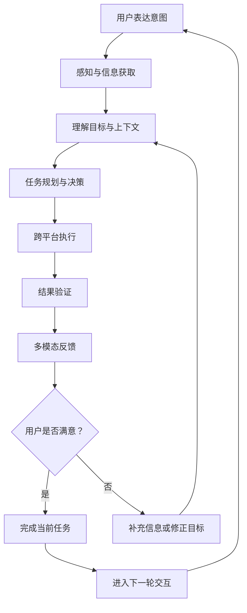

# 第八章 融合架构：感知、理解、执行与反馈
# Chapter 8: Integrated Architecture — Perception, Understanding, Execution and Feedback

> **让每一次交互，都成为连接人与数字世界的完整闭环。**
>
> Make Every Interaction a Complete Loop Connecting Humans and the Digital World.

## 8.1 整体架构愿景：从孤立功能到完整交互闭环

ZeroGap 的目标，是构建一个能够连接人的意图、智能执行和信息反馈的统一交互系统。

传统软件通常围绕特定功能设计。用户需要自行理解应用的功能边界，选择合适的工具，并通过一系列操作完成任务。

ZeroGap 希望改变这一交互模式：用户首先表达目标，系统负责理解需求、制定计划、连接合适的能力、执行任务，并将结果以适合人的方式反馈回来。

这一过程由五个核心环节组成：

1. **感知：** 获取用户通过不同方式表达的意图与相关信息。
2. **理解：** 识别用户目标、上下文和当前任务状态。
3. **规划：** 将目标转化为可执行的任务步骤。
4. **执行：** 连接不同应用、工具与服务，完成任务。
5. **反馈：** 呈现结果，接受用户确认或修正，并开启下一轮交互。

这些环节并非彼此独立的功能模块，而是共同构成持续运行的交互闭环。

## 8.2 感知层：接收多模态输入

感知层负责接收人与系统之间的输入信息，为后续理解和执行提供依据。

ZeroGap 不应依赖单一输入方式，而应根据设备条件、用户需求和具体场景，支持不同形式的信息输入。

### 8.2.1 输入方式

- **文字：** 用户通过自然语言描述目标、条件和要求。
- **语音：** 用户通过口头表达提交任务或补充信息。
- **视觉：** 系统接收图片、屏幕内容或其他视觉信息。
- **触摸与操作事件：** 通过点击、选择和设备操作表达意图。
- **脑机接口：** 在技术条件允许的场景中，探索识别经过训练的有限控制意图。
- **其他辅助设备：** 根据应用场景连接适当的输入与交互设备。

不同输入方式既可以独立使用，也可以组合使用。

例如，用户可以通过语音提出任务，再通过图片补充背景信息，最后通过界面确认关键操作。

### 8.2.2 感知层的关键能力

感知层不仅需要获取输入，还需要完成必要的信号处理、格式转换、信息提取和质量判断。

对于不清晰、相互矛盾或不足以支撑执行的信息，系统应能够识别不确定性，并在必要时向用户询问。

脑机接口属于这一层的潜在输入方式，但其信号识别能力、可靠性和适用范围需要单独验证，不能假设系统可以直接读取任意思想。

## 8.3 理解层：解析意图与上下文

接收到输入，不代表系统已经理解用户真正想做什么。

同一句话在不同上下文中，可能代表完全不同的目标。因此，理解层需要结合当前输入、任务背景、必要的历史信息和系统状态，形成对用户需求的合理解释。

### 8.3.1 从指令理解到目标理解

例如，用户说：

“帮我整理一下这些资料，形成一份可以汇报的文档。”

系统不能只把这句话转换成一条文本命令，而应进一步识别：

- 需要处理哪些资料？
- 文档面向什么对象？
- 希望采用什么结构？
- 是否有格式、篇幅或时间要求？
- 哪些信息存在缺失或需要确认？

理解层的目标，是将自然表达转化为结构化、可执行的任务需求。

### 8.3.2 上下文与状态管理

理解层需要使用与当前任务相关的信息，同时避免无关内容干扰判断。

随着任务变得复杂，系统还需要维护任务进度、执行结果、尚未解决的问题和用户的最新要求。

这与上下文工程密切相关：系统不仅要理解当前消息，还要组织完成任务所必需的信息。

### 8.3.3 关键原则

当系统对用户目标存在重要歧义时，应优先澄清，而不是为了追求自动化程度而擅自选择高风险操作。

## 8.4 规划与决策层：制定任务方案

理解目标之后，系统需要判断如何完成任务。

规划与决策层负责将复杂目标拆解为有顺序、有依赖关系的步骤，并根据任务要求选择合适的工具和执行路径。

例如，一项资料整理任务可能包含：

1. 获取用户授权访问的资料。
2. 提取和整理关键信息。
3. 识别重复、缺失或存在冲突的内容。
4. 生成结构化文档。
5. 检查文档是否满足要求。
6. 向用户展示结果并等待必要的确认。

### 8.4.1 核心能力

- **任务拆解：** 将整体目标转换为可执行步骤。
- **工具选择：** 根据任务需求选择合适的应用、API 或服务。
- **依赖管理：** 明确任务的执行顺序和前置条件。
- **风险评估：** 识别权限、数据和操作风险。
- **动态调整：** 根据执行结果、环境变化和用户反馈修订计划。

规划层不应假设所有任务都能一次性执行成功。当任务失败或信息发生变化时，系统需要重新评估后续步骤。

## 8.5 执行层：跨平台任务执行

执行层负责将任务计划转化为实际操作，是 ZeroGap 连接数字世界的重要基础。

用户的目标可能涉及多个应用、服务或设备。执行层需要在授权范围内调用这些能力，并协调不同系统之间的执行过程。

### 8.5.1 执行能力

- **API 与服务连接：** 通过公开或获授权的接口访问业务能力。
- **Web 应用操作：** 在支持的条件下完成网页信息读取与操作。
- **桌面及移动端交互：** 根据设备和系统能力执行相应操作。
- **任务状态管理：** 记录执行进度、步骤结果和失败原因。
- **异常处理：** 在权限不足、网络错误或操作失败时暂停、重试或请求用户介入。

### 8.5.2 从执行动作到验证结果

完成某个操作，不代表整体任务已经完成。

例如，系统提交了一份文档，还需要判断文档是否成功保存、内容是否完整，以及用户是否要求进一步发送或分享。

因此，执行层必须与结果验证机制协同工作，避免把“已经尝试执行”误认为“已经实现目标”。

## 8.6 反馈层：多模态结果交付

系统完成任务后，需要将结果交还给用户。

反馈层负责根据任务类型、用户需求和使用环境，选择合适的信息呈现方式。

### 8.6.1 多模态反馈方式

- **文字与文档：** 返回摘要、结构化信息、报告或任务结果。
- **图片与可视化：** 展示图表、界面状态、图片或其他视觉结果。
- **视频：** 在适合的场景中呈现动态内容或操作过程。
- **语音与声音：** 提供语音说明、状态提示或其他音频反馈。
- **触觉与辅助反馈：** 在支持的设备上提供震动等提示。
- **交互式界面：** 允许用户查看进度、选择方案、确认操作或修正结果。

### 8.6.2 反馈不只是展示结果

反馈还承担三个重要职责：

1. **说明结果：** 让用户知道系统完成了什么，以及哪些任务尚未完成。
2. **提供依据：** 在适当情况下展示关键来源、执行记录或验证信息。
3. **支持下一步决策：** 让用户确认、修改、拒绝或继续任务。

系统应根据结果的重要性和风险决定反馈的详细程度，而不是对所有任务采用相同的展示方式。

### 8.6.3 从传统输出到长期神经交互探索

近期，ZeroGap 可以通过屏幕、文字、图片、视频、声音和触觉设备构建反馈体系。

更长期的研究可以关注神经接口信息传递，但这属于独立的研究方向，需要专门验证其可行性、安全性和适用范围，不能视为现阶段已经具备的通用输出能力。

## 8.7 持续交互闭环：让系统逐步适应用户

ZeroGap 的整体架构不是一条从输入到输出的单向流水线。

当用户收到结果后，可能会确认完成、提出修改、补充信息，或进一步表达新的目标。系统需要将这些反馈重新纳入理解和规划过程。

典型闭环如下：

持续交互能够让系统根据真实结果调整后续行为，但并不意味着系统可以未经授权地自行扩大权限或改变用户目标。

ZeroGap 需要保持清晰的任务状态、授权边界和用户控制机制，让交互闭环既连续，又可控。

## 8.8 安全、权限与系统边界

当智能系统能够跨越多个应用并执行实际操作时，安全与权限管理就成为整体架构的基础能力。

ZeroGap 应将安全机制贯穿感知、理解、规划、执行和反馈的全过程。

### 8.8.1 最小权限

系统只应获取完成当前任务所需的权限，并在权限不足时向用户请求授权，而不是默认拥有广泛的应用访问能力。

### 8.8.2 高风险操作确认

对于涉及资金、敏感信息、外部发送、删除或其他不可逆操作的任务，应根据风险设置明确的确认流程。

### 8.8.3 可追溯执行

在适当范围内记录任务步骤、关键操作、执行结果和异常信息，帮助用户理解系统做过什么，并在出现问题时进行排查。

### 8.8.4 不确定性处理

当输入信息不完整、识别结果不可靠或执行条件发生变化时，系统应能够暂停、说明问题并请求用户介入。

### 8.8.5 神经交互的额外边界

脑机接口及未来可能涉及的神经刺激技术，需要额外考虑信号隐私、人体安全、专业监督和伦理要求。不能因为它们被纳入统一架构，就假设所有相关技术已经成熟或能够安全部署。

## 8.9 本章总结：从感知到反馈，形成统一体系

第八章展示了 ZeroGap 的整体架构：以多模态感知为起点，通过意图理解、任务规划和跨平台执行，将系统能力组织为一个持续交互的过程。

在这一体系中：

- 感知层连接不同的输入方式。
- 理解层将输入转化为明确的任务目标。
- 规划层决定如何完成目标。
- 执行层连接数字应用和外部能力。
- 反馈层将结果以适合人的方式交付。
- 持续交互机制让用户能够确认、纠正并开启新的任务。

这些能力共同构成 ZeroGap 的技术骨架。

它不依赖某一种固定的输入设备，也不预设未来必须采用某一种神经接口。随着技术进步，新的输入与输出方式可以逐步接入，但系统始终围绕同一个目标展开：减少人与数字世界之间不必要的操作和理解成本。

**ZeroGap — From Intent to Action, Without Steps.**

从意图到行动，再从结果回到人的理解，让每一次交互都更自然、更可靠、更接近真实需求。