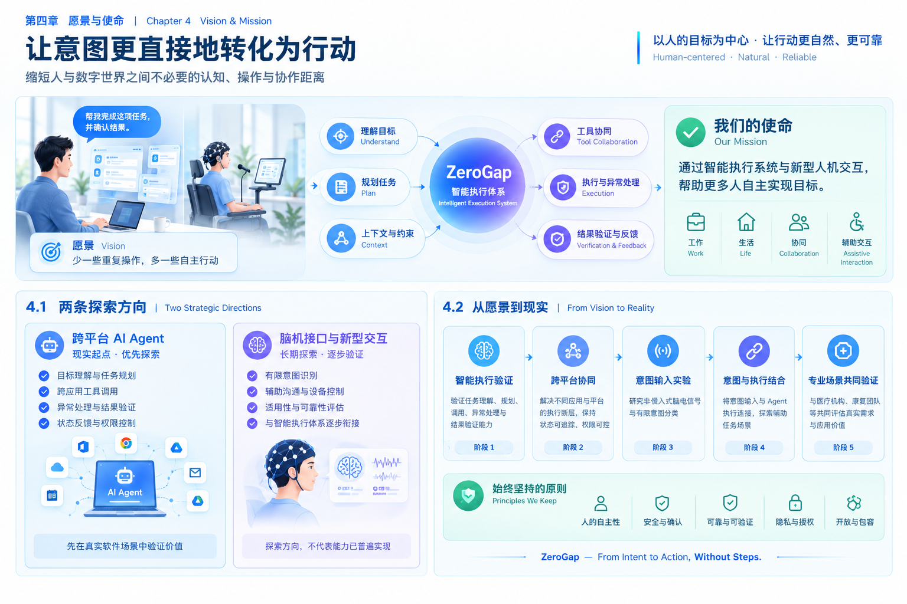

# 第四章 愿景与使命：我们想创造怎样的未来

## 4.1 我们想象中的未来

想象一下未来某一天的工作与生活。

一个人希望完成一项任务，不再需要亲自操作每一个按钮，也不必在不同应用之间反复切换。智能系统能够理解他的目标，在获得必要授权的前提下，协调不同的软件与设备，执行任务，并反馈真实结果。

对于大多数人来说，这意味着更少的重复操作、更自然的交互体验，以及更多可以投入到思考、创造和生活中的时间。

而对于因疾病、损伤或身体功能障碍而难以使用传统交互设备的人来说，这种变化可能具有更深远的意义。

一个无法方便地使用键盘、鼠标或触摸屏的人，仍然可能拥有明确的需求、判断与行动意愿。他可能希望呼叫医护人员、表达身体不适、控制辅助设备、参与康复训练，或者独立完成更多日常活动。

问题在于，**拥有意图，并不意味着一定拥有将意图表达出来、并转化为行动的能力。**

当一个人难以使用传统交互方式时，即使数字世界已经提供了丰富的工具和服务，他仍然可能无法方便地使用它们。

如果未来的脑机接口能够在特定条件下识别某些有限、明确的控制意图，智能系统又能够将经过确认的意图转化为安全、可靠、经过授权的操作，那么人与外部世界之间的距离就有机会进一步缩短。

对于部分身体功能受限的人，这可能意味着更多表达需求、控制设备、参与日常生活的机会，而不仅仅是减少几次操作。

*图片预留：建议以“人的意图—智能系统—数字世界与现实行动”为视觉主线，同时呈现普通用户的效率提升与身体功能受限人群的辅助交互需求。*

这并不意味着技术能够消除疾病、恢复所有身体功能，也不意味着每个人都适合使用同一种脑机接口。

它代表的是一种值得努力的方向：

**让人不必因为传统交互方式的限制，就失去表达需求、实现目标和参与数字生活的机会。**

## 4.2 愿景：让意图更直接地转化为行动

ZeroGap 希望创造一个人与数字世界能够更加自然地连接的未来。

今天，人们已经拥有大量数字工具，但人与工具之间仍然存在着许多不必要的交互步骤。

一个简单的目标，可能需要经过搜索、打开应用、切换页面、填写表单、选择功能和确认操作，才能最终实现。

人工智能正在改变这种交互模式。

随着系统逐渐具备理解语言、识别场景、规划任务和调用工具的能力，人们与数字世界之间的关系，有机会从逐步操作工具，转向表达目标并由系统协助完成任务。

与此同时，未来的人机交互也不应该局限于键盘、鼠标、触摸屏和语音。对于传统交互方式难以满足需求的人群，新型意图输入技术可能提供另一种选择。

ZeroGap 希望沿着这一方向持续探索：

- 对普通用户，减少不必要的操作与工具切换，让复杂任务能够更加自然地完成。
- 对开发者与企业，让不同软件、平台和设备能够围绕统一目标协同工作。
- 对部分身体功能受限的人，探索更适合其实际能力的意图输入与辅助执行方式，扩大其表达、行动与自主选择的空间。

我们的目标不是简单地让机器变得更聪明，而是让人的目标能够以更低的交互成本、更可靠的方式转化为实际结果。

**ZeroGap — From Intent to Action, Without Steps.**

**从意图到行动，让不必要的距离归零。**

这里的“Without Steps”并不是消灭所有步骤，而是减少那些无法创造价值、却持续消耗时间、注意力和精力的中间操作。

对于复杂任务，系统仍然需要规划、验证和反馈；对于高风险操作，仍然必须保留必要的授权、确认与安全机制。

我们希望消除的不是合理的流程，而是人与目标之间不必要的阻隔。

## 4.3 使命：缩短从意图到行动之间不必要的距离

ZeroGap 的使命是：

**通过构建智能执行系统，并探索新型人机交互方式，减少人与数字世界之间不必要的认知、操作与协作成本，让更多人能够自主地实现自己的目标。**

为了实现这一使命，我们将围绕两个相互关联、发展节奏不同的方向开展探索。

### 方向一：让软件更好地理解目标并完成任务

我们将跨平台 AI Agent 作为优先探索方向。

传统软件通常要求用户按照预先设计的界面与流程完成操作。即使部分步骤能够自动化，用户仍然需要理解不同工具的使用方式，并在多个应用之间进行协调。

ZeroGap 希望逐步建立以用户目标为中心的智能执行能力，使系统能够：

- 理解用户的目标与约束条件。
- 将复杂目标拆解为可执行的任务。
- 根据任务需要选择合适的工具和执行路径。
- 在获得授权的范围内协调不同平台与应用。
- 处理执行过程中的异常，并验证最终结果。
- 通过清晰的反馈，让用户了解任务进展，并在必要时介入。

这不仅适用于日常办公和生活任务，也为未来的辅助交互应用提供了可能的执行基础。

例如，在经过适当评估和授权的场景中，系统可以协助用户查询已授权的医疗服务信息、完成预约流程、管理康复训练安排，或发起医护呼叫。

但涉及诊断、治疗建议、用药、医疗设备控制及其他高风险医疗行为时，必须遵循适用的专业规范、临床要求和安全机制，不能仅凭系统识别到一个意图就直接执行。

我们希望先通过真实、可验证的应用场景，建立可靠的任务理解、执行、反馈与验证能力，再逐步拓展其应用范围。

### 方向二：探索更自然的人机交互输入

我们将脑机接口等新型交互技术作为长期探索方向。

对于部分严重运动功能受限的人，传统输入设备可能无法充分满足其需求。脑机接口有望在特定条件下提供另一种意图输入通道，使使用者通过经过训练和验证的神经信号表达有限、明确的控制指令。

当这种输入能力与智能执行系统结合时，研究重点就不再局限于“能否识别一个脑电信号”，而是进一步关注完整的交互过程：

- 使用者能否通过适合自己的方式表达具体需求？
- 系统能否正确理解，并在必要时确认其意图？
- 是否存在安全、适当且经过授权的执行方式？
- 任务是否真正完成，使用者能否确认结果？
- 与现有交互方式相比，这种方案是否带来了实际改善？

这要求我们同时关注信号识别、意图理解、执行可靠性、状态反馈和安全控制，而不是只关注某一个技术环节的准确率。

两条方向相互关联，但并不要求同步成熟。

跨平台 Agent 可以先在通用软件场景中验证价值；脑机接口则需要根据技术成熟度、适用人群和实验条件逐步推进。未来，当新的意图输入方式具备足够的可靠性，并能够满足具体场景的要求时，它们才有机会接入统一的智能执行体系。

## 4.4 我们坚持的原则：让技术服务于人的自主性

ZeroGap 不以使用最先进的技术为最终目标。

我们更关心的是，技术能否真正帮助人实现目标，并让使用者保有对自身行动的决定权。

因此，我们将坚持以下原则。

### 4.4.1 以人的目标为中心

技术应该适应人的需求，而不是要求人不断适应技术。

我们将优先关注真实、具体、能够验证的使用场景，理解不同人群的能力、限制和实际需求。

对于身体功能受限的人，我们尤其需要避免假设所有使用者都具有相同的感知、运动、语言或认知能力。

### 4.4.2 减少不必要的操作，但不削弱人的控制权

交互步骤减少，不代表用户失去决定权。

系统应当提供必要的任务状态、执行结果和中止机制，并允许用户在适当的环节进行确认、纠正或取消。

对于支付、删除、对外发送、医疗相关操作及其他高风险行为，应根据风险等级保留相应的授权与确认流程。

当系统无法可靠判断用户意图时，应当主动澄清或停止执行，而不是猜测用户的想法。

### 4.4.3 以可靠性建立信任

一次成功的演示，不等于一个值得长期使用的产品。

ZeroGap 必须重视任务成功率、执行稳定性、异常恢复、结果验证和过程可追踪性。

对于辅助交互场景，还需要评估误触发、漏识别、响应延迟、使用疲劳以及失败后的替代操作方式。

只有当技术在真实场景中表现出足够的可靠性，才有可能真正帮助人减少对繁琐操作或他人协助的依赖。

### 4.4.4 以开放的技术路线拥抱未来

ZeroGap 不将自身绑定于某一种模型、某一种设备或某一种输入方式。

我们将根据实际场景选择合适的技术，并通过清晰的系统架构与接口，使不同模型、软件工具、交互设备和反馈方式能够逐步接入。

脑机接口是我们关注的长期方向之一，但不是整个产品体系成立的前提。

即使相关技术的发展速度低于预期，ZeroGap 仍然可以通过智能执行和跨平台协同，为用户创造实际价值。

### 4.4.5 尊重隐私、安全与技术边界

人与数字世界的连接越直接，系统所承担的责任就越大。

ZeroGap 必须重视数据最小化、权限管理、用户授权、隐私保护和风险控制。

涉及脑电信号及其他神经数据时，应审慎处理数据的采集、存储、分析与使用，避免将有限的信号分类能力夸大为读取完整思想的能力。

涉及患者、康复和医疗应用时，应根据具体用途遵循适用的伦理、专业和法规要求，并与具备相应资质和能力的专业机构开展合作。

技术的边界必须清晰，产品承诺必须建立在实际验证的基础上。

## 4.5 现实起点：从可验证的产品价值开始

ZeroGap 的愿景具有长期性，但实现它必须从今天能够解决的问题开始。

我们不会等待脑机接口完全成熟后才开始行动，也不会把尚未验证的技术设想当作已经实现的能力。

我们的现实起点，是先建立能够理解目标、规划任务、调用工具并验证结果的智能执行系统。

在此基础上，我们将逐步探索更加自然的意图输入方式，并通过真实场景验证其价值。

### 第一阶段：验证智能执行能力

围绕通用软件场景，探索跨平台 Agent 的任务理解、任务规划、工具调用、异常处理和结果验证能力。

重点不是展示系统能够调用多少工具，而是验证它是否能够在明确的约束下，稳定地帮助用户完成真实任务。

### 第二阶段：验证跨平台协同能力

逐步解决不同应用、平台与服务之间的执行断层，使系统能够根据任务目标协调合适的工具，并在执行过程中保持状态可追踪、权限可控制、结果可验证。

通过这些实践，为未来接入更多交互设备和输入方式建立基础。

### 第三阶段：验证新型意图输入

从可控、低风险的实验场景出发，研究非侵入式脑电信号采集、信号处理、特征提取与有限意图分类。

例如，在受控条件下，尝试将经过验证的分类结果映射为简单的界面选择或模拟控制指令。

这一阶段的目标是验证特定实验任务在给定条件下是否可行，而不是宣称系统已经能够普遍识别真实意图，更不是直接进入未经验证的医疗应用。

### 第四阶段：探索意图输入与智能执行的结合

在有限、明确的任务范围内，研究如何将经过验证的意图输入与 Agent 执行能力连接起来。

例如，探索通过辅助输入方式选择“发起医护呼叫”“查看已授权的服务信息”或“开始指定的康复训练流程”等任务。

系统需要具备清晰的状态反馈、取消机制、误触发处理和必要的人工确认。

对于不确定的识别结果，优先重新确认或停止执行，而不是直接采取可能造成风险的行动。

### 第五阶段：与专业机构共同验证真实场景

在前期技术验证的基础上，与具备相应专业能力的医疗机构、康复团队、研究人员及潜在使用者共同评估具体需求。

可能的探索方向包括：

- **辅助沟通：** 为难以使用传统输入设备的人探索替代性的需求表达方式。
- **辅助控制：** 在明确的安全边界内，探索对经过验证的辅助设备或环境控制系统进行有限操作。
- **康复支持：** 探索将意图输入、训练任务与反馈机制结合起来，辅助开展由专业人员制定的康复流程。
- **医疗服务协同：** 探索如何更方便地表达需求、发起请求，以及获取经过授权的医疗服务信息。

这些方向都需要根据具体人群、临床需求、技术可行性与风险等级分别验证。任何进入真实医疗环境的应用，都不能仅凭实验室原型的表现就推断其具有临床有效性或安全性。

我们的目标不是用一个系统包办所有人的需求，而是让合适的技术在合适的场景中，为使用者提供更多选择。

## 4.6 长期目标：让更多人获得表达与行动的机会

ZeroGap 的长期愿景不应只局限于提高普通用户的操作效率。

我们也希望关注那些因为运动、语言或其他身体功能受限，而在表达意图、控制设备或完成日常任务方面面临额外障碍的人群。

对这些人来说，减少一次操作可能不仅意味着节省几秒钟，还可能意味着更多自主性、更少的操作障碍，以及重新参与某项活动的机会。

传统交互方式并不适合所有人。不同患者的身体状态、功能能力、认知状况和实际需求也存在显著差异。

因此，ZeroGap 希望探索的不是一种适用于所有人的万能交互设备，而是一套能够适应不同输入方式、执行环境与使用者需求的智能交互体系。

在这一体系中：

- 新型输入技术可以为部分使用者提供不同于传统设备的意图表达通道。
- 智能执行系统可以在明确的权限与约束下，将经过确认的需求转化为具体任务。
- 反馈机制可以帮助使用者了解执行状态，并确认任务是否真正完成。
- 安全机制可以在意图不明确、执行失败或风险过高时，阻止不适当的操作并提供替代方案。

这条路径的核心不是让所有人使用同一种技术，而是尽可能避免某一种交互方式成为参与数字世界的唯一门槛。

我们希望未来衡量产品价值时，不仅关注系统自动完成了多少任务、节省了多少时间，也关注它是否让使用者拥有更多选择、更加方便地表达需求，以及更自主地参与自己重视的活动。

这些价值需要通过真实使用者的反馈、可验证的任务结果和适当的长期评估来判断，而不能仅靠技术演示来证明。

## 4.7 ZeroGap 希望成为什么

ZeroGap 希望逐步建立围绕人的意图与实际行动之间的连接能力。

对普通用户而言，这可能意味着更少的重复操作、更自然的跨平台协作，以及更可靠的任务执行。

对企业和开发者而言，这可能意味着不同的软件、服务与工具能够围绕统一目标协同工作，降低复杂流程中的操作成本。

对部分身体功能受限的人而言，这种能力还可能具有更深层的意义。

当传统输入方式不再适用时，新的意图输入通道有机会帮助他们与数字系统建立连接；当智能执行系统能够理解经过确认的需求，并在授权范围内调用合适的工具时，使用者就可能借助技术完成更多原本难以独立完成的任务。

这条链路的核心不是让人适应越来越复杂的技术，而是让技术尽可能适应人的实际能力与需求。

我们希望探索一种更具包容性的人机交互方式：

**不因为一个人难以使用键盘、鼠标、触摸屏或语音，就让他失去表达需求和参与数字生活的机会。**

这是一条长期的探索路径。它需要智能系统的持续进步，需要新型输入技术的验证，也需要使用者、开发者、研究人员和专业机构之间的协作。

ZeroGap 不承诺一种技术能够解决所有问题，也不把尚未实现的能力当作既定结果。

我们希望从真实问题出发，以可验证的产品价值为基础，逐步推动人的意图与数字行动之间的连接变得更加自然、可靠和包容。

## 4.8 本章总结

ZeroGap 的愿景，是创造一个人与数字世界能够更加自然地连接的未来。

我们的使命，是通过智能执行系统和新型人机交互方式，减少人与数字世界之间不必要的认知、操作与协作成本，让更多人能够自主地实现自己的目标。

在现实路径上，我们将优先探索跨平台 AI Agent，逐步建立目标理解、任务规划、工具执行与结果验证能力；在长期方向上，我们将持续关注脑机接口等新型意图输入技术，探索它们在辅助沟通、辅助控制及其他适用场景中的可能性。

而在更深层的价值上，我们希望关注的不只是效率。

从帮助普通用户减少繁琐操作，到探索如何让部分身体功能受限的人获得更多表达与行动的机会，ZeroGap 始终关注同一个问题：

**当一个人已经拥有明确的意图时，我们能否让他以更自然、更可靠的方式，将意图转化为现实中的行动？**

这就是 ZeroGap 希望持续探索的方向。

**ZeroGap — From Intent to Action, Without Steps.**