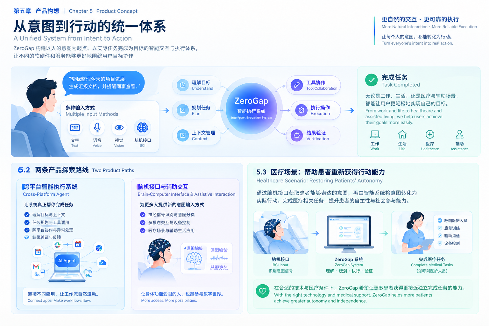

# 第五章 产品构想：从意图到行动的统一体系

*Chapter 5: Product Concept — A Unified System from Intent to Action*

> **从意图到行动，让不必要的距离归零。**
>
> *From Intent to Action, Without Steps.*

ZeroGap 希望构建一套以人的意图为起点、以真实任务完成为目标的智能交互与执行体系。

它将探索两条相互关联的产品路线：一条通过跨平台 AI Agent，让智能系统协助人们完成真实任务；另一条通过脑机接口等新型交互技术，探索如何帮助部分身体功能受限的人群表达意图，并借助系统完成适当的任务。

两条路线的技术成熟度与研发节奏不同，但共同指向一个目标：让技术更好地适应人的需求，而不是让人始终适应技术的操作方式。

## 5.1 产品全景：从意图到行动

*Product Overview: From Intent to Action*

ZeroGap 的产品核心，不是单一的聊天界面，也不是某一个独立的 AI 模型，而是连接意图输入、目标理解、任务规划、工具执行与结果验证的完整过程。

这套体系可以分为五个阶段：

1. **意图输入（Intent Input）**：用户通过文字、语音、视觉或未来经过验证的脑机接口表达需求。
2. **目标理解（Goal Understanding）**：系统结合必要的上下文，理解目标、条件与限制。
3. **任务规划（Task Planning）**：将目标拆解为可执行的步骤，并确定执行顺序。
4. **工具协作与执行（Tool Orchestration & Execution）**：在授权范围内调用应用、服务或设备完成操作。
5. **结果验证与反馈（Result Verification & Feedback）**：依据实际执行结果判断任务状态，并向用户反馈。

这五个阶段构成了 ZeroGap 的基础产品模型。真实任务可能需要反复调整计划、补充信息或请求人工确认，但系统始终应该围绕用户希望实现的目标推进工作。

## 5.2 两条产品探索路线

*Two Product Paths*

### 路线一：跨平台智能执行系统

*Cross-Platform Agent*

让智能系统理解目标、协调多个应用，并在授权范围内完成真实任务。

近期优先探索的能力包括任务规划、上下文管理、工具调用、跨平台协作、异常处理与结果验证。

### 路线二：脑机接口与辅助交互

*Brain-Computer Interface & Assistive Interaction*

探索通过经过验证的神经信号识别有限的控制意图，并将其转化为系统可以处理的输入。

长期关注的应用方向包括辅助沟通、辅助设备控制，以及经过专业评估的医疗与康复相关任务。

脑机接口并不能直接读取任意思想。实际应用必须建立在具体任务的技术验证、用户适配、知情同意和安全评估之上。

## 5.3 医疗场景：帮助患者获得更多自主行动的机会

*Healthcare Scenario: Supporting Patient Autonomy*

对于部分难以使用键盘、鼠标、触摸屏或语音设备的患者，表达需求和控制外部设备可能存在额外障碍。

ZeroGap 希望探索这样一条技术路径：

**脑机接口识别有限意图 → 智能系统理解并确认 → 执行经过授权的任务 → 反馈实际结果。**

例如，在经过充分验证的适用场景中，患者可能通过辅助交互方式发起医护呼叫、表达有限的沟通需求，或选择由专业人员制定的康复训练流程。

我们的长期目标，是帮助更多患者提升自主性、参与能力和完成日常任务的机会，而不是承诺技术能够恢复所有身体功能。

涉及诊断、治疗、用药或高风险医疗设备控制的任务，必须遵循相应的医疗规范与专业监督要求。

## 5.4 产品原则：减少操作，保留必要边界

*Product Principle: Fewer Unnecessary Steps, Essential Boundaries Preserved*

ZeroGap 不追求不受约束的自动化。

我们希望减少重复操作、跨应用协调成本和不必要的交互障碍，同时保留隐私保护、身份验证、权限控制、重要操作确认和人的自主决定权。

系统应该知道自己能够做什么、不能做什么，以及何时应该暂停并请求人工介入。

**减少不必要的步骤，保留必要的边界。**

这既是 ZeroGap 的产品原则，也是构建可信赖智能执行系统的基础。

## 5.5 从愿景到验证

*From Vision to Validation*

ZeroGap 将优先从范围明确、风险较低的软件任务开始，验证智能系统是否真正帮助用户完成目标。

在基础执行能力得到验证后，再逐步扩展跨平台协作能力，并独立推进脑机接口相关实验。

每一个阶段都需要明确的验证指标，包括任务完成率、结果准确性、人工介入成本、执行可靠性，以及具体脑机接口实验中的识别表现和误触发风险。

我们不会仅凭演示效果判断产品价值，而会持续追问：

- 任务是否真正完成？
- 用户是否因此减少了不必要的工作？
- 系统是否能够识别失败与不确定性？
- 对于辅助与医疗场景，是否确实改善了适用人群的实际体验？

ZeroGap 不需要一开始就实现所有愿景。我们需要从第一个真实问题出发，通过可验证的成果逐步构建更完整的产品体系。

**从意图到行动，让不必要的距离归零。**

*From Intent to Action, Without Steps.*