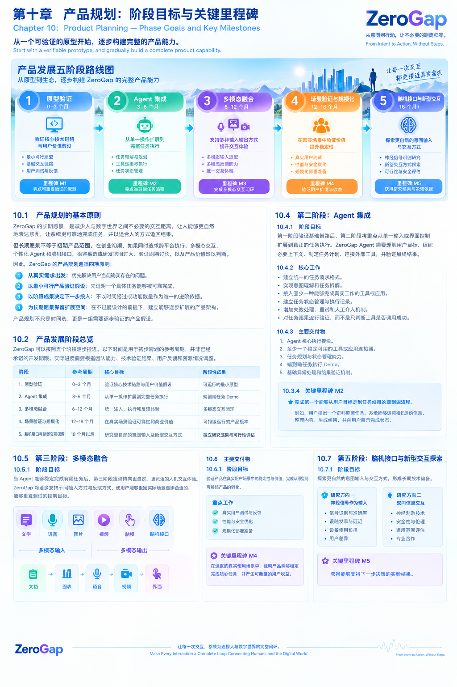
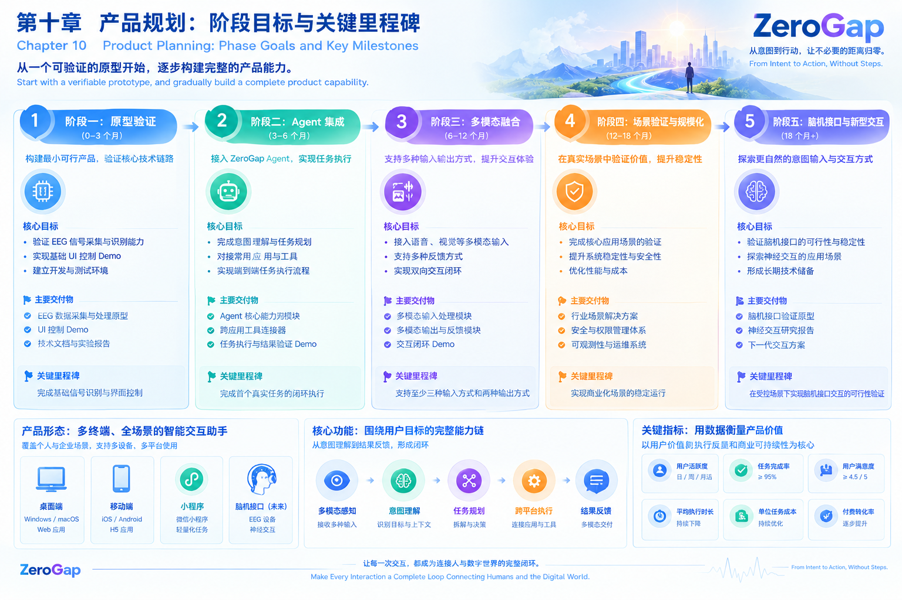
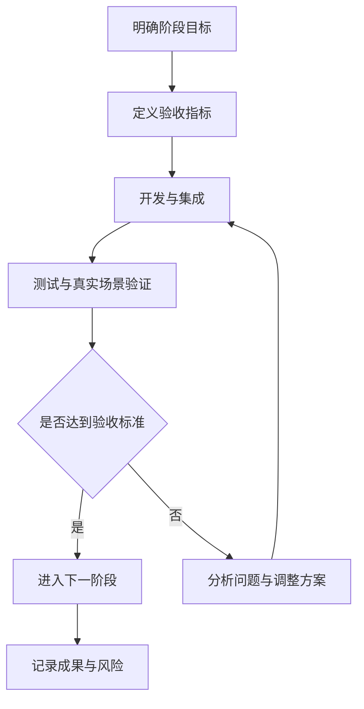

# 第十章 产品规划：阶段目标与关键里程碑

# Chapter 10: Product Planning — Phase Goals and Key Milestones

## 10.1 产品规划的基本原则

ZeroGap 的长期愿景，是减少人与数字世界之间不必要的交互距离，让人能够更自然地表达意图，让系统能够可靠地完成任务，并以适合人的方式返回结果。

但长期愿景不等于初期产品范围。在创业初期，如果同时推进跨平台 Agent、多模态交互、脑机接口和复杂的自动化系统，容易导致研发范围过大、验证周期过长，以及产品价值难以判断。

因此，ZeroGap 的产品规划遵循四项原则：

1. **从真实需求出发：** 优先解决用户当前确实存在的问题。
2. **从最小可行产品开始：** 先证明一个具体任务能够被可靠完成。
3. **以阶段成果决定下一步：** 每个阶段都必须有可以展示、测试和验证的交付物。
4. **为长期扩展保留空间：** 在不过度设计的前提下，逐步建立可扩展的产品架构。

产品规划不是简单地安排开发时间，而是将长期愿景拆解成一系列可以逐步验证的产品假设。

## 10.2 产品发展阶段总览

ZeroGap 初步规划五个发展阶段。以下时间仅作为规划参考，并非已经承诺的开发期限；实际推进节奏需要根据技术验证结果、用户反馈和资源情况调整。

| 阶段 | 参考周期 | 核心目标 | 阶段交付物 |
|---|---|---|---|
| 第一阶段：原型验证 | 0–3 个月 | 验证核心技术链路与用户价值假设 | 可运行的最小原型 |
| 第二阶段：Agent 集成 | 3–6 个月 | 从单一输入扩展到完整任务执行 | 具备任务执行能力的 Demo |
| 第三阶段：多模态融合 | 6–12 个月 | 统一输入、执行与反馈体验 | 多模态交互闭环 |
| 第四阶段：场景验证与规模化 | 12–18 个月 | 在真实场景中验证可靠性与商业价值 | 可持续迭代的产品版本 |
| 第五阶段：脑机接口与新型交互探索 | 18 个月以后 | 探索更自然的意图输入方式 | 独立研究原型与可行性评估 |

这些阶段不是严格的线性关系。部分技术研究可以并行开展，但产品主线应始终围绕可验证的用户价值推进。

## 10.3 第一阶段：原型验证

### 10.3.1 阶段目标

建立一个足够小、能够实际运行的原型，验证从用户输入到系统执行，再到结果反馈的基本链路。

这一阶段不追求复杂的 Agent 能力，也不要求脑机接口直接成为可用的产品输入方式。最重要的是证明：ZeroGap 可以针对一个明确任务，减少用户原本需要完成的操作步骤。

### 10.3.2 核心工作

- 选择一个具体、可重复验证的使用场景。
- 建立最小化的用户交互界面。
- 接入基础模型或规则处理能力。
- 实现简单、明确的任务执行逻辑。
- 提供执行结果与失败状态反馈。
- 记录任务成功率、执行时间和用户操作步骤。

脑机接口方向可以在这一阶段进行独立的技术预研，例如探索 EEG 信号识别与简单 UI 控制，但不应成为整个产品原型成立的前置条件。

### 10.3.3 主要交付物

1. 一个可以现场演示的最小原型。
2. 一条端到端可运行的任务链路。
3. 一组可重复执行的测试用例。
4. 一份初步的用户反馈与技术验证记录。

### 10.3.4 关键里程碑 M1

**完成可重复验证的最小原型。**

验收重点不是界面是否丰富，而是系统能否在明确条件下完成目标任务，并且能够解释成功、失败和异常状态。

## 10.4 第二阶段：Agent 集成

### 10.4.1 阶段目标

第一阶段验证基础链路后，第二阶段将重点从单一输入或界面控制扩展到真正的任务执行。

ZeroGap Agent 需要理解用户目标、组织必要步骤、调用合适的工具或应用，并验证最终结果。

### 10.4.2 核心工作

- 建立统一的任务描述格式。
- 实现意图理解与任务拆解。
- 接入至少一种能够完成实际工作的工具或应用。
- 建立任务状态管理与执行记录。
- 增加失败处理、重试和人工介入机制。
- 对任务结果进行验证，而不是只判断工具是否调用成功。

### 10.4.3 主要交付物

1. Agent 核心执行模块。
2. 至少一个稳定可用的工具或应用连接器。
3. 基础任务规划与状态管理能力。
4. 可观察的执行日志和结果验证机制。
5. 一组端到端任务测试用例。

### 10.4.4 关键里程碑 M2

**完成端到端的任务执行 Demo。**

例如，用户提出一个明确目标，系统能够理解需求、规划步骤、执行必要操作、检查结果，并向用户反馈最终状态。

## 10.5 第三阶段：多模态融合

### 10.5.1 阶段目标

当 Agent 能够稳定完成任务后，第三阶段转向更自然、更灵活的人机交互体验。

ZeroGap 逐步支持不同输入方式与反馈方式，让用户能够根据实际场景选择合适的交互形式，而不必被限制在单一界面或固定操作流程中。

### 10.5.2 核心工作

- 接入文字、语音、图片等输入方式。
- 统一不同输入方式对应的意图表达。
- 根据任务选择合适的执行路径。
- 提供文字、语音、图片或界面状态等反馈。
- 处理多模态输入之间的信息关联。
- 保持不同终端上的任务状态与交互体验一致。

多模态融合并不意味着一开始就要支持所有模态。应根据用户需求逐步接入，并确保每一种新增方式都能带来可衡量的体验改善。

### 10.5.3 主要交付物

1. 统一的多模态输入接口。
2. 能够关联用户意图与任务上下文的处理模块。
3. 多种可用的结果反馈方式。
4. 基础的跨模态交互测试方案。

### 10.5.4 关键里程碑 M3

**完成多模态交互闭环。**

用户可以通过一种合适的方式表达需求，系统完成任务，并以适当的方式返回结果；用户还能够进一步修正需求或继续操作。

## 10.6 第四阶段：场景验证与规模化

### 10.6.1 阶段目标

前三个阶段主要验证技术链路与产品能力。第四阶段则需要回答一个更关键的问题：

**ZeroGap 是否真正解决了用户的问题，并且值得持续使用？**

这一阶段需要将产品放入真实使用环境，验证其可靠性、使用频率、用户留存和潜在商业价值。

### 10.6.2 核心工作

- 选择一个边界清晰、需求明确的目标场景。
- 招募目标用户进行真实任务测试。
- 收集任务成功率、完成时间和人工干预频率。
- 优化异常处理、权限控制和系统稳定性。
- 评估部署成本、运行成本和维护成本。
- 根据用户反馈调整产品定位与功能优先级。

### 10.6.3 主要交付物

1. 面向真实用户的产品版本。
2. 可重复的场景测试与验收标准。
3. 产品使用数据和用户反馈报告。
4. 初步的成本、价值与商业化评估。
5. 下一阶段产品迭代计划。

### 10.6.4 关键里程碑 M4

**验证产品在真实场景中的用户价值。**

重点关注用户是否愿意持续使用、任务是否能够稳定完成，以及相较于原有操作方式是否产生了明确收益。

## 10.7 第五阶段：脑机接口与新型交互探索

### 10.7.1 阶段目标

脑机接口是 ZeroGap 长期探索的重要方向之一，但其研发周期、硬件条件、信号质量与应用边界，都需要独立验证。

这一阶段的目标不是预设脑机接口一定能够成为成熟的商业产品，而是探索更自然的意图输入方式，评估其技术可行性与真实使用价值。

### 10.7.2 研究方向一：神经信号作为输入

- 研究 EEG 等非侵入式信号的识别能力。
- 评估识别准确率、延迟与稳定性。
- 探索简单、低风险的 UI 控制场景。
- 评估设备成本、佩戴负担与用户接受度。

### 10.7.3 研究方向二：双向信息交互

- 研究不同神经交互方式的技术边界。
- 评估安全性、伦理问题与适用范围。
- 探索神经交互与其他输入方式的协同。
- 与具备相应专业能力的研究团队开展合作。

双向脑机交互涉及复杂的神经科学、硬件和安全问题，不应与普通软件交互混为一谈。相关能力必须依据真实研究成果逐步推进。

### 10.7.4 关键里程碑 M5

**获得能够支持下一步决策的研究证据。**

阶段成果可以是可重复的实验数据、可行性报告、技术原型或合作研究结果，而不必强行要求形成商业化产品。

## 10.8 产品指标与验收机制

每个阶段都应设置可验证的验收标准，避免仅凭 Demo 能否运行来判断产品是否成功。

| 指标类别 | 建议关注的指标 | 主要目的 |
|---|---|---|
| 任务效果 | 任务成功率、结果正确率 | 判断系统是否真正完成目标 |
| 交互效率 | 完成时间、用户操作步骤 | 衡量是否减少不必要的交互 |
| 系统可靠性 | 失败率、异常恢复能力 | 判断能否稳定运行 |
| 用户体验 | 满意度、重复使用意愿 | 判断是否具有实际使用价值 |
| 执行成本 | 单次任务成本、维护成本 | 评估持续运行的可行性 |
| 新型输入 | 识别准确率、延迟、稳定性 | 评估新交互技术的可用程度 |

具体目标值应在确定场景、测试基线和用户样本后制定，不应在缺乏数据时提前宣称已经达到某个指标。

### 阶段验收流程

每个阶段都应保留清晰的验收记录，包括已经验证的能力、仍然存在的问题、下一阶段的前置条件，以及需要继续观察的风险。

## 10.9 资源投入与优先级

在资源有限的创业早期，ZeroGap 应将主要投入集中在能够最快验证核心假设的工作上。

优先级建议如下：

1. **最高优先级：** 核心任务链路、Agent 执行能力、真实用户需求验证。
2. **第二优先级：** 必要的多模态输入、结果反馈、可靠性和安全机制。
3. **持续探索：** EEG 等新型输入技术的可行性研究。
4. **暂缓投入：** 缺乏明确用户需求支撑的复杂功能，以及过早的大规模平台建设。

这并不意味着忽略长期研究，而是将产品交付与前沿技术探索分开管理，避免长期愿景拖慢近期产品验证。

## 10.10 本章总结

ZeroGap 的产品发展应从可验证的原型开始，逐步建立 Agent 任务执行能力，融合多模态交互，再通过真实场景验证产品价值，并在具备适当条件时持续探索脑机接口等新型意图输入方式。

五个阶段对应着五个逐步深入的问题：

- **M1：** 核心链路能否运行？
- **M2：** 系统能否真正完成任务？
- **M3：** 不同输入与反馈方式能否形成自然的交互闭环？
- **M4：** 产品是否在真实场景中创造了可验证的价值？
- **M5：** 新型交互技术是否具备进一步研究与应用的依据？

ZeroGap 不需要在第一天就实现最终愿景，而需要通过一系列可验证的成果，逐步缩短从人的意图到数字世界行动之间的距离。

**从可验证的原型开始，逐步构建完整的产品能力。**

*ZeroGap — From Intent to Action, Without Steps.*