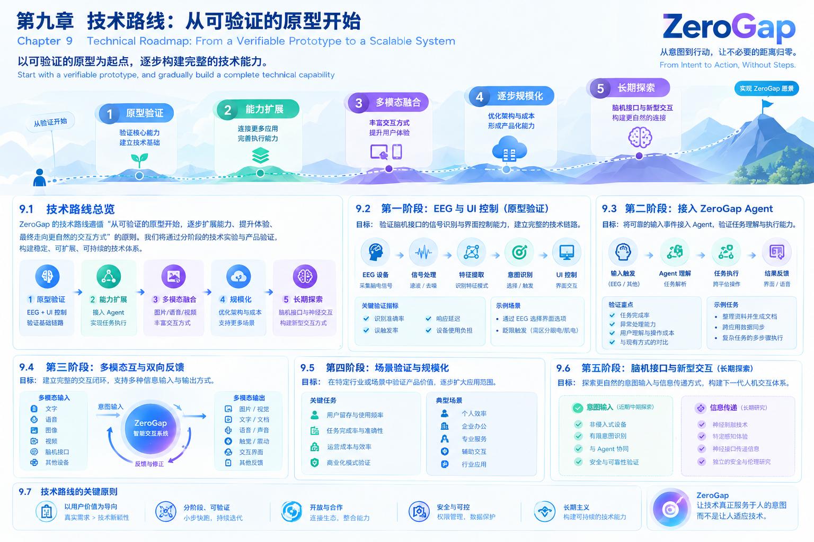
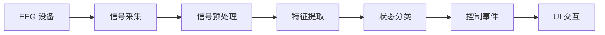
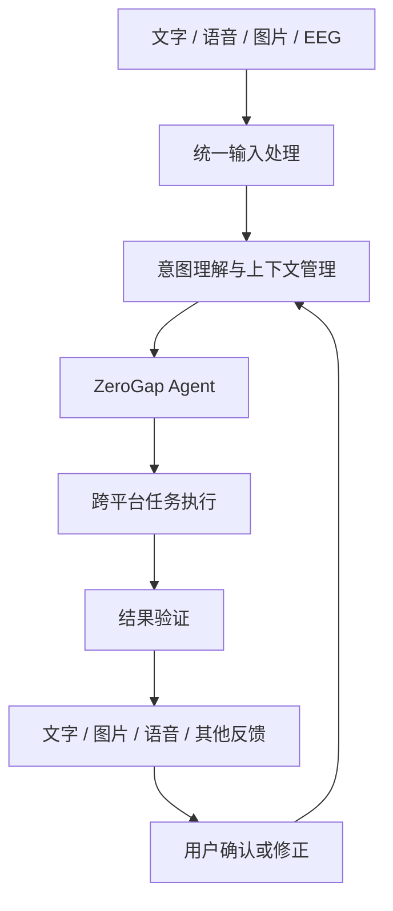

# 第九章 技术路线：从可验证的原型开始
# Chapter 9: Technical Roadmap — From a Verifiable Prototype to a Scalable System

> **以可验证的原型为起点，逐步构建完整的技术能力。**
>
> Start with a verifiable prototype, and gradually build a complete technical capability.

## 9.1 技术路线总览

ZeroGap 的技术路线遵循一个基本原则：**从可验证的原型开始，逐步扩展能力、提升体验，最终走向更自然的人机交互方式。**

ZeroGap 的愿景涉及跨平台 Agent、多模态交互和脑机接口等多个方向，但这些技术不需要在创业初期同时实现。

更合理的方式，是先选择一个边界清晰、能够验证实际价值的场景，建立最小可行原型，再根据验证结果逐步增加能力。

整个技术路线分为五个阶段：

1. 原型验证：建立基础技术链路。
2. 能力扩展：接入 Agent，完成真实任务。
3. 多模态融合：支持多种输入和输出方式。
4. 场景验证与规模化：在真实场景中验证产品价值，提升稳定性。
5. 长期探索：研究脑机接口与新型人机交互。

各阶段并非完全割裂。前一阶段形成的能力，将成为后一阶段的技术基础；如果验证结果不符合预期，也应及时调整路线。

## 9.2 第一阶段：EEG 与 UI 控制（原型验证）

### 9.2.1 阶段目标

验证脑机接口相关信号能否经过采集、处理和识别，转换为可用于界面交互的控制事件。

第一阶段不追求读取复杂思想，也不追求通过脑电完成复杂任务，而是选择有限、明确、能够重复测试的控制目标。

例如，使用合适的非侵入式 EEG 设备，研究在受控实验条件下识别预设控制状态，并将识别结果映射为 UI 选择或界面状态变化。

### 9.2.2 技术流程

各环节需要逐步验证：

- 信号能否稳定采集？
- 预处理能否降低常见噪声的影响？
- 提取的特征是否有助于区分预设状态？
- 分类结果能否稳定映射为控制事件？
- 系统是否存在明显延迟或误触发？

如果使用眨眼作为触发方式，需要明确区分眼电或眼部肌肉活动与脑电意图识别。眨眼触发可以作为简单交互实验，但不能直接证明系统已经能够解码脑电意图。

### 9.2.3 阶段交付物

- 可运行的 EEG 数据采集与处理原型。
- 一个具有明确输入和输出的 UI 控制 Demo。
- 基础实验记录与评估结果。
- 对设备限制、信号质量和误触发情况的总结。

### 9.2.4 核心评估指标

| 指标 | 验证目的 |
| --- | --- |
| 识别准确率 | 判断预设状态能否被有效区分 |
| 误触发率 | 判断系统是否频繁错误执行 |
| 响应延迟 | 判断交互是否足够及时 |
| 稳定性 | 判断多次测试结果是否一致 |
| 使用负担 | 评估设备佩戴、校准与训练成本 |

第一阶段的成功标准不是“演示一次能够运行”，而是能够重复测试、记录结果，并明确原型在哪些条件下有效。

## 9.3 第二阶段：接入 ZeroGap Agent

### 9.3.1 阶段目标

当输入事件能够稳定产生后，将其接入 ZeroGap Agent，验证从意图输入到任务理解、任务执行和结果反馈的完整链路。

此时，脑机接口只是输入方式之一。开发过程中也可以先使用键盘、按钮或模拟事件验证 Agent 流程，避免将所有问题混在一起排查。

### 9.3.2 技术流程

这一阶段重点验证：

- 输入事件能否被转换为明确的任务请求？
- Agent 能否理解目标并制定合理的执行计划？
- 外部工具和应用能否在授权范围内完成操作？
- 执行失败时，系统能否识别异常并恢复或请求用户介入？
- 最终结果是否真正满足用户目标？

### 9.3.3 示例任务

可以选择一个低风险、结果容易验证的任务，例如：

- 根据用户输入整理一份文档。
- 从授权的数据源读取信息并生成摘要。
- 完成简单的跨应用信息整理。
- 根据预设条件执行一个可逆的界面操作。

### 9.3.4 阶段交付物

- 输入事件到 Agent 任务请求的适配模块。
- 可执行的任务规划与工具调用流程。
- 任务状态、执行结果和异常记录。
- 一个端到端运行的任务 Demo。

这一阶段的重点，是验证输入技术与智能执行系统之间能否可靠协作，而不是扩大脑信号识别的复杂度。

## 9.4 第三阶段：多模态交互与双向反馈

### 9.4.1 阶段目标

在系统能够理解目标并执行任务后，进一步扩展输入与输出方式，形成完整的双向交互闭环。

ZeroGap 不应将交互限制在单一设备或单一通道。不同的任务和使用环境，可能需要不同的输入与反馈方式。

### 9.4.2 多模态输入

- 文字：输入明确的目标和条件。
- 语音：以自然语言表达任务。
- 图片：提供视觉背景或待处理资料。
- 视频：提供动态场景信息。
- 触摸与界面操作：完成选择、确认和修正。
- 脑机接口：在经过验证的范围内提供有限控制输入。

### 9.4.3 多模态输出

- 文字和文档：提供任务结果与说明。
- 图片和图表：展示视觉化信息。
- 视频：呈现动态信息或过程。
- 语音：提供语音说明和状态反馈。
- 触觉反馈：在支持的设备上提供辅助提示。
- 交互界面：让用户查看进度、确认操作或调整目标。

### 9.4.4 技术流程

### 9.4.5 阶段交付物

- 统一的多模态输入接口。
- 可根据任务选择输出方式的反馈模块。
- 用户确认、修正和继续执行机制。
- 可记录、可测试的完整交互闭环。

这一阶段要验证的核心问题是：多模态交互是否真正降低了用户的操作负担，而不只是增加了更多功能。

## 9.5 第四阶段：场景验证与规模化

### 9.5.1 阶段目标

当核心技术链路可以稳定运行后，将系统放入真实使用场景，验证它是否具备持续创造价值的能力。

技术原型能够运行，不代表产品已经适合真实用户。真实场景会带来网络波动、应用变化、权限差异、输入噪声、复杂任务和异常操作等问题。

因此，第四阶段需要从单次演示转向持续运行和系统性评估。

### 9.5.2 重点工作

**稳定性**

- 建立统一的错误处理和任务状态管理。
- 为可重试操作制定合理的重试策略。
- 防止重复提交和重复执行。
- 在失败时保留足够的信息用于排查。

**安全与权限**

- 使用最小必要权限。
- 对高风险操作增加确认机制。
- 记录关键执行过程。
- 保护用户数据和敏感信息。

**性能与成本**

- 监测模型调用、工具执行和任务等待时间。
- 优化上下文组织和模型选择。
- 控制无效重试和重复调用。
- 评估每项任务的平均执行成本。

**可维护性**

- 为核心模块建立清晰接口。
- 将输入适配、任务规划、执行与反馈分离。
- 建立日志、监控和测试机制。
- 降低单个应用变化对整个系统的影响。

### 9.5.3 场景验证指标

| 评估维度 | 核心问题 |
| --- | --- |
| 任务完成率 | 系统能否稳定完成目标？ |
| 端到端延迟 | 用户需要等待多久？ |
| 人工介入率 | 有多少任务需要用户额外处理？ |
| 异常恢复率 | 失败后系统能否正确恢复？ |
| 单位任务成本 | 每次完成任务需要多少资源？ |
| 用户收益 | 是否减少时间、步骤或认知负担？ |

只有在明确场景中持续取得可验证的效果，才能决定是否进一步扩大用户规模和技术投入。

## 9.6 第五阶段：脑机接口与新型交互（长期探索）

### 9.6.1 阶段目标

在现有交互和智能执行能力成熟后，继续探索更自然的意图输入方式，以及未来可能出现的新型人机交互技术。

脑机接口属于长期研究方向，但不应成为早期产品必须依赖的技术前提。

### 9.6.2 两条不同的研究路线

**路线一：神经信号作为输入**

探索在明确条件下识别有限的控制意图，并将其用于界面控制或 Agent 任务触发。

研究重点包括信号质量、识别准确率、个体差异、训练成本、误触发率和真实环境中的稳定性。

**路线二：通过神经接口传递信息**

关注神经刺激及相关接口研究是否能够在特定条件下传递有限的感知信息。

这与 EEG 意图识别属于不同的技术问题，需要独立的研究方法、安全评估和专业能力。不能将其描述为已经能够直接向大脑传输任意图片、视频或文字。

### 9.6.3 研究原则

- 优先验证具体、有限的研究目标。
- 通过专业合作补足神经科学与硬件能力。
- 对涉及人体的研究遵循相应的安全和伦理要求。
- 不将尚未验证的能力作为产品承诺。
- 以真实用户收益决定技术投入。

## 9.7 技术路线的关键原则

ZeroGap 的技术发展应始终遵循以下原则。

### 以用户价值为导向

每一项技术投入都应对应具体问题。技术先进并不自动意味着用户体验更好。

### 分阶段、可验证

每个阶段都需要明确目标、交付物和评估指标。未达到阶段目标时，应先分析原因，而不是盲目扩大范围。

### 模块化与可扩展

输入设备、任务理解、执行工具和反馈方式应通过清晰的接口连接，避免系统依赖某一种固定设备或技术。

### 开放集成与能力复用

优先利用成熟、可靠并且经过授权的现有技术，将研发重点放在 ZeroGap 的交互闭环和任务执行能力上。

### 安全与可控

用户授权、操作边界、结果验证和异常处理应贯穿所有阶段，而不是等到产品规模扩大后再补充。

### 为长期愿景保留空间

早期技术选择既要解决当前问题，也应尽量避免形成不必要的架构限制，为未来的新型输入设备和交互方式预留接入能力。

## 9.8 本章总结：从一个可验证的原型开始

ZeroGap 的技术路线不是一次性构建一个覆盖所有场景的复杂系统，而是从小规模、可测量的原型开始，逐步建立完整的智能交互能力。

第一阶段验证输入与界面控制，第二阶段将输入接入 Agent，第三阶段构建多模态双向反馈，第四阶段验证真实场景中的稳定性与用户价值，第五阶段再探索脑机接口及其他长期交互方向。

每一步都应建立在前一步的验证结果之上。

**从可验证的原型开始，用真实结果指导技术演进，让每一次能力扩展都更接近 ZeroGap 的愿景。**

ZeroGap — From Intent to Action, Without Steps.