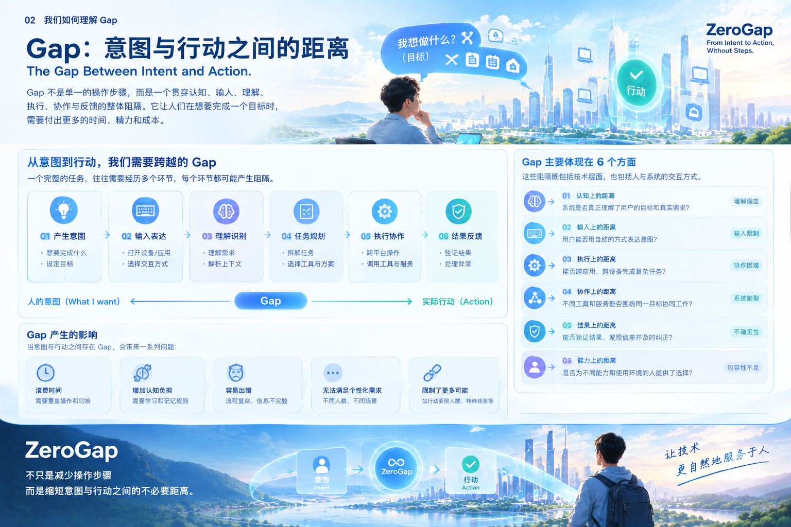

# 02｜我们如何理解 Gap

## 2.1 Gap：意图与行动之间的距离

在 ZeroGap 的理念中，Gap 并不只是操作步骤多，也不单纯等同于用户体验不佳。

我们所说的 Gap，是指一个人从产生意图，到最终实现目标的过程中，需要跨越的各种不必要的认知、表达、执行、协作与反馈阻隔。

一个人可能已经明确知道自己想做什么，但仍然需要理解系统的操作规则、寻找合适的工具、手动传递信息、协调不同应用，并检查最终结果。

这些中间环节并非全部没有价值。有些步骤是完成任务所必需的，有些则来自现有系统的能力限制、交互方式的局限，以及不同工具之间缺乏有效协作。

ZeroGap 关注的是后者。

我们不追求无条件地删除所有步骤，而是希望识别那些可以被更自然的交互、更智能的执行和更可靠的系统协作所减少的成本。

**Gap 的核心，不是人需要做多少次操作，而是为了实现一个目标，人不得不承担多少本可以避免的中间工作。**

## 2.2 从意图到行动：Gap 如何产生

一个完整的任务，往往不是一次输入就能直接完成，而是涉及多个相互关联的环节。

例如，一个人希望安排一次旅行。这个目标可能需要查询目的地、比较交通方式、确认日期、规划行程、预订服务，并检查相关信息是否正确。

从人的目标到最终结果，可以抽象为以下过程：

**产生意图 → 输入表达 → 理解识别 → 任务规划 → 执行协作 → 结果反馈**

每个环节都可能产生 Gap。

### 产生意图：人知道自己想要什么

用户需要明确目标，或者在信息不充分时逐步澄清需求。

如果系统不能帮助用户整理模糊需求，用户就必须花费额外精力，把自己的想法转化为系统能够处理的明确要求。

### 输入表达：人需要把意图传递给系统

用户通过键盘、鼠标、触摸屏、语音或其他交互方式表达需求。

当某种输入方式不适合当前环境，或者用户难以使用系统要求的输入方式时，表达本身就会成为障碍。

### 理解识别：系统需要理解真正的目标

系统需要识别用户的目标、上下文、约束和预期结果。

如果系统只理解了字面指令，却忽略了重要条件，就可能产生错误理解，要求用户反复解释或纠正。

### 任务规划：系统需要确定如何完成目标

复杂目标通常需要被拆分为多个子任务，并选择合适的工具、服务和执行顺序。

如果系统无法完成这一步，用户就必须亲自规划流程，将一个完整目标拆解为许多独立操作。

### 执行协作：不同能力需要围绕同一个目标工作

执行任务可能涉及多个应用、设备、数据源或外部服务。

如果这些能力彼此割裂，用户就需要手动切换系统、复制信息、协调步骤，并处理不同工具之间的衔接问题。

### 结果反馈：行动完成后还需要确认结果

发出指令不代表任务已经完成。

系统需要判断执行是否成功、结果是否符合预期，以及是否存在需要处理的异常。如果缺乏验证和反馈，用户仍然需要自行检查，甚至重复执行任务。

因此，Gap 不是只存在于某一个按钮或界面中，而可能贯穿整个任务过程。

## 2.3 Gap 的六个主要维度

为了更系统地理解这些阻隔，ZeroGap 将 Gap 划分为六个相互关联的维度。

### 01｜认知 Gap：理解目标与理解系统之间的距离

认知 Gap 指的是，用户想实现一个目标，却需要额外理解系统的功能、规则、操作逻辑或任务流程。

例如，用户只想完成一份项目报告，却需要先理解多个工具的使用方式，再决定如何组合它们。

这种情况下，用户的精力不仅用于实现目标，还被消耗在理解工具和管理流程上。

ZeroGap 的探索方向，是让系统更多地围绕用户的目标组织能力，减少用户为了使用技术而必须掌握的额外知识。

### 02｜输入 Gap：表达意图与系统接收意图之间的距离

输入 Gap 指的是，用户拥有明确的意图，却难以通过当前系统要求的方式准确、方便地表达出来。

键盘、鼠标、触摸屏和语音各有适用范围，也各有局限。

例如，在某些环境下语音输入不方便；对于一些行动能力受限的人，精确操作鼠标或持续输入文字可能存在额外困难。

ZeroGap 希望探索更多可选择的交互方式，让输入方式尽可能适应人的能力、环境与需求，而不是要求所有人适应同一种交互模式。

脑机接口是这一方向的长期探索之一，但其具体适用范围和可实现能力，需要通过真实实验和持续验证来确定。

### 03｜执行 Gap：表达目标与实际完成任务之间的距离

执行 Gap 指的是，用户已经表达了目标，但系统无法独立完成所需操作，或者只能完成任务中的部分环节。

例如，AI 能够生成一份行程建议，却不能在获得授权后继续完成相关信息整理、服务调用和结果核验。

此时，用户仍然需要手动完成大量后续工作。

ZeroGap 希望探索从目标理解到任务执行的完整链路，让系统不仅能够提供信息和建议，也能够在权限范围内执行任务，并对执行结果负责地进行验证和反馈。

### 04｜协作 Gap：不同工具与服务之间的距离

协作 Gap 指的是，不同应用、设备和服务虽然各自具备一定能力，却难以围绕同一个目标有效协作。

用户可能需要在多个应用之间切换，重复输入相同信息，手动传递数据，并协调各个环节的执行顺序。

这些成本并不一定来自单个工具的缺陷，而可能来自整个工作流程缺少统一的目标和协调机制。

跨平台 AI Agent 是 ZeroGap 当前重点探索的方向之一：让系统根据用户目标组织不同工具的能力，在适当授权下完成跨应用任务，并验证最终结果。

### 05｜结果 Gap：系统声称完成与目标真正实现之间的距离

结果 Gap 指的是，系统执行了某个操作，但用户仍然无法确定目标是否真正实现。

例如，系统发出了保存文件的指令，却没有确认文件是否成功保存；或者系统提交了请求，却没有检查服务是否实际完成处理。

这类问题会降低信任，也可能导致重复操作、遗漏和错误累积。

ZeroGap 因此将结果验证、异常识别、状态反馈和必要的纠正视为完整执行过程的重要组成部分。

我们关注的不只是系统做了什么，还包括结果是否符合目标，以及用户能否理解和确认执行状态。

### 06｜能力与可及性 Gap：人的实际能力与交互要求之间的距离

能力与可及性 Gap 指的是，系统提供的交互方式和操作要求，可能无法充分适应不同人的身体条件、认知特点、使用环境或辅助需求。

这不仅涉及残障人士，也涉及临时行动受限、处于特殊环境，或者无法方便地使用某种输入设备的人。

ZeroGap 希望探索更具包容性的交互方式，为不同使用者提供合理的选择。

这里的目标不是假设一种新技术能够解决所有人的问题，而是通过多种输入方式、可调整的交互设计和辅助能力，逐步降低技术使用的门槛。

## 2.4 六种 Gap 并不是彼此独立的

在真实任务中，这六种 Gap 往往会同时出现，并且相互放大。

例如，当用户希望完成一次跨应用的预约任务时：

- 用户需要理解不同服务的规则，产生认知 Gap。
- 用户需要通过适合的方式表达需求，产生输入 Gap。
- 系统可能只能提供建议，产生执行 Gap。
- 不同服务之间无法有效衔接，产生协作 Gap。
- 操作完成后缺少确认，产生结果 Gap。
- 如果用户无法方便地使用现有输入方式，还可能产生能力与可及性 Gap。

这些阻隔并非简单相加。

理解错误可能导致规划错误；规划错误可能导致执行失败；缺乏结果验证又可能让错误一直延续。

反过来，即使输入方式足够自然，如果系统无法理解目标或可靠地完成任务，整体体验仍然无法真正改善。

因此，ZeroGap 需要关注的是一个完整的系统，而不是孤立地优化某个交互环节。

## 2.5 Gap 带来的不只是时间成本

当意图与行动之间存在过多不必要的距离时，产生的影响也不仅仅是多花几分钟。

**时间成本**

用户需要完成额外的点击、切换、重复输入和检查，降低了完成任务的效率。

**认知成本**

用户需要记住操作规则、管理多个流程，并持续判断下一步应该做什么。

**错误与不确定性**

信息在不同系统之间传递时，可能出现遗漏、误解、重复操作或状态不一致。

**协作成本**

用户需要亲自承担工具之间的衔接工作，难以把精力集中在真正重要的目标上。

**机会成本**

当完成任务需要付出过高的操作成本时，一些本来可以实现的事情可能被放弃。

**可及性成本**

如果某种交互方式成为使用技术的必要条件，一部分人就可能难以平等地使用相关能力。

这些影响共同说明：Gap 不只是界面设计问题，也涉及系统能力如何组织、任务如何执行，以及技术是否能够适应不同人的实际需求。

## 2.6 ZeroGap 如何看待 Gap

ZeroGap 不认为所有 Gap 都能够立即消除，也不认为技术应该替代人的全部判断。

有些距离来自当前技术能力的限制，有些来自系统之间缺乏协作，还有些属于必要的安全和责任边界。

例如，付款、删除重要数据或执行高风险操作时，必要的确认并不是需要消除的阻隔，而是保护用户自主权和利益的重要机制。

因此，我们需要区分两类距离：

**不必要的距离：** 由于工具割裂、重复操作、交互限制或执行能力不足而产生，可以通过更好的产品和技术逐步减少的成本。

**必要的边界：** 为了确保安全、隐私、知情同意和人的自主控制而必须保留的约束。

ZeroGap 追求的不是让系统不受限制地执行一切指令，而是在明确的权限、责任与安全边界内，让用户更自然地实现自己的目标。

这也决定了 ZeroGap 的技术探索需要同时关注输入方式、智能理解、任务执行、结果验证和人的控制权。

## 2.7 从理解 Gap 到设计 ZeroGap

当我们将 Gap 视为贯穿意图到行动全过程的阻隔时，产品设计的出发点也会随之改变。

我们不再只问：

- 如何减少一个页面中的点击次数？
- 如何让某个功能更快？
- 如何让模型生成更好的回答？

我们还会进一步问：

- 用户真正想完成的目标是什么？
- 哪些中间工作是实现目标所必需的，哪些可以被减少？
- 用户能否通过适合自己的方式表达意图？
- 系统能否组织不同工具的能力，完成完整任务？
- 如何验证结果，并在出现偏差时进行反馈和纠正？
- 哪些操作必须由用户确认，才能保障其自主权和安全？

这些问题将成为 ZeroGap 理解需求、设计产品和评估技术方案的重要依据。

在当前阶段，我们将从跨平台 AI Agent 入手，验证如何降低认知、执行与协作方面的成本；同时持续探索脑机接口等新型交互方式，为特定场景下的意图输入提供更多可能。

两条路径面对的问题侧重点不同，但都服务于同一个方向：

**让人的意图更自然地连接到实际行动，减少不必要的距离，同时保留必要的安全边界与人的自主控制权。**

---

### 本部分总结

Gap 是人的意图与实际行动之间，贯穿认知、输入、执行、协作、结果反馈和可及性等环节的阻隔。

ZeroGap 的目标不是机械地删除操作步骤，而是识别并减少其中不必要的成本，让系统围绕人的目标组织能力，以更自然、可靠、包容和可控的方式协助人完成任务。

*ZeroGap — From Intent to Action, Without Steps.*