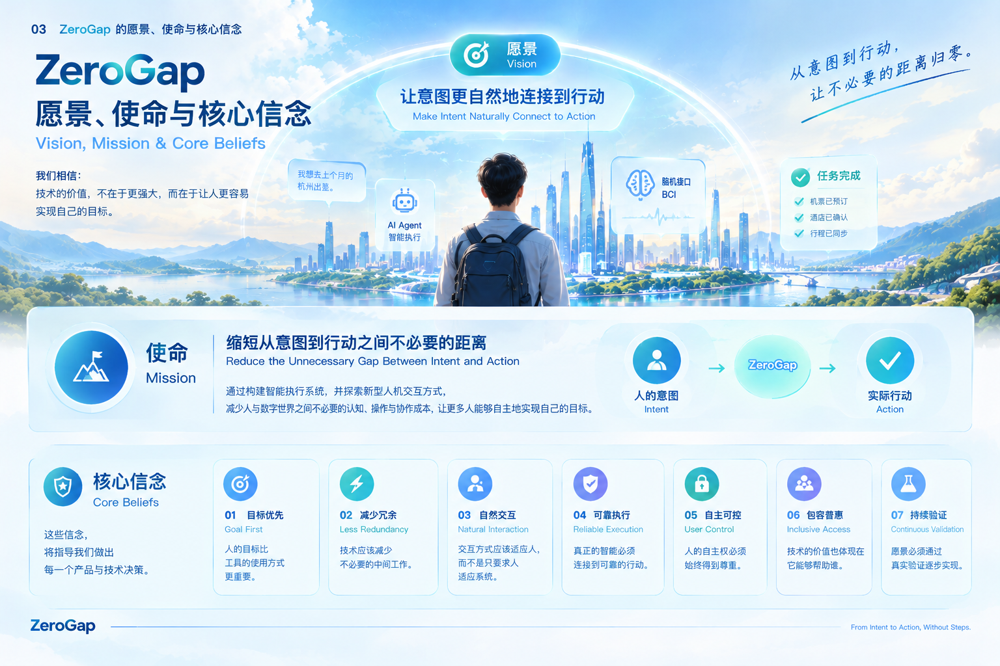

# 03｜ZeroGap 的愿景、使命与核心信念

## 3.1 我们的愿景：让意图更自然地转化为行动

我们希望创造一个人与数字世界能够更加自然地连接的未来。

在这个未来中，人不必为了完成一个明确的目标，始终亲自操作每一个界面、理解每一种工具的规则，或在彼此割裂的系统之间反复协调。

人可以通过适合自己的方式表达意图，系统能够在理解目标与约束的基础上，组织不同工具和设备的能力，协助完成任务，并将真实的执行结果反馈给人。

技术不再只是等待人逐步操作的功能集合，而能够成为连接人的意图与实际行动的桥梁。

对于一些传统输入方式不够方便的人，我们也希望探索更多表达意图的可能性，让不同身体条件、能力和使用环境下的人，都有机会以更适合自己的方式参与数字生活。

这并不意味着所有任务都应该自动完成，也不意味着所有技术边界都将消失。

我们真正希望实现的是：在安全、可靠并尊重人的自主权的前提下，让人与技术之间不必要的阻隔越来越少。

**ZeroGap 的愿景，是让人的意图更自然地连接到行动，让技术以更少的不必要阻隔服务于人。**

## 3.2 我们的使命：缩短从意图到行动之间不必要的距离

愿景描述我们希望走向的未来，使命则决定我们现在应该做什么。

ZeroGap 的使命是：

**通过构建智能执行系统，并探索新型人机交互方式，减少人与数字世界之间不必要的认知、操作与协作成本，让更多人能够自主地实现自己的目标。**

这一使命包含三个相互关联的方向。

### 方向一：让系统围绕目标组织能力

今天，许多数字工具按照应用、功能和操作流程组织自身能力。用户要完成一个目标，往往需要自行理解这些工具，并把它们串联起来。

ZeroGap 希望探索以用户目标为中心的智能执行系统。

系统不仅理解用户希望完成什么，还能够在明确的权限和约束下，拆解任务、选择工具、协调执行、验证结果，并在必要时向用户请求澄清或确认。

当前，跨平台 AI Agent 是这一方向的重要实践路径。

我们希望逐步验证：能否让用户从亲自协调每个操作环节，转向以目标表达、关键决策和结果确认的方式与系统协作。

### 方向二：探索更加自然的意图输入方式

人的意图可以通过文字、语音、触摸、动作以及其他交互方式表达。

不同的输入方式适用于不同的人和环境，但没有一种方式能够在所有场景中满足所有人的需求。

ZeroGap 希望持续探索新的意图输入通道，使人能够根据自己的能力、环境和任务选择合适的交互方式。

脑机接口（Brain-Computer Interface，BCI）是这一方向的长期探索之一。

我们关注的是：在特定条件和经过验证的任务范围内，能否通过神经信号识别有限的、明确的意图，并将其连接到后续的数字操作或辅助系统。

这是一条需要长期研究和验证的技术路径，而不是当前已经实现的通用能力。

### 方向三：让更多人拥有实现目标的机会

ZeroGap 不仅关注如何让熟练使用数字设备的人提高效率，也关注现有交互方式是否会成为部分人实现目标的障碍。

对于一些行动能力受限的人来说，传统输入设备可能带来额外困难。新的交互方式、辅助技术与智能执行系统的结合，有机会帮助他们更方便地表达需求、控制设备或完成特定任务。

我们希望探索这些可能性，同时尊重每个人的实际需求、选择和自主权。

我们的目标不是承诺一种技术可以解决所有问题，而是持续验证哪些能力能够在真实场景中产生有意义的帮助。

## 3.3 我们的核心信念

愿景决定方向，使命决定行动，而核心信念决定我们如何做出选择。

无论未来 ZeroGap 开发什么产品、采用什么技术，以下信念都应该保持一致。

### 信念一：人的目标比工具的使用方式更重要

人使用技术，是为了完成某件事情，而不是为了使用技术本身。

我们相信，产品应该尽可能围绕人的目标组织能力，而不是要求用户先理解所有工具，再自行组合完成任务。

这意味着，我们评估产品时，不应只看它提供了多少功能，也应该看用户能否以更低的认知和操作成本，实现真正想要的结果。

### 信念二：技术应该减少不必要的中间工作

很多任务需要用户亲自完成大量协调工作，并不是因为这些工作本身具有独立价值，而是因为现有工具缺少有效的连接和执行能力。

我们相信，技术可以承担其中一部分重复性、流程性和协调性工作，让人把更多精力放在目标、判断、创造和决策上。

但减少中间工作，不等于取消必要步骤。

如果某个环节涉及风险、授权或重要决策，它就可能具有不可替代的价值。

### 信念三：自然的交互应该适应人，而不是只要求人适应系统

人的身体条件、认知特点、生活环境和使用习惯存在差异。

我们相信，未来的人机交互不应该只有一种固定入口，也不应该把某种设备的操作能力作为使用数字技术的唯一前提。

更自然的交互意味着提供更多合理的选择，让不同的人能够通过适合自己的方式表达意图。

这也是 ZeroGap 关注脑机接口及其他新型交互方式的重要原因。

### 信念四：真正的智能必须连接到可靠的行动

理解一条指令、生成一段内容或提出一个建议，并不等于完成了用户的任务。

我们相信，面向任务的智能系统需要关注从意图理解到结果验证的完整过程。

系统不仅应该尝试执行，还应该尽可能确认执行状态，识别失败和偏差，并在适当情况下进行纠正或请求用户介入。

对于不能确认的结果，系统应该明确说明不确定性，而不是把“已经尝试”描述为“已经完成”。

### 信念五：人的自主权必须始终得到尊重

技术能力越强，越需要明确人与系统之间的责任和控制边界。

我们相信，智能系统应该在用户授权的范围内行动，并让用户理解关键操作、必要风险和执行结果。

对于高风险、不可逆或涉及重要利益的操作，系统应根据风险设置适当的确认机制。

人应该能够在必要时暂停、取消或调整系统行为，而不是被迫接受系统已经做出的决定。

### 信念六：技术的价值也体现在它能够帮助谁

技术进步不应只体现在速度更快、功能更多或自动化程度更高。

我们相信，还应该关注技术是否降低了原本难以使用数字工具的人所面临的门槛，是否提供了更多表达、参与和完成任务的可能性。

包容性不是某个特定产品的附加功能，而应该成为 ZeroGap 长期审视产品价值的一个维度。

### 信念七：愿景必须通过真实验证逐步实现

ZeroGap 面向未来，但不应该把未来的设想当作当前已经具备的能力。

AI Agent 的执行可靠性、跨平台协作能力、脑机接口的信号识别能力，以及这些技术在辅助场景中的实际效果，都需要通过原型、实验和真实使用持续验证。

我们相信，清晰的技术边界、诚实的能力表达和可验证的进展，比夸大技术能力更有价值。

只有把愿景转化为一个个可以验证的问题，ZeroGap 才能从理念逐步走向真实产品。

## 3.4 ZeroGap 的 Slogan：From Intent to Action, Without Steps.

**From Intent to Action, Without Steps.**

**从意图到行动，让不必要的距离归零。**

这句 Slogan 表达了 ZeroGap 最核心的产品方向。

- **Intent（意图）：** 人希望实现的目标、表达的需求或希望发生的改变。
- **Action（行动）：** 系统在明确的授权和约束下，协助完成的实际操作与任务。
- **Without Steps（无需多余步骤）：** 减少为了连接意图与行动而不得不承担的重复操作、系统切换和不必要的协调成本。

其中，“Without Steps”不是字面意义上的零操作，也不是承诺所有任务都能一步完成。

它强调的是：当某些中间环节可以由更好的交互设计、更智能的任务执行或更有效的系统协作承担时，人就不必再为这些环节付出同样的成本。

必要的确认、安全检查和人的自主决策仍然应该存在。

ZeroGap 追求的不是无条件的自动化，而是更自然、更可靠、更可控的目标实现方式。

## 3.5 愿景、使命、信念与技术路线之间的关系

为了让 ZeroGap 在长期发展中保持方向一致，我们需要区分几个不同层次的概念。

| 层次 | ZeroGap 的定义 | 作用 |
|---|---|---|
| 愿景 Vision | 让人的意图更自然地连接到行动 | 定义长期希望创造的未来 |
| 使命 Mission | 通过智能执行系统和新型交互，减少不必要的距离 | 定义持续投入的方向 |
| 核心信念 Beliefs | 以人的目标为中心，尊重自主权，重视可靠性与包容性 | 指导产品与技术决策 |
| 技术路径 Technology Paths | 跨平台 AI Agent、脑机接口及其他适用的交互方式 | 探索实现使命的可行方法 |
| 产品实践 Product Practice | 通过原型、场景验证、用户反馈和持续迭代检验价值 | 将理念转化为真实能力 |

这一区分非常重要。

ZeroGap 不应将自己局限于某一种技术，也不应因为某条技术路线暂时遇到困难，就失去对核心问题的关注。

如果未来出现更适合的交互方式或执行技术，我们可以调整技术路径，但仍然依据同一套核心信念判断它是否符合 ZeroGap 的方向。

## 3.6 从理念走向行动

愿景只有进入产品设计和实际验证，才能逐步产生价值。

在当前阶段，ZeroGap 将优先探索跨平台 AI Agent，验证系统能否围绕用户目标完成任务规划、工具协作、结果验证和反馈。

与此同时，我们将把脑机接口作为长期探索方向，逐步研究神经信号采集、有限意图识别，以及与数字系统连接的可行性。

在产品实践中，我们将持续追问：

- 用户真正想实现的目标是什么？
- 当前流程中有哪些不必要的认知、操作和协作成本？
- 系统是否真正完成了任务，还是仅仅给出了答案？
- 执行结果是否能够被验证？
- 用户是否始终了解并控制关键操作？
- 这种产品是否为不同使用者提供了实际价值？

这些问题既是理念的延伸，也是判断产品是否符合 ZeroGap 方向的重要依据。

我们不会假设所有问题都能被一次解决，也不会把尚未验证的能力当作既定事实。

我们希望通过持续探索，让 ZeroGap 的核心理念逐步变成能够被使用、被验证并持续改进的真实能力。

---

### 本部分总结

ZeroGap 的愿景，是让人的意图更自然地连接到行动。

ZeroGap 的使命，是通过智能执行系统与新型人机交互，减少人与数字世界之间不必要的认知、操作与协作成本。

ZeroGap 的核心信念，是始终以人的目标为中心，尊重人的自主权，重视真实执行结果，并持续探索更自然、更可靠、更具包容性的技术可能。

技术可以演进，产品可以变化，但这些信念将成为 ZeroGap 长期发展的方向依据。

*ZeroGap — From Intent to Action, Without Steps.*