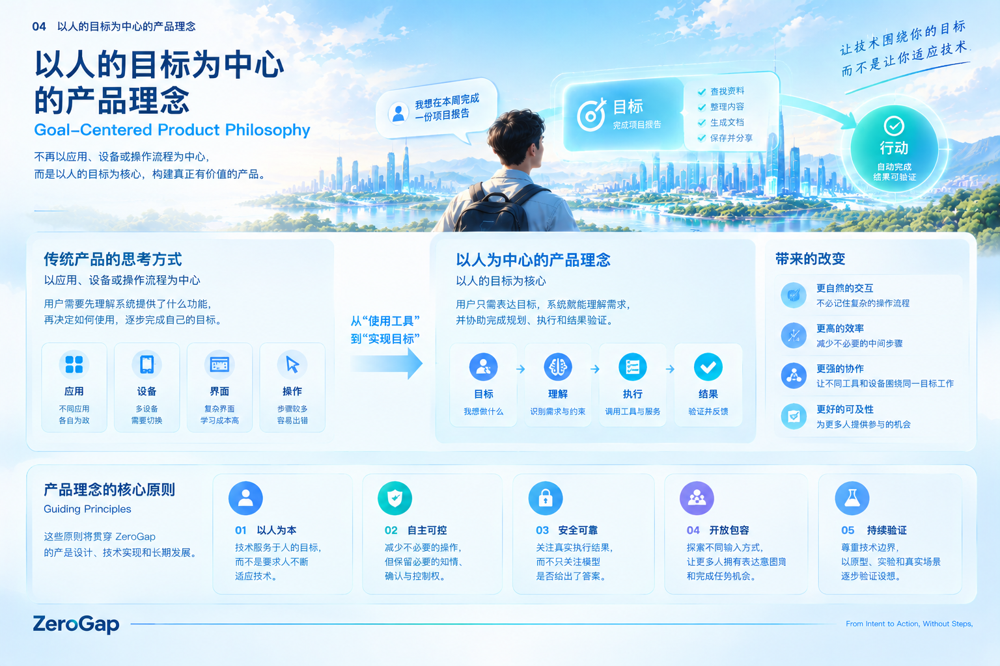

# 04｜以人的目标为中心的产品理念

## 4.1 从人的目标出发，而不是从工具出发

传统软件通常围绕功能、页面和操作流程组织产品能力。

用户想完成一件事，需要先找到对应的应用，再理解它提供的功能，按照系统规定的流程进行操作。如果任务涉及多个应用，用户还需要自行协调它们之间的关系。

这种方式在很多场景中是有效的，但也让用户承担了大量中间工作。

ZeroGap 希望采用不同的思考方式。

我们首先关注的不是系统有什么功能，而是：

**用户真正想完成什么？为了实现这个目标，系统需要提供哪些能力？**

例如，当用户说“帮我准备明天的项目会议”时，他表达的是一个目标，而不是一串具体操作。

围绕这个目标，系统可能需要整理项目资料、提取关键进展、生成会议议程、创建文档，并在获得授权后通知相关人员。

用户不应该必须先了解每个工具的功能，再亲自规划所有步骤，才能把这些能力组合起来。

ZeroGap 希望系统能够从目标出发，识别所需能力，并在明确的权限和约束下组织执行。

这并不意味着应用和工具不再重要。相反，它们仍然是完成任务的基础，只是用户不必始终亲自承担连接所有工具的工作。

## 4.2 从“操作功能”转向“完成目标”

功能是系统提供的能力，目标则是用户希望实现的结果。

两者之间存在区别。

一个日历应用可以提供创建日程的功能，但用户真正想做的可能是安排一次会议，并确保相关人员收到通知。

一个文档应用可以提供编辑和导出功能，但用户真正想做的可能是完成一份能够交付的报告。

一个医疗服务平台可以提供预约入口，但用户真正想做的可能是找到合适的服务、完成预约，并确认预约信息。

如果产品只围绕单一功能设计，用户就需要自行连接不同功能，形成完整的工作流程。

如果产品从目标出发，就可以进一步思考：完成这个目标需要哪些步骤？哪些工作可以由系统承担？哪些决策仍然需要用户参与？

ZeroGap 关注的不是单纯增加功能数量，而是让已有能力能够围绕用户目标发挥作用。

因此，我们希望产品的评价标准逐步从“提供了什么功能”，扩展到：

- 用户能否更容易地表达目标？
- 系统是否理解了目标及其约束？
- 用户需要亲自完成多少中间操作？
- 相关工具能否有效协作？
- 最终结果是否真正满足用户的需求？

**功能是实现目标的手段，目标才是组织产品能力的出发点。**

## 4.3 用户表达目标，系统负责组织执行

在以目标为中心的产品中，用户与系统的分工可以发生变化。

用户主要负责表达希望实现的目标、提供必要的背景信息、设定约束，并对重要决策进行判断。

系统则尝试承担目标理解、任务拆解、工具选择、流程协调、执行状态跟踪和结果验证等工作。

这是一种分工方向，而不是要求系统在所有情况下独立完成全部任务。

对于简单、低风险且已经获得授权的任务，系统可以尝试自动执行。

对于需求模糊的任务，系统应该先询问必要的问题。

对于涉及付款、删除数据、对外发送重要信息等具有较高影响的操作，系统应该根据风险要求用户确认。

对于当前能力无法可靠完成的任务，系统应该说明限制，而不是假装已经成功。

因此，ZeroGap 所追求的并不是让人完全退出任务过程，而是让人把精力更多地放在目标、判断和关键决策上，而不是重复操作和机械协调上。

## 4.4 以目标为中心，需要理解上下文与约束

一个目标通常不会完整地包含在一句话中。

用户表达需求时，可能依赖当前任务背景、已经提供的资料、个人偏好、时间限制、权限范围以及其他条件。

例如，“帮我安排会议”可能涉及：

- 会议的目的与参与人员。
- 可用时间和时区。
- 会议时长与地点。
- 需要参考的项目资料。
- 是否允许系统发送邀请。
- 哪些信息可以分享给其他人。

如果系统只识别“安排会议”这一表面指令，而忽略相关条件，就可能执行出形式上正确、实际上不符合用户意图的操作。

因此，以目标为中心的产品不能只关注自然语言理解，还需要关注上下文管理、约束识别、必要的澄清以及权限判断。

当信息不足时，系统应该区分哪些条件可以合理推断，哪些条件必须询问用户。

**理解目标，不只是理解用户说了什么，还包括判断完成目标需要满足哪些条件。**

## 4.5 从单一工具走向跨工具协作

许多真实目标都需要多个工具共同参与。

例如，完成一份项目汇报可能涉及资料检索、数据整理、文档生成、文件存储和信息分享。

如果这些工具彼此割裂，用户就需要手动在它们之间传递信息，并承担流程衔接的成本。

ZeroGap 希望通过跨平台 AI Agent 等技术方向，探索一种以目标为中心的协作方式。

在这种方式下，系统可以根据任务需要选择合适的工具，按照依赖关系安排执行顺序，并持续跟踪各个环节的状态。

但跨工具协作并不意味着系统可以无条件访问所有应用或数据。

每个工具都应该具有明确的能力范围和权限边界。系统只能调用已经授权、当前可用且适合该任务的能力；当权限不足、执行失败或结果存在不确定性时，应及时向用户反馈。

ZeroGap 的目标不是建立一个不受限制的自动化系统，而是让不同工具能够在可控条件下，围绕人的目标协同工作。

## 4.6 完成任务，比发出指令更重要

以目标为中心，意味着不能把“发出了指令”当作“实现了目标”。

一个系统可能成功调用工具，却没有获得预期结果；可能生成了文件，却保存到了错误的位置；也可能提交了请求，却没有确认外部服务是否实际完成处理。

如果产品只展示执行过程，却无法判断最终结果是否符合用户需求，用户仍然需要自己检查所有环节。

因此，ZeroGap 将结果验证视为目标执行的重要组成部分。

一个完整的任务过程至少需要关注：

1. **目标理解：** 明确用户希望实现的结果及其约束。
2. **任务规划：** 确定必要步骤、依赖关系和所需能力。
3. **执行过程：** 在授权范围内调用合适的工具与服务。
4. **结果验证：** 检查操作状态及最终结果是否符合预期。
5. **反馈与纠正：** 向用户说明结果，在允许的范围内处理失败或偏差。

并非所有任务都能被完全验证。对于缺少可靠反馈的外部系统，产品应该明确说明验证范围与不确定性。

真正以目标为中心的产品，关注的不只是系统执行了什么，而是用户希望实现的结果究竟实现到了什么程度。

## 4.7 让不同的人拥有适合自己的交互方式

如果产品真正以人的目标为中心，就不能假设所有人都能通过相同的方式表达意图。

文字输入适合一些场景，语音适合另一些场景，触摸、动作以及其他交互方式也各有适用范围。

对于某些行动能力受限的人，传统输入方式可能带来更高的使用成本。对于特定任务和经过验证的使用环境，辅助设备或新型交互技术也许能够提供其他选择。

ZeroGap 因此将交互方式视为可以持续探索和改进的部分，而不是把某种输入设备当作所有产品的固定前提。

跨平台 AI Agent 与脑机接口在这里承担不同角色：

- **跨平台 AI Agent** 主要探索如何理解目标、组织工具并执行任务。
- **脑机接口（BCI）** 主要探索能否在特定条件下，为部分用户提供新的意图输入通道。

两者未来可能形成协作，但它们并不是同一种技术，也不需要同时成熟才能分别产生价值。

尤其对于脑机接口，我们必须尊重现有技术能力与实验条件，不将有限的信号识别能力夸大为通用的意图读取能力。

以人为中心，意味着为不同的人提供更多合理的选择，而不是要求所有人采用同一种技术。

## 4.8 人仍然是目标与决策的主体

当系统拥有更强的规划和执行能力时，以人的目标为中心就不仅是一个效率问题，也涉及人的自主权。

系统可以帮助用户完成任务，但不应因此默认自己有权决定用户真正应该追求什么。

当用户的意图不明确时，系统应适当澄清；当操作可能带来重大影响时，应提供必要的说明与确认；当系统无法可靠判断结果时，应如实告知。

产品还应该尽可能让用户了解任务进展、关键操作和最终结果，并在适当情况下提供暂停、取消、纠正或撤销的能力。

这些机制会根据任务风险和系统能力有所不同，但其基本方向一致：

**减少用户不必要的操作，不等于减少用户对自身目标的控制权。**

ZeroGap 希望通过技术承担更多重复性工作，同时让人保留对目标、授权和关键决策的主导地位。

## 4.9 将产品理念转化为设计问题

以人的目标为中心，不能只停留在产品口号上。它应该能够指导具体的产品决策。

在设计每一项能力时，我们都可以从以下问题出发：

| 设计维度 | 需要回答的问题 |
|---|---|
| 目标 | 用户真正希望实现什么结果？ |
| 输入 | 用户能否通过适合自己的方式表达意图？ |
| 理解 | 系统是否理解必要的上下文与约束？ |
| 执行 | 哪些工作可以由系统可靠地承担？ |
| 协作 | 是否需要多个工具或服务共同完成任务？ |
| 验证 | 如何判断任务是否真正完成？ |
| 控制 | 哪些操作需要用户确认、暂停或取消？ |
| 体验 | 与现有方式相比，实际减少了哪些不必要的成本？ |
| 包容性 | 这种设计是否适合不同能力与使用环境的人？ |

这些问题既能帮助我们判断一个功能是否值得开发，也能帮助我们比较不同技术方案。

例如，一项新技术即使具有较强的技术吸引力，如果不能解决明确的用户问题，或者增加了更高的使用成本，就不应仅仅因为技术新颖而成为产品的优先方向。

相反，一个范围有限、能够稳定解决真实问题的能力，也可能是 ZeroGap 迈向长期愿景的重要一步。

## 4.10 本章总结

以人的目标为中心，是 ZeroGap 组织产品能力的基本理念。

我们希望从用户希望实现的结果出发，理解必要的上下文和约束，协调适当的工具与服务，验证实际执行结果，并在整个过程中尊重人的自主权。

跨平台 AI Agent 为我们提供了探索目标驱动执行的现实起点；脑机接口及其他新型交互方式，则可能在未来拓展意图表达的选择。

无论技术如何变化，判断产品价值的核心问题始终是：

**它是否帮助人以更自然、更可靠、更可控的方式实现自己的目标，并减少了原本不必要的距离？**

*ZeroGap — From Intent to Action, Without Steps.*