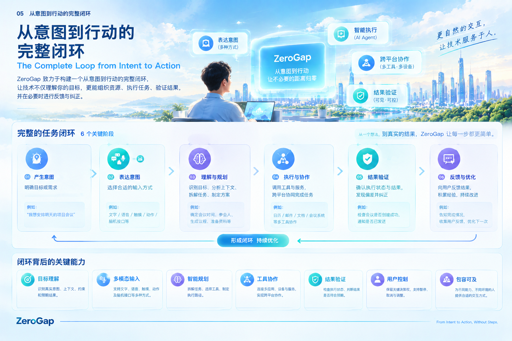

# 05｜从意图到行动的完整闭环

## 5.1 从理解意图，到实现目标

传统的人机交互，通常从用户操作开始：打开应用、寻找功能、填写信息、执行命令，最后由用户判断结果是否符合预期。

ZeroGap 希望探索另一种方式。

用户首先表达自己想要实现的目标，系统负责理解目标、组织任务、协调资源、执行操作，并确认最终结果是否符合预期。

这并不意味着用户不再需要操作，而是让用户不必始终亲自承担每一个中间步骤。

例如，用户说：

> 帮我安排明天下午的项目会议，确认参与人员的时间，预订会议室，并把会议邀请发给大家。

传统方式下，用户可能需要分别打开日历、查看人员安排、查询会议室、创建会议，再逐一发送邀请。

在 ZeroGap 的产品理念下，系统应当围绕同一个目标组织这些工作，协调不同工具，并在适当的节点向用户确认关键信息。

**交互的重点由“用户如何操作工具”，转向“用户想实现什么，以及系统能否可靠地实现它”。**

## 5.2 完整闭环的六个关键阶段

ZeroGap 将从意图到行动的过程理解为一个持续循环，而不是一次简单的指令响应。

### 第一阶段：产生意图

一切从人的目标开始。

用户可能希望完成一项工作、获取某个信息、解决一个问题，也可能希望通过新的交互方式控制设备。

此时，用户不一定知道应该使用什么工具，也不一定能够准确描述所有执行步骤。

系统首先需要关注的是：用户真正想要什么。

例如：

- 不是“打开日历”，而是“安排一次会议”。
- 不是“搜索几个网页”，而是“比较不同方案并给出建议”。
- 不是“点击某个设备按钮”，而是“让设备完成指定任务”。

意图是任务的起点，而不是预先确定的操作流程。

### 第二阶段：表达意图

系统需要提供适合不同人的表达方式。

这种表达可以来自文字、语音、触摸、图像、动作，也可能来自未来的脑机接口等新型交互渠道。

不同输入方式的共同目标，是帮助系统获取足够的信息，理解用户希望实现的结果。

但表达意图不等于意图已经被准确理解。

用户可能描述得不完整，语义可能存在歧义，系统也可能缺少必要的上下文。因此，系统需要识别不确定性，并在必要时主动询问，而不是把猜测当成事实。

### 第三阶段：理解与规划

获得输入后，系统需要将用户的目标转化为可以执行的任务计划。

这一阶段包括：

1. 识别目标和预期结果。
2. 理解相关上下文、资源与限制条件。
3. 判断哪些信息已经具备，哪些信息仍然缺失。
4. 将复杂目标拆解为可执行的子任务。
5. 确定任务顺序、依赖关系和可使用的工具。
6. 识别风险，并判断哪些操作需要用户确认。

例如，安排会议不仅是创建一条日历记录，还可能涉及参与人员、时间冲突、会议室资源、通知发送和最终确认。

规划的价值，在于把一个自然表达的目标转化为有顺序、有约束、可检查的执行过程。

### 第四阶段：执行与协作

计划形成后，系统需要调用实际能力完成任务。

这些能力可以来自应用程序、API、文件系统、浏览器、操作系统接口、外部服务或物理设备。

当一个目标跨越多个工具时，系统需要协调它们之间的关系，管理执行顺序，并处理执行过程中的失败与异常。

例如：

- 从日历中读取空闲时间。
- 查询可用的会议室。
- 创建会议安排。
- 向相关人员发送邀请。

真正的智能执行，不是简单地连续调用工具，而是让不同能力围绕同一个目标协同工作。

同时，执行权限必须与用户授权相匹配。涉及发送、发布、支付、删除等重要操作时，系统应根据风险和授权要求决定是否需要再次确认。

### 第五阶段：结果验证

**执行了操作，不代表实现了目标。**

这是完整闭环中至关重要的一环。

系统需要检查实际状态和预期结果是否一致，而不能仅凭工具返回成功、页面出现提示，或者模型声称任务完成，就认定目标已经实现。

例如：

- 会议是否真的创建成功？
- 邀请是否发送给了正确的参与人员？
- 预订是否已经确认，而不只是提交了申请？
- 文件是否成功保存到目标位置？
- 设备是否真正执行了指定动作？

验证方式应当根据任务类型选择，包括检查接口返回值、读取实际状态、核对文件内容、确认外部系统记录，或获取设备反馈。

如果无法验证，系统应明确说明当前能够确认的内容与仍然存在的不确定性。

### 第六阶段：反馈与优化

当系统获得执行结果后，需要把结果反馈给用户。

如果目标已经实现，应清楚说明完成了什么，以及哪些关键结果已经得到验证。

如果任务只完成了一部分，系统应说明已完成、未完成和受阻的部分。

如果发现偏差，则应根据情况重新规划、补充信息、修正操作，或者请求用户决策。

由此，系统形成持续循环：

**产生意图 → 表达意图 → 理解与规划 → 执行与协作 → 结果验证 → 反馈与优化 → 必要时重新规划。**

这才是 ZeroGap 所关注的完整任务闭环。

## 5.3 闭环为什么比单次执行更重要

单次执行关注的是：系统有没有完成某个动作。

完整闭环关注的是：用户的目标有没有实现，以及系统能否证明这一点。

两者存在本质区别。

例如，一个 AI Agent 成功点击了“提交”按钮，只能说明它完成了点击操作；如果表单提交失败，用户的目标仍然没有实现。

同样，一个系统可以生成看似合理的答案，却没有核对数据来源；也可以发起一次预约，却没有确认预约是否成立。

因此，ZeroGap 不应只追求更快的响应速度或更多的自动化操作，还需要关注：

- **目标一致性：** 执行结果是否符合用户原本的意图？
- **执行可靠性：** 系统能否稳定完成任务，并妥善处理异常？
- **结果可验证性：** 用户能否知道任务究竟完成到了什么程度？
- **过程可控性：** 用户能否了解、暂停、取消或调整执行过程？
- **失败可恢复性：** 任务失败或部分完成后，系统能否安全地继续处理？

这些能力共同决定了用户是否真正能够信任一个智能执行系统。

## 5.4 人与系统如何共同完成任务

完整闭环并不意味着所有决策都应该交给系统。

更合理的方式，是让人和系统根据各自的能力进行分工。

**人负责目标、价值判断与关键决策；系统负责理解、规划、执行和验证，并在必要时向人请求指导。**

对于风险较低、结果容易验证且已获得授权的操作，系统可以自主完成。

对于存在歧义、影响较大或难以撤销的操作，系统应当在适当节点请求确认。

当系统发现自身能力不足、信息缺失或执行结果无法确定时，也应及时停止、解释原因并寻求帮助，而不是为了完成任务而盲目继续。

因此，闭环中的“反馈”不仅是任务完成后的通知，也是用户重新介入、调整目标和恢复控制权的入口。

ZeroGap 要减少的是不必要的人为负担，而不是消除人的选择权。

## 5.5 Agent 与 BCI 如何参与这一闭环

ZeroGap 的两条探索路径，可以在同一个闭环中承担不同职责。

### 跨平台 Agent：连接意图与执行

Agent 主要解决目标理解、任务规划、工具调用、跨应用协作和结果验证等问题。

它让系统不再局限于单一应用的功能边界，而是尝试围绕用户目标组织多个工具与服务。

因此，Agent 是 ZeroGap 现阶段更具可验证性的产品路径。

### 脑机接口：探索新的意图输入方式

脑机接口（BCI）探索通过神经信号获取特定的意图或控制信息，为人与数字系统的交互提供新的可能。

它有机会减少对手动操作、语音或其他传统输入方式的依赖，但其能力受到信号质量、解码准确率、设备形态、使用环境和具体应用场景等因素的限制。

BCI 并不直接等于完整的智能执行能力。即使系统能够识别某种意图，仍然需要理解目标、组织任务、执行操作并验证结果。

因此，Agent 与 BCI 并不是互相替代的关系：

- Agent 更侧重于如何理解目标并完成任务。
- BCI 更侧重于探索如何获取人的意图与控制信号。
- 完整闭环负责将输入、智能处理、实际行动与结果反馈连接起来。

二者未来可以结合，但这种结合需要建立在真实的技术能力、可验证的使用价值和充分的安全保障之上。

## 5.6 从技术闭环到产品体验

对于用户来说，完整闭环不应该表现为一连串复杂的技术步骤，而应该体现为一种清晰、可信、可控的体验。

用户需要知道：

1. 系统是否理解了自己的目标。
2. 系统准备采取什么行动。
3. 哪些操作已经执行，哪些仍在进行。
4. 最终结果是否得到确认。
5. 如果出现问题，应该如何调整或继续。

这意味着 ZeroGap 的产品设计不能只关注模型能力，还必须同时考虑交互设计、工具集成、权限管理、异常处理、状态反馈和结果验证。

技术能力决定系统能够做什么，产品设计则决定用户能否安全、顺畅地使用这些能力。

## 5.7 如何衡量闭环是否有效

ZeroGap 可以从以下维度评估产品的实际效果：

| 评估维度 | 需要回答的问题 |
|---|---|
| 目标理解 | 系统是否准确理解了用户的目标与约束？ |
| 任务完成率 | 用户目标最终实现的比例是多少？ |
| 端到端耗时 | 从表达意图到获得有效结果需要多久？ |
| 人工介入成本 | 用户需要补充多少信息、进行多少次操作或确认？ |
| 验证覆盖率 | 已完成任务中，有多少经过实际状态验证？ |
| 失败恢复能力 | 出现异常后，系统能否安全地恢复或继续？ |
| 用户可控性 | 用户是否能够理解、暂停、取消和调整任务？ |
| 使用可及性 | 不同能力和使用习惯的人是否都能有效使用系统？ |

这些指标应当结合具体任务设定基线，并通过真实使用场景进行验证。不能仅以操作次数减少或执行速度提升，就判断用户的目标一定更容易实现。

## 5.8 本章总结

ZeroGap 的核心产品逻辑，不是让系统执行更多操作，而是建立一个从人的意图出发、以真实结果为目标、以验证和反馈为保障的完整闭环。

在这个闭环中：

- 人提出目标，并保留最终的控制权。
- 系统理解意图，将目标转化为执行计划。
- Agent 协调工具与服务，完成具体任务。
- 验证机制检查实际结果，而不是只报告操作状态。
- 反馈机制帮助用户了解进展，并在必要时调整或纠正。
- BCI 等新型交互技术可以探索更自然的意图输入方式。

**从意图到行动，不只是让指令更快抵达系统，而是让人的目标更可靠地转化为真实结果。**

这就是 ZeroGap 希望逐步建立的完整闭环。

*ZeroGap — From Intent to Action, Without Steps.*