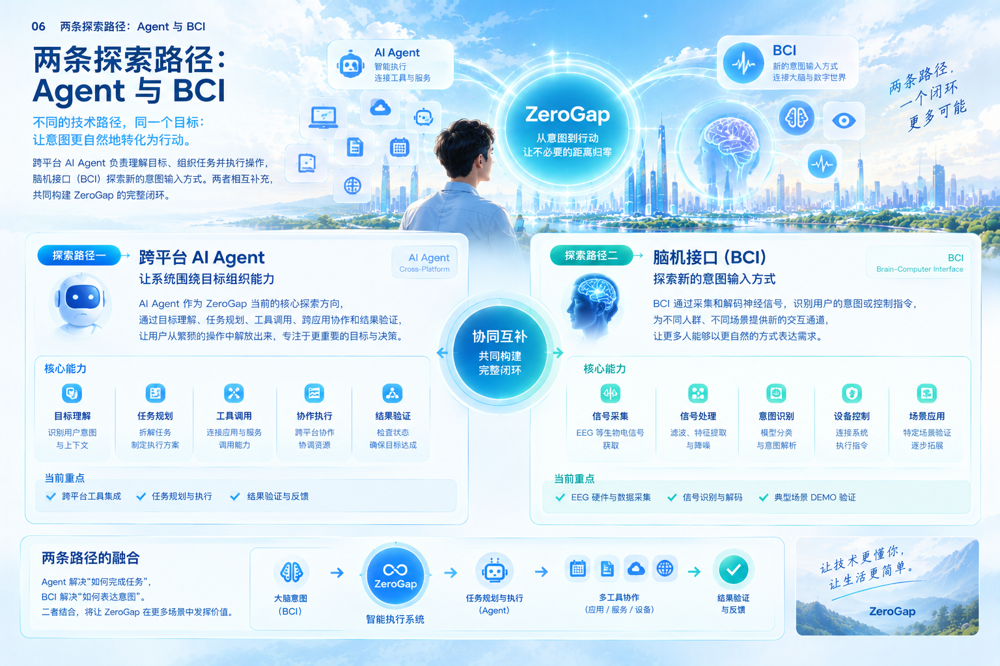

# 06｜两条探索路径：Agent 与 BCI

## 6.1 同一个目标，两条不同的技术路径

ZeroGap 希望减少人与数字世界之间不必要的距离，让人的意图更自然地转化为真实行动。

要实现这一目标，需要回答两个不同的问题：

**第一，系统如何理解人的目标，并把目标转化为可靠的行动？**

**第二，人如何以更自然、更低负担的方式向系统表达意图？**

跨平台智能 Agent 与脑机接口（BCI），分别为这两个问题提供了不同的探索方向。

Agent 关注智能执行：理解目标、拆解任务、调用工具、协调资源，并验证执行结果。

BCI 关注新型交互：通过采集与分析神经信号，在特定条件下识别用户的意图或控制指令，为传统输入方式之外的交互提供可能。

两条路径的技术基础、实现难度和成熟程度并不相同，也不需要同步发展。

ZeroGap 的整体愿景不依赖某一项技术必须先行成熟。我们可以从当前可实现的智能执行场景开始验证产品价值，同时持续探索未来的人机交互方式。

## 6.2 探索路径一：跨平台智能 Agent

### 6.2.1 为什么从 Agent 开始

当前，人们使用数字设备完成任务时，通常需要在多个应用、服务和操作流程之间来回切换。

即使系统已经具备丰富的功能，用户仍然需要自己理解工具、组织步骤、传递信息，并确认最终结果。

ZeroGap 希望让系统更多地围绕用户的目标组织工作，而不是要求用户始终围绕工具的功能组织操作。

跨平台 Agent 是实现这一目标的现实探索方向。

它尝试理解用户的任务需求，调用合适的工具和服务，在不同应用与设备之间协调执行，并根据实际结果判断任务是否完成。

### 6.2.2 Agent 的核心能力

ZeroGap 的 Agent 路径可以围绕以下能力逐步构建。

**1. 目标理解**

识别用户真正想完成的任务，理解相关上下文、约束条件和预期结果。

**2. 任务规划**

将复杂目标拆解为多个子任务，明确执行顺序、依赖关系和必要的用户确认节点。

**3. 工具调用**

通过受控接口调用应用程序、API、浏览器、文件系统或其他系统能力，让模型的理解转化为实际操作。

**4. 跨平台协作**

协调不同应用、服务和设备，使它们能够围绕同一个目标共同完成任务，而不是各自孤立地工作。

**5. 结果验证**

检查操作后的实际状态，识别执行失败、结果偏差和未完成事项，避免把“尝试执行”误认为“目标达成”。

**6. 反馈与恢复**

向用户说明执行进度和结果，在出现异常时尝试安全恢复，或请求用户补充信息、确认操作和调整目标。

这些能力共同构成 Agent 从理解目标到完成任务的执行链路。

### 6.2.3 从单一应用走向跨平台执行

ZeroGap 关注的并非只是在某一个应用中增加一个聊天入口，而是让智能执行能力逐步跨越应用和设备的边界。

例如，用户希望完成一次工作安排时，Agent 可能需要读取日历信息、查询相关资料、整理文档、协调会议时间，并在获得适当授权后执行相应操作。

对用户而言，这是一个整体目标；对系统而言，它可能涉及多个工具和服务。

ZeroGap 希望逐步减少用户在这些工具之间手动传递信息、重复操作和检查状态的负担。

但跨平台并不意味着系统可以不受限制地控制所有应用。具体能力取决于操作系统权限、应用开放接口、身份认证、安全策略和用户授权。

因此，跨平台 Agent 应当从明确的使用场景出发，优先建立可执行、可验证、可恢复的任务能力，再逐步扩大支持范围。

### 6.2.4 Agent 路径的阶段目标

现阶段，Agent 是 ZeroGap 更适合优先验证的方向。

初期可以从个人设备上的典型任务开始，建立稳定的输入、规划、工具执行、结果验证和反馈机制；随后逐步增加跨应用协作能力，并探索更广泛的操作系统与设备适配。

阶段性进展不应只以支持多少工具或完成多少次调用衡量，更应关注真实任务完成率、执行可靠性、用户介入成本和安全可控性。

Agent 的目标不是让自动化步骤无限增加，而是让用户更少地处理不必要的中间工作。

## 6.3 探索路径二：脑机接口（BCI）

### 6.3.1 为什么探索 BCI

人类与数字世界的交互，长期以来主要依赖手部操作、键盘、鼠标、触摸屏、语音和其他可观察的行为。

这些方式已经十分成熟，但并不适合所有人和所有场景。

对于存在运动或语言障碍的人群，某些传统输入方式可能带来较高的使用成本。在其他场景中，人们也可能希望减少对显式操作的依赖，探索更直接的意图表达方式。

脑机接口为这种探索提供了新的可能。

BCI 通过采集和处理与神经活动相关的信号，尝试识别特定的意图或控制指令，并将其转换为设备可以使用的输入。

它并不意味着设备能够直接读取人的全部思想，也不意味着所有意图都能被准确识别。可实现的能力取决于具体的信号采集方式、解码方法、使用者、任务类型和环境条件。

对于 ZeroGap，BCI 的价值在于探索：能否为更多人提供合适的意图输入渠道，并在可靠、安全的前提下减少实现目标所需的交互负担。

### 6.3.2 BCI 的基本技术链路

一个典型的 BCI 交互过程，可以抽象为以下步骤：

**神经信号采集 → 信号预处理 → 特征提取与解码 → 意图或控制指令识别 → 设备响应 → 结果反馈。**

具体来说：

**1. 信号采集**

使用适当的传感设备获取与目标任务相关的神经信号。例如，脑电图（EEG）是一种常见的非侵入式信号采集方式。

**2. 信号处理**

对原始信号进行必要的预处理，降低噪声和伪迹的影响，并提取与任务相关的特征。

**3. 意图识别**

利用信号处理和分类方法，判断当前信号是否符合预先定义的意图类别或控制模式。

**4. 指令映射**

将识别结果映射为具体的系统输入，例如选择界面中的某个选项，或触发一个经过授权的控制动作。

**5. 结果反馈**

向使用者提供清晰的反馈，使其能够判断系统是否正确响应，并在必要时重新尝试或取消操作。

这条链路的每个环节都可能影响最终效果。即使系统能够识别某种信号，也仍然需要验证其在真实使用环境中的稳定性、准确性和可用性。

### 6.3.3 从可验证的 Demo 开始

BCI 的研究范围广泛，技术门槛和验证周期也可能较高。

因此，ZeroGap 不需要一开始就追求复杂的脑机交互系统，而可以先选择范围明确、容易测量结果的原型场景。

例如，可以探索通过 EEG 识别特定的实验性控制模式，并将其映射到一个简单的界面交互中。

验证重点可以包括：

- 系统能否区分预设的目标状态？
- 不同使用者之间是否存在明显差异？
- 在重复测试中，识别效果是否稳定？
- 从信号采集到界面响应需要多长时间？
- 误触发、漏识别和环境干扰的情况如何？
- 用户是否能够理解系统状态，并在需要时停止交互？

这类原型的意义，是验证一条具体、有限的技术链路，而不是据此宣称系统已经能够普遍识别人的思想或实现通用脑机控制。

### 6.3.4 BCI 的重要应用方向：辅助交互与可及性

ZeroGap 希望探索 BCI 的重要原因之一，是它可能为部分传统交互方式受限的人群提供新的选择。

例如，在适当的技术与临床应用条件下，BCI 可以被探索用于辅助选择界面元素、表达有限指令，或与其他辅助技术协同完成数字任务。

但具体应用必须建立在充分的可行性、安全性和使用者需求验证之上。医疗相关场景还需要考虑适用人群、临床证据、监管要求和专业支持，不能将实验原型直接等同于成熟的医疗产品。

ZeroGap 对这类场景的关注，不仅是追求更先进的输入技术，也包括让更多人能够以适合自己的方式参与数字世界。

## 6.4 两条路径的差异与互补

Agent 与 BCI 不是同一种技术的两个版本，它们解决的是交互链路中不同的问题。

| 对比维度 | 跨平台 Agent | 脑机接口（BCI） |
|---|---|---|
| 核心问题 | 如何理解目标并完成任务 | 如何获取特定意图或控制信号 |
| 主要作用 | 规划、执行、协作、验证 | 信号采集、处理、解码与输入 |
| 主要技术挑战 | 工具可靠性、上下文理解、权限、安全和恢复 | 信号质量、解码准确率、个体差异、噪声与可用性 |
| 现实验证方式 | 从明确的跨应用任务开始 | 从范围有限、可重复测量的信号识别原型开始 |
| 主要依赖 | 软件接口、系统权限、模型与执行框架 | 传感设备、信号处理、解码算法与实验条件 |
| 在 ZeroGap 中的定位 | 当前优先验证的智能执行路径 | 持续探索的新型意图输入路径 |

两条路径能够互相补充，但并非天然能够无缝集成。

BCI 即使提供了一个可识别的控制信号，仍然需要下游系统理解其含义、决定对应动作、执行操作并验证结果。

Agent 即使具备可靠的任务执行能力，也仍然需要获得用户输入，而输入方式可以来自语音、文字、触摸、辅助设备或未来经过验证的 BCI 系统。

因此，二者的互补关系可以概括为：

**BCI 探索意图如何进入系统，Agent 负责意图如何转化为行动。**

## 6.5 ZeroGap 的融合架构

从整体产品架构看，ZeroGap 不应把 Agent 与 BCI 设计成彼此割裂的两套产品，而应当在条件成熟时，让它们通过统一的任务与反馈体系协作。

可以将整体过程抽象为：

**人的目标 → 意图输入 → 目标理解与任务规划 → 工具与设备执行 → 结果验证 → 用户反馈。**

其中，意图输入可以支持多种渠道；目标理解和任务规划负责把输入转化为明确的任务；执行层连接实际的工具、应用和设备；验证与反馈机制则确保系统能够判断执行结果，并在必要时进行修正。

在这一架构下：

- Agent 可以接收文字、语音或其他形式的输入。
- BCI 在特定能力得到验证后，可以提供相应的意图或控制信号。
- 任务执行层根据目标、权限和运行环境决定如何行动。
- 验证机制检查实际结果，而不是假定输入正确就意味着任务成功。
- 用户始终可以了解执行状态，并在适当的控制机制下暂停、取消或调整任务。

融合的重点不是简单地把两项技术放在一起，而是让不同的输入方式能够接入同一套可靠、可控的目标实现过程。

## 6.6 两条路径的推进策略

ZeroGap 应当根据技术成熟度、实现成本、真实需求和验证结果，分阶段推进两条路径。

### 阶段一：验证 Agent 的实际产品价值

围绕个人设备和具体工作场景，构建最小可用的智能执行原型。

重点验证目标理解、任务规划、工具调用、跨应用协作、结果确认和异常处理能力，建立可重复测试的任务评估体系。

### 阶段二：扩展跨平台执行能力

在已有任务闭环稳定运行的基础上，增加应用、系统和设备的适配能力，完善权限控制、执行状态管理、错误恢复和用户反馈。

这一阶段关注的不只是覆盖范围，还包括不同环境下的可靠性与一致性。

### 阶段三：开展 BCI 原型验证

围绕明确的研究问题和目标人群，选择合适的信号采集方式与实验任务，验证信号识别、指令映射、交互反馈和使用体验。

应当在实验开始前确定评估指标，并如实记录误识别、失败案例和技术限制。

### 阶段四：探索两条路径的协同

当某类 BCI 输入具备足够的可靠性，且 Agent 执行链路能够稳定完成相应任务时，再探索将二者连接起来。

融合测试应重点评估端到端成功率、误触发风险、用户可控性、反馈及时性以及整体使用成本。

每一阶段是否进入下一阶段，都应由真实验证结果决定，而不是仅凭技术愿景推断。

## 6.7 技术探索必须遵守的边界

ZeroGap 希望减少不必要的交互成本，但不应以牺牲安全、隐私或用户自主权为代价。

在 Agent 路径中，需要重视最小权限、敏感操作确认、执行记录、异常停止和结果可追溯性。

在 BCI 路径中，需要重视神经信号与相关数据的隐私保护、明确授权、数据使用范围、识别结果的不确定性，以及使用者随时停止参与的权利。

两条路径都应遵循同一个原则：

**技术可以帮助人更容易地实现目标，但不能替代人的意愿，也不能把不确定的识别结果当作确定授权。**

ZeroGap 的长期价值，不仅取决于系统能完成多少任务，还取决于它是否能够以透明、可靠和可控的方式完成任务。

## 6.8 本章总结

Agent 与 BCI 代表 ZeroGap 的两条不同探索路径。

Agent 让系统更有能力理解目标、组织资源、跨工具执行任务并验证结果；BCI 则探索通过神经信号获取特定意图或控制信息，为未来的人机交互提供新的可能。

前者是当前更适合优先验证的产品方向，后者是需要持续研究与谨慎验证的技术方向。

它们可以独立发展，也可以在适当条件下协同工作。ZeroGap 的整体架构，则负责把不同的意图输入方式与智能执行能力连接起来，形成从目标到行动、从行动到验证、再从反馈到调整的完整过程。

**两条探索路径，一个共同目标：让技术更自然地理解人的意图，让人的目标更可靠地转化为真实结果。**

*ZeroGap — From Intent to Action, Without Steps.*