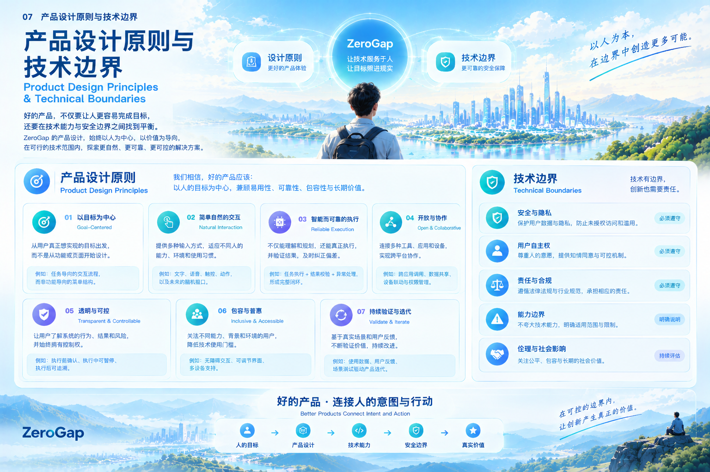

# 07｜产品设计原则与技术边界

## 7.1 为什么需要设计原则与技术边界

ZeroGap 希望减少人的意图与实际行动之间不必要的距离。但实现这一愿景，并不意味着技术越先进、自动化程度越高，产品就越有价值。

一个系统即使能够快速执行任务，如果误解用户的目标、擅自执行重要操作，或者无法解释结果是否可靠，也很难真正获得用户的信任。

同样，一项新技术即使具有很大的发展潜力，也需要经过真实场景验证，才能证明它能够解决具体问题。

因此，ZeroGap 不仅需要明确产品希望实现什么，还需要明确产品应该如何设计、能力应该发展到什么程度，以及哪些边界不能轻易突破。

**产品设计原则决定我们追求什么样的用户体验，技术边界决定我们如何负责任地实现这种体验。**

两者共同指导 ZeroGap 的技术选择、产品规划和长期发展。

## 7.2 七项核心产品设计原则

### 原则一：以人的目标为中心

ZeroGap 从用户希望实现的目标出发，而不是从现有工具的功能或操作流程出发。

用户不应该为了使用系统而被迫理解所有技术细节，也不应该因为系统内部的组织方式而承担不必要的中间工作。

产品设计需要优先回答：

- 用户真正想完成什么？
- 什么结果才算满足用户的目标？
- 当前哪些操作、信息转换或工具切换可以被合理简化？
- 系统是否理解了目标背后的约束条件？

例如，用户希望完成一份项目报告，系统应当关注资料收集、信息整理、内容生成和结果检查等任务如何协同完成，而不是只提供一个孤立的文本生成入口。

以目标为中心，并不意味着系统可以自行决定用户应该追求什么。目标仍然由人提出，系统的职责是帮助人更有效地实现目标。

### 原则二：提供自然、适合人的交互方式

不同的人、不同的环境和不同的任务，需要不同的交互方式。

文字、语音、触摸、图像、动作以及未来可能发展的脑机接口，都可以成为人表达意图的渠道。

ZeroGap 不应将某一种输入方式视为所有场景下的唯一答案，而应根据用户需求、任务特点、环境条件和技术能力，探索合适的交互组合。

自然交互也不只是减少点击次数。

如果用户需要反复解释同一件事、不断纠正系统的误解，或者无法判断系统当前的状态，即使操作步骤减少了，整体交互负担也未必降低。

因此，产品应关注理解成本、表达成本、学习成本和纠错成本，让交互方式尽可能适应人，而不是要求人完全适应技术。

### 原则三：追求可靠的执行，而不只是智能的表达

ZeroGap 关注从意图到真实结果的完整过程。

因此，系统不仅要能够理解和规划，还需要具备执行、验证和纠错能力。

一个系统给出了合理的计划，并不代表任务已经完成；一次工具调用返回成功，也不一定代表用户的目标已经实现。

产品需要根据具体任务建立相应的结果验证机制，并明确区分：

- 已经执行的操作。
- 已经得到确认的结果。
- 尚未完成或执行失败的部分。
- 当前无法确认的状态。

当系统能力不足时，应当如实说明限制；当任务出现异常时，应当尝试安全恢复，或请求用户介入。

可靠性不是智能执行之后的附加功能，而是智能执行能够真正产生价值的基础。

### 原则四：开放协作，减少工具之间的割裂

用户的目标通常不会严格局限于某一个应用或设备。

完成一项任务，可能需要多个应用、服务、数据源和设备共同参与。

ZeroGap 因此重视跨工具、跨应用和跨设备的协作能力，希望逐步减少用户在不同系统之间重复操作、手动传递信息和反复确认状态的负担。

这要求产品具备清晰的能力边界与协作机制，包括：

- 通过适当的接口连接外部工具与服务。
- 明确不同工具的输入、输出和执行状态。
- 管理任务之间的依赖关系与执行顺序。
- 处理工具失败、权限不足和数据不一致等情况。
- 在跨系统执行时保护用户的数据与授权范围。

开放协作不等于无限访问。每一项工具能力都应在明确的权限和责任范围内使用。

### 原则五：透明、可控，并尊重人的自主权

当系统开始代替用户执行操作时，用户需要知道系统正在做什么、为什么这样做，以及可能产生什么结果。

ZeroGap 应当让用户能够理解任务进度、查看重要执行信息，并在适当的场景下暂停、取消或调整任务。

特别是涉及发送信息、公开发布、支付、删除数据或其他重要后果的操作时，系统需要根据风险和授权情况设置适当的确认机制。

用户授权不应被理解为对所有后续操作的无限授权；用户表达一个目标，也不代表系统可以忽略目标中的约束条件。

透明与可控的设计需要让用户始终保有对自身目标和关键决策的主导权。

### 原则六：关注包容性与可及性

技术进步的价值，不仅在于让熟练使用数字设备的人更高效，也在于帮助更多人获得适合自己的交互方式。

不同用户可能在身体能力、语言表达、技术经验、使用环境和认知负担方面存在差异。

ZeroGap 应当在产品设计中考虑这些差异，尽可能降低使用门槛，并探索多种可替代的交互路径。

例如，在适用的场景中，系统可以同时提供文字与语音交互、清晰的状态提示、可调整的界面，以及对辅助技术的适配。

BCI 也是值得研究的一条探索路径，但不能将其视为所有用户的统一解决方案。是否适用，需要根据真实需求、技术成熟度和具体场景进行判断。

包容性不是产品成熟之后才考虑的附加特性，而应当尽早进入需求分析和设计过程。

### 原则七：通过真实验证持续迭代

ZeroGap 是一个面向未来的人机交互探索方向，其中部分能力可以在当前阶段进行产品验证，另一些能力仍需要长期研究。

因此，产品规划需要区分愿景、假设、原型能力和已经得到验证的实际能力。

每项重要功能都应当尽可能对应明确的使用场景、预期价值和评估指标。

例如，可以通过任务完成率、端到端耗时、人工介入次数、错误恢复能力和用户反馈，判断某项 Agent 能力是否真正减少了交互成本。

对于 BCI 等探索性技术，则需要根据具体实验目标，评估信号识别效果、误触发情况、稳定性和使用者体验。

ZeroGap 不应只展示技术能够做到什么，还应持续验证它在真实环境中是否有效、可靠，并且值得使用。

## 7.3 五项重要技术边界

产品原则说明了 ZeroGap 希望如何创造价值，技术边界则明确了实现这些价值时必须考虑的约束。

### 边界一：隐私与数据安全

ZeroGap 可能需要处理用户的任务内容、个人信息、文件、应用状态，未来的部分研究方向还可能涉及神经信号等敏感数据。

系统应当根据任务需要处理数据，明确数据的采集目的、使用范围、保存方式和访问权限，并采取与风险相适应的安全措施。

对于敏感数据，应避免不必要的采集、传输、保存和共享。

在 BCI 相关研究中，神经信号及其衍生数据的处理还需要充分考虑使用者知情、明确授权、访问控制和用途限制。

技术上能够获取某类数据，并不意味着产品就有理由获取或使用它。

### 边界二：用户自主权与明确授权

ZeroGap 的目标是帮助人完成任务，而不是替人决定目标。

系统应当区分用户明确要求的行为、完成任务所必需的操作，以及可能产生额外后果的操作。

对于影响较大、难以撤销或超出既有授权范围的行为，应根据风险设置确认、限制或其他适当的控制机制。

当系统无法确定用户意图时，应优先澄清，而不是自行扩大任务范围。

对于 BCI 输入，同样不能把不确定的信号识别结果自动视为用户已经明确授权。系统应根据具体场景设计适当的确认与防误触机制。

### 边界三：法律、合规与责任

ZeroGap 的不同产品和技术路径，可能涉及个人信息保护、数据安全、知识产权、平台规则、软件许可，以及特定行业的监管要求。

如果未来进入医疗辅助、康复或其他受监管场景，还需要根据实际产品功能和应用方式，评估适用的法规、审批或专业要求。

系统的设计和部署应当明确各方的责任范围，避免将模型输出或自动执行结果视为天然正确。

具体的合规要求应根据产品部署地区、数据类型、应用场景和实际功能进行评估，不能仅凭通用技术设计推定已经满足全部法律义务。

### 边界四：能力限制与结果不确定性

AI 模型可能误解指令、生成错误信息或制定不合适的计划；外部工具可能不可用、返回错误或发生状态变化；跨平台执行也可能受到接口、权限和环境差异的影响。

BCI 系统则可能受到信号噪声、个体差异、设备条件和解码准确率等因素的限制。

因此，ZeroGap 应当明确区分已经具备的能力与仍在探索的能力，并针对不同风险设置合理的验证机制。

对于无法确认的结果，系统应如实表达不确定性，而不是用流畅的语言掩盖技术限制。

对于高风险任务，还需要考虑人工监督、停止机制、故障恢复和其他适当的保护措施。

### 边界五：伦理与社会影响

技术的价值不能只由效率提升来衡量，还需要考虑它对人的自主性、机会公平、工作方式和社会关系产生的影响。

ZeroGap 应当关注：

- 自动化是否让用户更有能力，还是让用户失去必要的控制权？
- 新的交互方式是否真正降低了使用门槛？
- 系统的能力和限制是否对用户足够透明？
- 自动执行产生的错误由谁发现、纠正和承担责任？
- 不同群体是否能够公平地获得技术带来的价值？

对于 BCI 等涉及人类神经活动的技术，还需要特别重视个人尊严、知情同意、数据保护和使用者自主权。

技术发展不应以牺牲人的基本权益为代价。

## 7.4 如何把原则转化为工程实践

产品设计原则和技术边界不能只停留在文档中，还需要落实到需求、架构、开发、测试和上线流程。

ZeroGap 可以通过以下机制逐步落实这些要求。

| 实践环节 | 需要落实的内容 |
|---|---|
| 需求分析 | 明确用户目标、预期结果、约束条件和潜在风险 |
| 产品设计 | 提供清晰的任务状态、反馈机制和用户控制入口 |
| 技术架构 | 采用适当的权限隔离、接口约束和模块化设计 |
| Agent 执行 | 区分计划与实际结果，管理工具调用和异常状态 |
| BCI 实验 | 明确实验范围、评价指标、数据用途与参与者授权 |
| 测试验证 | 覆盖正常流程、失败场景、边界条件和恢复过程 |
| 发布评估 | 根据实际效果、安全风险和用户反馈决定是否扩大范围 |

这些实践不必一开始就发展为复杂的治理体系，但应随着系统能力和任务风险的增加逐步完善。

## 7.5 原则之间如何取得平衡

实际产品设计中，不同原则有时会产生冲突。

例如，减少用户操作可能与重要操作的确认要求冲突；扩大跨平台协作能力，可能增加数据访问和权限管理的复杂度；探索更自然的输入方式，也可能带来新的误识别风险。

ZeroGap 不应简单地将某一个指标最大化，而应结合具体场景作出权衡。

对于低风险、可逆且经过授权的操作，可以优先减少不必要的步骤。

对于影响重大、难以撤销或存在明显不确定性的操作，则应优先保障用户知情、明确授权和结果可控。

对于尚未验证的技术能力，可以通过小范围原型、受控实验和明确的评估标准逐步探索，而不是直接将实验结果包装成成熟产品能力。

这种权衡体现了 ZeroGap 的基本立场：效率、自然交互和自动化很重要，但必须建立在可靠性、透明性和人的自主权之上。

## 7.6 本章总结

ZeroGap 的产品设计应始终围绕人的目标展开，通过自然交互、可靠执行、开放协作、透明可控、包容设计和持续验证，逐步降低实现目标的成本。

与此同时，技术探索必须尊重隐私、安全、用户自主权、法律合规、能力限制和社会责任等边界。

这些边界并不是阻碍创新的额外负担，而是帮助产品建立信任、验证真实价值并实现长期发展的必要条件。

**ZeroGap 不追求没有边界的自动化，而是追求在合理边界内，让人的意图更可靠地转化为行动。**

当技术能力与人的需求、安全要求和真实使用价值保持一致时，减少 Gap 才具有真正的意义。
*ZeroGap — From Intent to Action, Without Steps.*