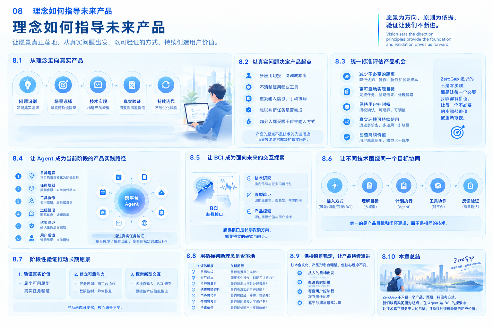

# 08｜理念如何指导未来产品

## 8.1 从理念走向真实产品

ZeroGap 的愿景是让人的意图更自然地转化为行动，让技术减少实现目标过程中不必要的距离。

但愿景本身不会自动变成产品。

从理念到产品，需要经过问题识别、场景选择、技术实现、真实验证和持续迭代。每一个阶段都需要回答一个基本问题：

**我们正在开发的能力，是否真的让人更容易、更可靠地实现自己的目标？**

如果一项功能使用了先进的模型，却没有解决真实问题，那么它可能只是技术展示。

如果一种交互方式减少了几次点击，却增加了理解成本和错误风险，那么它未必真正缩短了 Gap。

如果一个系统能够自动执行大量操作，却让用户无法了解执行状态或控制最终结果，那么自动化程度的提高也不等于用户体验的改善。

因此，ZeroGap 需要让理念参与产品决策的全过程，而不是只将理念作为项目介绍中的一段愿景描述。

## 8.2 以真实问题决定产品起点

ZeroGap 不应从“我们能够使用什么技术”开始定义产品，而应从“用户正在遇到什么问题”开始。

技术能力固然重要，但技术的价值需要通过具体的使用场景体现。

例如：

- 用户需要在多个应用之间反复切换才能完成一项任务。
- 用户知道自己想要什么结果，却不知道应该使用哪些工具。
- 用户需要重复输入相同的信息，并手动协调不同系统。
- 用户难以判断自动化操作是否真正成功。
- 某些用户受到传统输入方式的限制，难以有效使用数字设备。

这些问题分别涉及任务规划、跨工具协作、信息传递、结果验证和交互可及性。

它们可以成为 ZeroGap 发现产品机会的起点，但并不是所有问题都需要由同一种技术解决。

在选择具体场景时，应进一步判断问题是否真实存在、出现频率如何、当前解决方式有什么不足，以及用户是否能够从改进中获得明确价值。

**产品的起点不是技术的先进程度，而是技术能够解决的真实问题。**

## 8.3 用统一标准评估不同产品机会

未来，ZeroGap 可能发展出多种产品形态，包括跨平台 Agent、自然交互系统、辅助交互工具，以及与 BCI 相关的探索性原型。

这些产品的技术实现方式可能完全不同，但应当接受相同的核心价值判断。

### 第一，是否减少了不必要的距离

产品是否减少了用户在理解、表达、操作、协作或验证过程中的负担？

减少的负担是否真实存在，而不是仅仅将工作从用户转移到其他环节？

### 第二，是否更可靠地实现了目标

产品是否能够完成用户真正需要的任务？

执行结果是否得到验证？当任务失败或只完成一部分时，系统能否清楚地说明情况？

### 第三，是否让用户保持控制权

用户是否理解系统将要做什么？

对于重要操作，是否具有适当的授权和确认机制？用户是否能够在必要时暂停、取消或调整执行过程？

### 第四，是否能够在真实环境中持续使用

产品是否能够适应实际的设备、应用、网络、权限和使用环境？

系统能否处理异常，而不是只在预先设计好的演示流程中正常运行？

### 第五，是否创造了值得持续投入的价值

产品带来的改善是否足够明确？

用户是否愿意持续使用，实际收益是否能够覆盖使用成本、技术成本和维护成本？

这些问题可以帮助 ZeroGap 在面对不同技术机会时保持一致的判断标准，避免因为某项技术受到关注，就忽略产品本身的价值。

## 8.4 让 Agent 成为当前阶段的产品实践路径

在 ZeroGap 的技术探索中，跨平台 Agent 是当前更适合优先验证的方向。

原因在于，它可以围绕具体的任务执行问题建立原型，并通过真实使用过程评估系统是否减少了用户的操作负担。

初期产品可以选择范围明确、结果容易核验的任务，重点建设以下能力：

1. **目标理解：** 将用户的自然表达转化为明确的任务目标。
2. **任务规划：** 将复杂任务拆解为可执行的步骤。
3. **工具协作：** 调用适当的应用、服务或设备能力。
4. **过程管理：** 跟踪任务状态，并处理执行顺序与异常。
5. **结果验证：** 检查实际状态是否符合预期。
6. **用户反馈：** 清楚地说明结果，并允许用户在必要时介入。

通过这些能力，ZeroGap 可以逐步验证一个核心假设：

当系统能够围绕用户目标组织多个工具的工作时，用户是否可以减少不必要的中间操作，同时获得更可靠的结果？

这个假设需要通过真实任务来检验，而不能仅凭模型演示或技术架构推断成立。

在验证基础能力之后，再逐步扩大支持的应用范围、任务复杂度和设备类型。

## 8.5 让 BCI 成为面向未来的交互探索

与 Agent 相比，BCI 所探索的是另一个层面的问题：人是否能够通过新的信号输入方式，更自然地向数字系统表达特定意图或控制指令。

这条路径具有长期探索价值，但需要面对信号采集、解码准确性、个体差异、设备条件和实际使用体验等挑战。

因此，ZeroGap 不应将 BCI 的远期潜力直接等同于当前产品能力，而应当通过逐步验证建立可信的技术基础。

可以从范围有限的实验开始，例如识别预先定义的控制状态，并将识别结果映射为简单的界面操作。

在此基础上，逐步评估识别准确率、误触发情况、响应时间、稳定性和使用者体验。

对于辅助交互等应用方向，还需要结合目标人群的实际需求，判断这种输入方式是否比现有方案更适合特定场景。

ZeroGap 对 BCI 的探索，不是为了证明某种技术必然代表未来，而是为了研究新的交互方式能否在具体场景中产生真实价值。

## 8.6 让不同技术围绕同一个目标协同

Agent 与 BCI 可以分别发展，也可能在未来形成协同。

这种协同不应只是将两种技术简单组合，而应当建立在统一的产品逻辑之上。

在这一逻辑中，用户始终是目标的提出者和重要决策的主体；不同的输入方式负责提供意图信息；智能执行系统负责理解目标、规划任务并调用相应能力；验证机制检查执行结果；反馈机制则帮助用户了解状态并在必要时进行调整。

例如，在某个经过充分验证的辅助交互场景中，用户可能通过一种新型输入方式表达有限的控制意图，再由执行系统完成相应操作，并通过清晰的反馈确认结果。

但这种融合是否可行，需要取决于输入信号的可靠程度、任务的风险、执行系统的能力和实际使用者的需求。

因此，ZeroGap 的长期架构应当允许不同技术路径逐步接入，同时保持明确的能力边界、权限机制和结果验证要求。

**统一的是产品目标和闭环逻辑，而不是要求所有产品使用相同的技术。**

## 8.7 用阶段性验证推动长期愿景

ZeroGap 的发展不应依赖一次性实现完整愿景，而应通过阶段性成果不断积累能力。

可以将产品发展理解为三个相互衔接的层次。

### 第一层：验证真实价值

选择明确的用户问题，建立最小可用的产品原型。

通过真实任务验证产品是否减少了操作负担，是否能够稳定完成目标，以及用户是否认可实际效果。

### 第二层：建立可靠的系统能力

在验证有效的场景中，逐步完善任务规划、跨工具协作、状态管理、结果验证、权限控制和异常恢复。

让产品从单一场景中的可行原型，发展为能够持续使用的系统。

### 第三层：探索更自然的人机交互

在已有产品能力的基础上，持续研究新的输入方式、设备形态和交互机制。

对于 BCI 等探索性技术，通过明确的实验问题和评估标准积累证据；对于 Agent，则继续扩大其可靠执行和跨平台协作能力。

这三个层次不是严格分离的阶段，也不意味着后一层必须等前一层全部结束才能开始。它们可以并行推进，但资源投入和产品承诺应当与各自的验证程度相匹配。

ZeroGap 的长期愿景可以保持开放，而每一个阶段的产品目标都应当足够具体、可执行、可评估。

## 8.8 用指标判断理念是否真正落地

如果 ZeroGap 的理念已经进入产品实践，那么它应当能够在产品效果中体现出来。

评估时可以关注以下维度：

| 评估维度 | 关键问题 |
|---|---|
| 目标达成 | 用户提出的目标最终实现了吗？ |
| 交互成本 | 用户需要投入多少操作、时间和注意力？ |
| 执行可靠性 | 系统能否稳定执行任务，并正确处理异常？ |
| 结果可验证性 | 系统能否确认结果，而不是只报告操作成功？ |
| 用户可控性 | 用户是否能够理解、授权和调整系统行为？ |
| 使用可及性 | 产品是否帮助更多有不同需求的人完成任务？ |
| 持续价值 | 产品是否能够在真实环境中持续产生收益？ |

这些指标需要根据不同产品和场景进行具体定义。

例如，对于 Agent，可以重点衡量端到端任务完成率、人工介入成本、错误恢复能力和结果验证覆盖率。

对于 BCI 原型，则应重点衡量与实验目标相匹配的信号识别效果、误触发率、响应时间和使用体验。

不能使用一套简单的指标评价所有技术，也不能仅凭单项指标的提升，就推断产品已经实现整体价值。

真正重要的是：产品是否在真实条件下改善了用户实现目标的过程。

## 8.9 保持愿景稳定，让产品持续演进

技术环境会变化，新的模型、交互设备和系统架构也会不断出现。

ZeroGap 不需要预先确定未来所有产品的形态，更不需要把某一种当前技术视为永久答案。

需要保持稳定的是核心理念：

- 从人的目标出发，而不是从技术能力出发。
- 关注真实结果，而不是只关注操作和响应。
- 通过可靠执行、验证和反馈建立信任。
- 尊重人的自主权、隐私与安全。
- 通过真实使用和持续验证判断技术价值。

在这些原则之下，产品形态可以变化，技术路线可以调整，新的探索方向也可以不断加入。

如果未来出现更适合特定场景的模型、设备或交互技术，ZeroGap 应当根据实际价值重新评估，而不是为了维持原有技术路线而拒绝变化。

愿景为产品提供方向，原则为决策提供依据，验证则决定下一步应该如何前进。

## 8.10 本章总结：让理念成为持续决策的依据

ZeroGap 的愿景与产品理念，不是独立于技术和业务之外的口号，而应当成为判断产品机会、设计系统能力和决定发展节奏的共同依据。

它指导我们从真实问题中发现机会，通过 Agent 验证当前能够实现的智能执行价值，通过 BCI 探索未来可能出现的新型交互方式，并在不同技术之间建立统一的目标导向与结果闭环。

它也提醒我们，技术能力的增加并不自动等于人的负担减少；自动化程度的提高，也不意味着系统可以忽视用户的控制权。

每一个产品决策，都应当回到同一个问题：

**它是否让人的意图更自然、更可靠地转化为真实行动，同时让人始终保有理解、选择和控制的权利？**

这既是 ZeroGap 评价当前产品的标准，也是它持续探索未来的方向。

---

**本章核心观点：** 理念只有进入产品决策、技术实现与真实验证，才能产生实际价值。

**《愿景与产品理念》总结：** ZeroGap 从人的目标出发，以 Agent 探索智能执行，以 BCI 探索新的意图输入方式，通过可靠执行、结果验证和用户反馈，持续减少人与数字世界之间不必要的距离。

**From Intent to Action, Without Steps.**
*ZeroGap — From Intent to Action, Without Steps.*