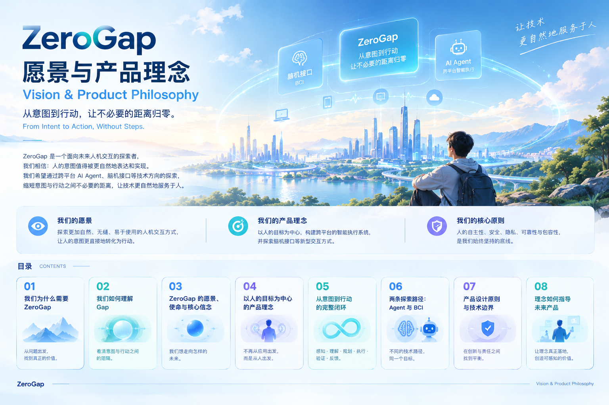

# ZeroGap｜愿景与产品理念

### Vision & Product Philosophy

> **From Intent to Action, Without Steps.**
>
> 从意图到行动，让不必要的距离归零。

ZeroGap 是一个面向未来人机交互的探索者。

我们相信，人的意图值得被更自然地表达和实现。技术的进步不应该只意味着更强大的设备、更多的应用和更复杂的操作，也应该意味着：**人为了实现一个目标，需要付出的不必要成本越来越少。**

通过跨平台 AI Agent、脑机接口（BCI）等方向的探索，我们希望逐步缩短从意图产生到行动完成之间不必要的距离，让技术更自然地服务于人。

---

## 我们的愿景

探索更加自然、连贯、易于使用的人机交互方式，让人的意图更直接地转化为行动。

## 我们的产品理念

**以人的目标为中心，而不是以应用、设备或操作流程为中心。**

我们希望系统能够理解人想完成什么，协助规划和执行任务，并通过结果验证与反馈形成完整闭环。

## 我们坚持的核心原则

- **以人为本：** 技术服务于人的目标，而不是要求人不断适应技术。
- **自主可控：** 减少不必要的操作，但保留必要的知情、确认与控制权。
- **安全可靠：** 关注真实执行结果，而不只关注模型是否给出了答案。
- **开放包容：** 探索不同输入方式，让更多人拥有表达意图和完成任务的机会。
- **持续验证：** 尊重技术边界，以原型、实验和真实场景逐步验证设想。

---

## 目录 Contents

1. [我们为什么需要 ZeroGap](vision-chapter-1.md)
2. [我们如何理解 Gap](vision-chapter-2.md)
3. [ZeroGap 的愿景、使命与核心信念](vision-chapter-3.md)
4. [以人的目标为中心的产品理念](vision-chapter-4.md)
5. [从意图到行动的完整闭环](vision-chapter-5.md)
6. [两条探索路径：Agent 与 BCI](vision-chapter-6.md)
7. [产品设计原则与技术边界](vision-chapter-7.md)
8. [理念如何指导未来产品](vision-chapter-8.md)

---

*ZeroGap — From Intent to Action, Without Steps.*